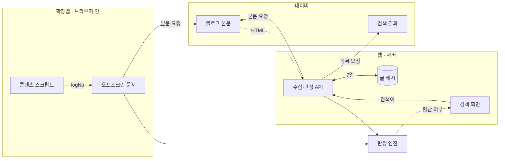

## 화면

### 검색 흐름

**영상** https://wzaqtubtqwpddouevwbk.supabase.co/storage/v1/object/public/project-media/clean-review/demo-1.mp4
**설명** 동네를 입력하면 협찬글을 흐리게 보여 주고 누르면 업체를 알려 줍니다

### 협찬 숨기기

**이미지** https://wzaqtubtqwpddouevwbk.supabase.co/storage/v1/object/public/project-media/clean-review/demo-2.png
**설명** 켜면 협찬글을 목록에서 뺍니다

### 더 보기

**이미지** https://wzaqtubtqwpddouevwbk.supabase.co/storage/v1/object/public/project-media/clean-review/demo-3.png
**설명** 30건씩 이어 붙이고 끝에서 확인한 글 수를 알려 줍니다

### 웹과 폰

**이미지** https://wzaqtubtqwpddouevwbk.supabase.co/storage/v1/object/public/project-media/clean-review/demo-4.png
**설명** 폰에서는 같은 결과를 한 열로 보여 주고 발췌문을 뺍니다

## 데이터와 API

### 네이버 검색·블로그

**용도** 검색어로 블로그 글 목록을 받고 글마다 본문을 열어 협찬 흔적을 찾는다
**방식** HTML 수집 · 글당 1회
**갱신** 7일 캐시
**링크** https://blog.naver.com
**주의** 공식 API가 아니다. 서버 HTML에 목록 30건이 담겨 오는 경로를 쓰는데, 문서에 없는 경로라 네이버가 바꾸면 동작하지 않는다
**주의** 크롤러처럼 되지 않게 글을 몇 건씩 나눠 받고 결과를 오래 캐시한다. 같은 검색어는 여러 사람이 입력해도 한 번만 읽는다
**주의** 본문은 옮겨 오지 않는다. 판정과 근거만 보여 주고 글은 원문에서 읽게 한다

## 인터뷰

**소개** 리뷰 체험단의 블로그 후기를 걸러주는 서비스입니다.
**계기** 외식을 하기 위해 네이버에 "건대 맛집" 이런 식으로 검색해 보면 열에 여덟아홉이 협찬글이더라고요.
**계기** 협찬을 받으면 아무래도 좋게 쓸 수밖에 없잖아요. 싫은 소리를 못 하게 되니까요. 그래서 진짜 내돈내산 글만 골라 보고 싶었어요


## 구상

- 검색 결과에서 협찬 글을 걸러내고 내돈내산 글만 남긴다
- 왜 협찬으로 봤는지 근거를 같이 보여 준다
- 네이버 검색 결과를 걸러 자체 사이트에 목록으로 보여 준다
- 협찬 배너 이미지를 지문으로 찾아낸다
- 이미지에만 들어 있는 표기를 OCR로 읽는다

## 유저 플로우

### 검색창에 지역과 업종을 입력한다

`성수 카페` 처럼 입력합니다. 홈에는 검색창 하나만 있어요.

### 확인이 끝나기를 기다린다

글 30건을 하나씩 열어 확인합니다. 모두 끝나야 목록이 한 번에 나와요.

**갈라짐** 처음 찾는 검색어 → 4~6초 / 누가 이미 찾은 검색어 → 1초 안

### 목록을 훑어본다

협찬으로 확인된 글은 흐리게 보이고, 깨끗한 글은 아무 표시 없이 평소처럼 보입니다.

### 흐린 글이 궁금하면 누른다

흐림이 풀리고 어느 업체인지 나옵니다. 다시 가릴 수도 있어요.

**갈라짐** 그래도 읽는다 → 원문으로 / 됐다 → 다시 가리기

### 마음에 드는 글을 연다

줄 어디를 눌러도 네이버 원문으로 이동합니다.

## 구조



### 판정 엔진

DOM과 `chrome.*` 에 의존하지 않는 순수 함수 묶음이에요. 본문과 리소스 URL, 태그를 받아 협찬 여부와 근거를 돌려줍니다. 확장앱과 웹이 같은 엔진을 씁니다.

### 수집·판정 API

검색어로 목록 30건을 받고 글마다 본문을 열어 엔진에 넘깁니다. 네이버로 보내는 요청은 4건씩 나눠요.

### 오프스크린 문서

확장앱이 본문을 가져오는 곳이에요. 콘텐츠 스크립트는 CORS에 막히고 서비스 워커에는 DOMParser가 없어서, 가져오기와 파싱을 둘 다 할 수 있는 곳은 여기뿐입니다.

### 글 캐시

`logNo` 단위로 7일 보관합니다. 사전이 바뀌면 버전을 올려 이전 결과를 전부 버려요.

### 검색 화면

목록을 그리고 흐림·해제·숨기기를 처리합니다. 판정이 모두 끝난 뒤에 한 번에 그려요.

## 개발 과정

### 1. 브라우저 확장으로 간단하게 시작했어요

"건대 맛집"을 검색하고 블로그를 읽다 보면 열에 여덟아홉이 협찬글이에요. 스크롤을 한참 내려 마지막 줄의 "소정의 원고료를 받아 작성했습니다"를 보고 나서야 광고였다는 걸 알게 되고요.

처음에는 검색 사이트를 떠올렸어요. 제 사이트에 검색어를 넣으면 협찬글을 뺀 목록이 나오는 방식입니다. 그런데 따져 보니 걸리는 게 많아 보였어요. 네이버가 주는 목록을 제가 다시 만들어야 하고, 검색 한 번에 글 서른 개를 읽는 요청이 전부 서버 한 곳에서 나갑니다. 서버 비용도 들고요. 혼자 취미로 운영할 서비스치고는 무겁다고 봤어요.

그래서 브라우저 확장으로 방향을 바꿨습니다. 목록은 네이버가 이미 보여 주니 그 위에 판정 결과만 표시하면 되고, 요청도 각 사용자의 브라우저가 자기 몫만 자기 IP로 보냅니다. 서버가 없으니 비용은 0이에요. "이게 쓸모가 있긴 한가"를 가장 적은 노력으로 확인할 수 있는 방법이었어요.

**붙인 것** TypeScript

### 2. 판정 로직부터 분리했어요

DOM과 `chrome.*` 에 의존하지 않는 순수 함수로 `core/` 를 만들었습니다. 브라우저를 띄우지 않고도 픽스처 몇 개로 결과가 바뀌는지 바로 확인할 수 있어서였는데, 나중에는 이 결정이 훨씬 큰 도움이 됐어요. 사이트를 만들 때 판정 쪽은 고칠 게 하나도 없었거든요.

표시 규칙도 이때 정했어요. **내돈내산 표시는 붙이지 않기로 했습니다.** 협찬으로 확인된 글만 가리고, 표시가 없다고 깨끗한 글이라고 말하지 않아요. 협찬글을 놓치는 건 감수해도 멀쩡한 글을 협찬으로 모는 건 안 된다고 봤거든요. 그래서 애매하면 표시하지 않습니다.

**붙인 것** Vitest

### 3. 판정은 브라우저 안에서 끝내기로 했어요

처음에는 본문을 LLM에 보내면 가장 정확하겠다고 생각했어요. 그런데 검색 결과 한 페이지가 서른 개이고 스크롤할 때마다 늘어나서 호출 수를 감당할 수 없겠더라고요. 사용자에게 자기 API 키를 넣게 하는 것도 이상하고요.

그래서 사전 기반으로 판정하기로 했습니다. 체험단 플랫폼 이름과 공정위 표기 문구를 JSON으로 모으고, 감성·솔직함·구체성·광고성 사전을 따로 뒀어요. 여기에 긍정어 도배 지수를 더해서, 단점이 한 줄도 없이 칭찬만 가득한 글도 잡아 보려고 했습니다.

키워드 매칭은 피해 가기 쉬워서 매칭 전에 정규화를 넣었어요. zero-width 문자를 지우고 분리된 자모를 털고, 공백을 모두 없앤 압축본으로 비교합니다. `소 정 의 원 고 료` 처럼 띄어 쓰거나 글자 사이에 안 보이는 문자를 넣어도 걸리게 하려고요.

### 4. 목록에서 판정하려면 본문을 미리 읽어야 했어요

검색 결과 카드에는 제목과 요약 두어 줄만 있어서 협찬 표기가 들어 있지 않아요. 표기는 늘 글 맨 아래에 있고요. 그래서 카드마다 본문을 미리 가져와야 했는데, 어느 컨텍스트에서 가져올지가 문제가 됐습니다(→ 시행착오).

가져올 수 있게 된 뒤에는 크롤러처럼 보이지 않게 하는 데 신경을 썼어요. 뷰포트에 곧 들어올 카드만 요청하고, 동시 요청은 3건까지로 제한하고, 요청 사이에 최소 간격과 랜덤 지터를 두고, 결과는 캐시합니다. 이 값들은 전부 `config.ts` 한 곳에 모아 뒀어요.

### 5. 협찬 표기를 이미지로 넣은 글이 많더라고요

텍스트 매칭을 돌리자 바로 빈틈이 보였습니다. 표기를 이미지 배너로 넣으면 본문 텍스트에는 아무것도 남지 않아요. 처음에는 배너 이미지의 지문(dHash)을 만들어 대조하려고 했는데, 대조할 DB를 제가 직접 모아야 해서 막혔습니다(→ 시행착오).

대신 배너 이미지의 출처 도메인을 확인했어요. 체험단 업체는 자기 도메인에 배너를 올려 두기 때문에, 이미지 주소에 `reviewnote.cloud` 가 들어 있으면 그것만으로 거의 확정할 수 있습니다. 네이버 이미지 프록시로 감싼 주소도 있어서 URL을 디코드한 뒤 안쪽까지 검사하게 했고요.

나중에 실제 글 475건을 모아 측정해 보니 텍스트로 걸린 글이 24건, 도메인으로 걸린 글이 149건이었습니다. 사전을 키우는 것보다 업체 도메인을 채우는 편이 훨씬 효과가 컸어요.

해시태그도 따로 수집합니다. `#협찬` 을 본문 밖 태그 영역에만 달아 둔 글이 있는데, 본문 컨테이너만 보면 이런 글을 모두 놓쳐요.

### 6. 측정해 보니 점수가 필요 없었어요

100점에서 감점·가점해 세 등급을 매기는 채점기를 공들여 만들어 뒀는데, 표본 475건으로 측정해 보니 **점수만으로 걸린 글이 0건**이었습니다(→ 시행착오). 걸린 160건은 전부 업체 도메인이나 명시 표기 같은 확정 신호로 걸렸어요.

그래서 사용자에게 보여 주는 판정을 예/아니오 하나로 줄였습니다. 신뢰도 점수와 `협찬 의심` 등급도 없앴어요. 100점 만점의 기준을 사용자가 알 수 없어서 숫자가 판단에 도움이 안 되고, 노랑 등급은 애초에 비어 있었어요.

대신 놓치는 글이 있다고 밝혔습니다. 표본에서 외부 도메인이 하나도 없는 글이 198건인데, 배너를 자기 블로그에 다시 올리면 출처가 지워져서 이 방식으로는 잡을 수 없어요. 그래서 화면 아래에 "표시가 없다고 협찬이 아닌 것은 아닙니다"를 넣었습니다.

### 7. 일반 사용자를 생각하니 사이트여야 했어요

확장앱은 제가 쓰기엔 편했지만 남에게 권하기는 어려웠습니다. 스토어에 들어가 설치하고 권한을 허용해야 쓸 수 있고, 무엇보다 맛집은 밖에서 찾는데 모바일 크롬은 확장을 지원하지 않아요. 링크 하나만 보내면 바로 열려야 했습니다.

그래서 1번에서 접어 둔 검색 사이트를 다시 꺼냈는데, **실제로 만들어 보니 제약이라고 생각한 것들이 대부분 착각이었어요.** 가장 큰 착각은 목록을 제가 만들어야 한다는 생각이었습니다. 네이버 검색 결과는 서버 HTML에 30건씩 그대로 담겨 와요. API 키도 인증도 없이 주소 하나로 받아서 파싱하면 됐습니다. 요청량도 판정 결과를 캐시하면 같은 검색어는 한 번만 읽으면 돼서 생각만큼 많지 않았고요.

남은 일도 적었습니다. 판정 엔진은 DOM에 의존하지 않는 순수 함수라 그대로 옮겼고, 오프스크린 문서가 하던 `fetch → 파싱 → 판정` 을 서버에서 하는 것도 구조가 같았어요. 새로 짠 코드는 검색 결과 목록을 뽑는 파서 하나입니다.

화면은 최대한 줄였습니다. 홈은 검색창 하나이고, 결과는 네이버 목록과 같은 모양에 협찬 표시만 더했어요. 깨끗한 글에는 아무것도 붙이지 않습니다. 표시는 알릴 내용이 있을 때만 나와요.

**붙인 것** Next.js, React, Vercel

## 시행착오

### 공들여 만든 점수 체계로 걸린 글이 0건이었어요

**증상** 감성 사전, 긍정어 도배 지수, 솔직함·구체성 가점까지 더해 세 등급을 매기게 만들어 뒀는데, 실제로 써 보니 `협찬 의심`(노랑) 등급을 본 기억이 없었습니다.

**시도** 처음에는 임계값이 잘못된 줄 알고 문턱을 낮춰 볼까 했어요. 그런데 그러면 멀쩡한 글까지 노랑이 될 것 같아서, 먼저 검색어 16개로 실제 글 475건을 모아 측정했습니다.

**결론** 점수만으로 걸린 글이 **0건**이었습니다. 걸린 160건은 전부 업체 도메인이나 명시 표기 같은 확정 신호로 걸렸어요. 계산해 보면 당연한 결과였습니다. 도배 지수는 최대 8점쯤 깎고 약한 단서는 건당 10점인데, 100점에서 40점 아래로 내리려면 60점이 필요해요. 확정 신호(70점) 없이는 문턱을 넘을 수 없었습니다. 그래서 사용자에게 보여 주는 판정을 예/아니오 하나로 줄이고, 점수와 등급은 내부 진단값으로만 남겼어요.

### 확정된 협찬이 '의심'으로 낮춰 표시되고 있었어요

**증상** 배너 도메인까지 확인된 글인데 `협찬` 이 아니라 `협찬 의심` 으로 표시되는 게 눈에 띄었습니다.

**시도** 라벨을 붙이는 로직부터 확인했어요. 확정 신호가 있으면 `협찬`, 아니면 `협찬 의심` 으로 나뉘게 돼 있어서 거기는 맞았습니다. 그렇다면 등급 자체가 잘못 나오고 있었던 거예요.

**결론** 솔직함 가점이 등급을 올리고 있었습니다. 확정 신호로 100점에서 70점을 깎아 30점이 됐는데, 단점을 언급하고 가격을 적었다는 이유로 비판 0.86 · 구체성 0.25가 붙어 44점까지 올라갔어요. 그래서 40점 문턱을 넘었습니다. 협찬글은 성의 있게 썼어도 협찬이므로, 확정 신호가 있으면 가점으로 문턱을 넘지 못하게 상한을 걸었어요. 실측에서 160건 중 94건이던 오분류가 0건이 됐습니다.

### 본문 텍스트가 계속 빈 문자열로 나왔어요

**증상** 블로그 글을 열면 콘텐츠 스크립트는 분명히 실행됐는데 추출한 본문 길이가 0이었습니다. 셀렉터를 바꿔도, 로딩을 더 기다려도 같았어요.

**시도** 스마트에디터 ONE의 `.se-main-container` 를 못 찾는 줄 알고 구버전 셀렉터까지 폴백으로 넣었습니다. 그래도 안 돼서 동적 로딩 문제로 보고 MutationObserver로 컨테이너가 나타나기를 기다리게 했는데, 타임아웃까지 간 뒤 null이 나왔어요.

**결론** 네이버 블로그의 본문은 최상위 문서가 아니라 iframe 안에 있었습니다. 그래서 최상위 프레임에서는 아무리 찾아도 나오지 않았어요. 매니페스트에 `all_frames: true` 를 주고, 진입점에서 "지금 이 프레임에 본문 컨테이너가 있나"로 분기하게 바꿨습니다.

### fetch와 DOMParser를 함께 쓸 수 있는 곳이 없었어요

**증상** 검색 결과 페이지에서 각 글의 본문을 미리 받아오려는데 어느 컨텍스트에서 해도 실패했습니다.

**시도** 먼저 검색 페이지의 콘텐츠 스크립트에서 `blog.naver.com` 으로 fetch했더니 CORS에 막혔어요. 확장앱 특권이 있는 서비스 워커로 옮기니 fetch는 됐지만, DOMParser가 없어서 받아온 HTML을 파싱할 수 없었습니다. 정규식으로 본문을 추출하는 방법도 해 봤는데 스마트에디터 마크업에는 통하지 않아 금방 포기했어요.

**결론** 둘 다 되는 컨텍스트는 오프스크린 문서뿐이었어요. 서비스 워커가 오프스크린 문서를 하나 띄워 두고, 거기서 `fetch → DOMParser → 판정` 까지 실행한 뒤 결과만 돌려받게 했습니다. 나중에 웹을 만들 때는 이 구조가 서버 코드와 같아서 그대로 옮겼어요.

### 가장 많이 나온 배너가 어느 업체 것인지 몰랐어요

**증상** 걸러지는 비율이 열에 셋 정도라 체감(여덟아홉)과 차이가 컸습니다. 놓친 글을 찾으려고 네이버 외부 도메인을 빈도순으로 뽑았더니 1위가 `d3i7y4ugnppb9p.cloudfront.net` 이었어요. CloudFront 주소라 어느 업체인지 알 수 없었습니다.

**시도** 경로가 `/contract/track/{uuid}/banner-small.png` 라서 협찬 배너는 분명했는데, 업체 이름을 몰라 뭐라고 등록할지 정할 수 없었어요. 추측으로 적으면 근거 문구에 틀린 업체명이 나오게 되고요.

**결론** 배너 이미지를 받아서 직접 열어 봤습니다. 520×78 크기의 띠에 "이 글은 슈퍼멤버스 앱을 통해 본 업체에서 할인을 제공받아 작성되었습니다"라고 적혀 있었어요. 목록에 없던 업체였습니다. 같은 방법으로 포포몬도 찾았어요. `강남맛집` 은 이름만 있고 도메인이 비어 있었는데, 한글 도메인이라 HTML에는 퓨니코드(`xn--939au0g4vj8sq.net`)로 들어 있어서 한글 문자열로는 일치할 수 없었습니다. 셋을 등록하니 걸러지는 비율이 29%에서 43%로 올랐어요.

### 빌드는 성공하는데 배포가 실패했어요

**증상** GitHub를 연결해 배포하니 실패했습니다. 로그를 보면 컴파일과 정적 페이지 생성은 모두 성공하고 맨 마지막 단계에서만 실패했어요.

```
✓ Compiled successfully
✓ Generating static pages (7/7)
Error: No Output Directory named "public" found after the Build completed.
```

**시도** 최신 커밋이 안 올라가서 그런가 싶어 푸시부터 했는데 그대로였습니다. 루트 디렉터리 설정도 의심했지만, 로그를 보니 앱 폴더 안에서 빌드가 돌고 있었어요.

**결론** 프로젝트의 Framework Preset이 Next.js가 아니라 "Other"로 잡혀 있었습니다. 그래서 정적 사이트처럼 `public/` 폴더를 찾다가 폴더가 없어 실패했어요. 대시보드에서 고칠 수도 있었지만 `vercel.json` 에 `framework: nextjs` 를 적어 뒀습니다. 대시보드 설정이 실수로 바뀌어도 코드의 값이 적용되게 하려고요.

## 남은 것

- 협찬 배너를 자기 블로그에 다시 올린 글은 잡지 못해요. 표본 475건 중 외부 도메인이 하나도 없는 글이 198건인데, 그중 얼마가 협찬인지 지금은 알 방법이 없습니다.
- 같은 배너를 이미지로만 걸어 둔 글은 배너 그림 자체를 대조해야 잡히는데, 대조할 배너를 아직 모으지 못했어요. 슈퍼멤버스 배너처럼 규격이 일정한 것부터 모으면 위 198건 중 재사용된 배너는 잡을 수 있습니다.
- 식당이 직접 협찬하면서 표기를 이미지로만 넣은 글은 이미지 속 글자를 읽어야 잡을 수 있어요. 텍스트로 적힌 표기는 이미 잡습니다.
- 아는 체험단 업체가 아직 적어요. 셋을 추가해 걸러지는 비율이 29%에서 43%로 올랐는데, 표본 475건에서는 더 나오지 않았습니다. 표본을 늘려 같은 절차를 반복하면 드물게 나오는 업체까지 찾을 수 있습니다.
- 다음 목표는 가게 단위로 묶는 일이에요. "이 집은 블로그 후기 94건 중 내돈내산 14건" 같은 숫자는 글 하나를 걸러 주는 것과 수준이 다른 정보인데, 가게 목록을 어디서 얻을지와 표본을 어떻게 정직하게 표기할지를 먼저 해결해야 합니다.
