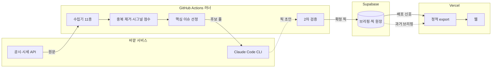

## 화면

### 국내

**이미지** https://wzaqtubtqwpddouevwbk.supabase.co/storage/v1/object/public/project-media/daily-brief/demo-1.png
**설명** 오늘 촉매가 있는 국내 종목을 순위대로 봅니다

### 해외

**이미지** https://wzaqtubtqwpddouevwbk.supabase.co/storage/v1/object/public/project-media/daily-brief/demo-2.png
**설명** 같은 형식으로 미국 종목과 관련 ETF를 봅니다

### 실적

**이미지** https://wzaqtubtqwpddouevwbk.supabase.co/storage/v1/object/public/project-media/daily-brief/demo-3.png
**설명** 지난 픽의 진입가 대비 수익률을 날짜별로 봅니다

### 발굴

**이미지** https://wzaqtubtqwpddouevwbk.supabase.co/storage/v1/object/public/project-media/daily-brief/demo-4.png
**설명** 사건과 상관없이 재무로 고른 종목을 점수순으로 봅니다

## 데이터와 API

### DART 전자공시

**용도** 국내 종목을 고를 때 쓰는 유일한 직접 촉매다. 종목을 지정하지 않고 시장 전체 공시를 받는다
**방식** REST · 전체 공시
**갱신** 매 실행마다
**링크** https://opendart.fss.or.kr/guide/main.do
**사흘치를 함께 받는 이유** 아침 6~7시에는 당일 공시가 거의 없어요. 직전 거래일까지 받아야 후보가 생기는데, 사흘치를 받으면 2,000건대가 됩니다.

### SEC EDGAR

**용도** 미국 기업의 8-K·Form 4·13F 원문을 언론보다 먼저 받는다
**방식** Atom 피드 · 최신순
**갱신** 매 실행마다
**링크** https://www.sec.gov/search-filings/edgar-application-programming-interfaces
**신원을 밝혀야 열린다** 요청에 실명과 이메일을 넣지 않으면 차단돼요. 그 값이 비어 있으면 수집을 건너뛰게 했습니다.

### KRX Open API

**용도** 전종목 시세·거래대금·시가총액을 받아 급상승 탐지와 국내 픽 시총 게이트에 쓴다
**방식** REST · 전종목 일별
**갱신** 매일
**링크** https://openapi.krx.co.kr
**응답이 느려요** 전종목을 한 번에 받으면 30초 가까이 걸려서 대기 시간을 넉넉히 잡았습니다.
**대안을 못 쓴 이유** KRX 내부 웹 데이터는 세션 인증이 필요하고, 네이버 금융 시세는 robots.txt 가 크롤러를 전부 막아요. 투자자별 순매수와 공매도 잔고는 이 API가 제공하지 않아 포기했습니다.

### USAspending

**용도** 미국 연방정부 조달 수주를 실적 선행 지표로 쓴다
**방식** REST · 최근 수주
**링크** https://api.usaspending.gov

### openFDA

**용도** 신약 승인 이벤트로 바이오 종목의 촉매를 찾는다
**방식** REST · 승인 목록
**링크** https://open.fda.gov/apis/

### Senate Stock Watcher

**용도** 상원의원 주식 거래 공시를 읽어 반복 매수 종목을 찾는다
**방식** 공개 JSON · 전량
**링크** https://github.com/timothycarambat/senate-stock-watcher-data

### 보도자료 와이어

**용도** GlobeNewswire·PR Newswire·Business Wire 원문을 언론이 거르기 전에 받는다
**방식** RSS · 3사
**갱신** 매 실행마다

### 네이버 금융 리서치

**용도** 증권사 리포트의 목표가와 컨센서스 방향을 참고 자료로 보여 준다
**방식** 크롤링 · 하루 90건
**링크** https://finance.naver.com/research/
**아이콘** Naver
**픽에는 안 씁니다** 등급 변경은 이미 주가에 반영된 뒤에 나오는 신호예요. 그래서 모아서 보여 주기만 하고 국내 픽을 고르는 입력에서는 뺐습니다.

### yfinance

**용도** 발굴 트랙의 재무를 수집하고, 픽의 진입가와 현재가를 받고, 티커가 실제로 있는지 확인한다
**방식** 라이브러리 · 병렬 8
**링크** https://github.com/ranaroussi/yfinance
**아이콘** Yahoo
**실패가 잦아요** 수천 종목을 한 번에 받으면 호출 제한에 걸려 쉬어 가며 받아야 합니다. 정상 종목도 자주 실패해서 "없는 티커"와 "확인 못 한 티커"를 구분할 수 없어요. 그래서 확인 실패를 탈락 근거로 쓰지 않습니다.

### Claude Code CLI

**용도** 요약·번역·핵심 이슈 선정·픽 검증·발굴 리서치를 전부 CLI로 처리한다
**방식** CLI · 배치
**갱신** 매 실행마다
**링크** https://docs.claude.com/en/docs/claude-code
**아이콘** Anthropic
**과금이 갈려요** API 키가 환경에 있으면 구독 할당량 대신 API 과금으로 넘어갑니다. 경고나 안내도 뜨지 않아서 이 프로젝트에는 그 키를 두지 않아요.

### Supabase

**용도** 브리핑·픽 원장·용어 사전·중복 기록을 저장하는 단일 원본이다
**방식** REST · 덮어쓰기
**갱신** 매 실행마다
**링크** https://supabase.com/docs/reference/python/introduction

## 인터뷰

**소개** 오늘 주가가 움직일 만한 종목을 아침에 골라 주는 브리핑이에요. 밤사이 올라온 공시와 원문 자료를 읽어서 사건이 있는 종목만 카드 몇 장으로 남깁니다
**소개** 기사를 모아 주는 뉴스 리더는 아니에요. 오늘 국내 몇 개, 해외 몇 개를 고르고, 왜 이 종목인지, 촉매가 뭔지, 얼마나 확신하는지를 카드 한 장에 넣습니다. 볼 만한 종목이 없는 날은 억지로 채우지 않고 "오늘은 강한 촉매가 있는 종목이 없어요"라고 씁니다
**계기** 요즘 주식 안 하는 사람이 없잖아요. AI 시대에 빅테크 주가가 계속 오르고, 국내에서도 SK하이닉스와 삼성전자가 코스피를 전례 없는 수준까지 올려놨고요. 저도 그 FOMO를 느끼던 사람 중 하나였어요
**계기** 그러다 이상하다 싶었어요. 제가 보는 소식은 언론사를 거친 보도자료인데, 그건 한 발도 아니고 두 발 늦은 소식이에요. 기대가 주가에 다 반영된 뒤에야 제가 읽게 됩니다. 저는 반영되기 전에 알고 선점하고 싶었고, 그러려면 언론사가 받아 쓰는 원본이 어디서 오는지부터 알아야 했어요. 그걸 찾아보다가 시작한 프로젝트입니다

## 구상

- 관심 종목을 미리 정하지 않고 시장 전체 공시를 읽어 점수가 높은 것만 남긴다
- 모르는 용어에 해설이 자동으로 붙어서 검색하지 않고 읽는다
- 출근길에 카카오톡 챗봇이 뉴스레터처럼 브리핑을 보내 준다
- 주 1회 뜨는 테마와 수혜 섹터를 리포트로 받는다
- 인포스탁 테마주 분류를 수집해 밸류체인 매핑 DB를 만든다

## 유저 플로우

### 아침에 알림을 받는다

매일 아침 요약이 옵니다. 링크를 누르면 그날 브리핑으로 바로 들어가요.

### 오늘 픽이 있는지 본다

국내 탭이 먼저 열립니다. 촉매가 있는 종목이 순위대로 나와요.

**갈라짐** 픽이 있다 → 카드를 훑는다 / 0개다 → 관찰 목록과 낙수효과 레이어만 본다

### 카드를 펼쳐 확인한다

TradingView 차트가 아코디언으로 열리고 토스증권·증권플러스·네이버증권 딥링크가 있어요. 주문 화면까지만 연결하고 매수는 직접 합니다.

### 지난 픽 성적을 확인한다

실적 탭에서 지금까지 고른 종목의 진입가 대비 수익률을 날짜별로 볼 수 있어요.

## 구조

### GitHub Actions 러너

평일 아침에만 실행되는 환경입니다. 한 번 실행에 6~9분쯤 걸려요. 두 실행이 같은 날짜의 데이터를 동시에 고치지 못하게 막아 뒀습니다.

### 수집기 11종

DART·EDGAR·KRX·RSS·거시지표·리서치·정부계약·내부자 클러스터·의회 거래·FDA·와이어에서 각각 데이터를 받아옵니다. 하나가 실패해도 나머지는 계속 돌아가요.

### 중복 제거·시그널 점수

`(소스, 외부 ID)` 쌍을 원장과 대조해 처음 보는 항목만 남기고, 공시 유형과 소스 신뢰도로 점수를 매깁니다.

### 핵심 이슈 선정

국내와 해외 후보 풀을 각각 한 번씩 동시에 LLM에 보내 Top N 종목을 받습니다.

### 2차 검증

촉매가 근거 공시에 실제로 있는지 이슈 단위로 대조하고, 종목과 공시 주체가 일치하는지 확인합니다. 티커가 실제로 있는지는 따로 조회해요.

### 브리핑·픽 원장

날짜별 브리핑과 픽 이력은 이곳에만 있습니다. 로컬 파일은 여기서 만든 캐시예요.

### 정적 export

빌드를 시작하기 전에 원장에서 그날 브리핑과 과거 브리핑을 받아 정적 파일로 만듭니다. 런타임에는 DB를 읽지 않아요.

## 개발 과정

### 1. 언론에 실리기 전 원본을 직접 받아 보기로 했어요

찾아보니 기사의 원본은 대부분 공개돼 있었어요. 국내는 DART 전자공시, 미국은 SEC EDGAR이고, 기자들도 여기서 받아 씁니다. 다만 하루에 수백 건씩 올라와서 사람이 다 볼 수 없어요. 그래서 걸러내는 일을 자동화하기로 했습니다.

첫 버전은 아주 단순했어요. DART 공시 목록과 경제 뉴스 RSS를 받아 공시 유형별 점수표로 거르고, 점수가 높은 순서로 몇 개만 남겼습니다. 중복을 막으려고 이미 본 항목을 SQLite에 기록했고, 같은 글을 두 번 요약하지 않도록 캐시 테이블을 뒀어요. 실행은 맥북 launchd에 아침 6시로 등록했습니다.

처음 고민한 결정은 LLM 호출 방식이었어요. Anthropic Python SDK를 쓰면 API 요금이 나오는데, 저는 이미 Claude Max를 구독 중이었습니다. `claude -p` CLI를 서브프로세스로 호출하면 구독 할당량으로 청구된다는 걸 확인하고 그 방식을 골랐어요. 그 뒤로 "`ANTHROPIC_API_KEY`를 절대 두지 않는다"가 이 프로젝트의 규칙이 됐습니다. 그 변수가 있으면 CLI가 아무 표시 없이 API 과금으로 넘어가거든요.

**붙인 것** DART Open API, Claude Code CLI, SQLite, launchd

### 2. 카카오톡 챗봇으로 보내려다 웹으로 옮겼어요

처음 구상은 출근길에 카카오톡으로 브리핑을 받아 지하철에서 읽는 것이었어요. 챗봇이 뉴스레터처럼 매일 아침 보내 주는 형태입니다. 알림을 따로 확인하지 않아도 원래 보던 앱으로 온다는 점이 좋았어요.

그런데 카카오톡 메시지 본문은 4KB로 제한돼 있고, 공시 열 몇 건에 요약을 붙이면 금방 넘어요. 잘라서 보내면 중요한 내용이 잘렸습니다. 그래서 카톡에는 요약 세 줄과 링크만 보내고 본문은 웹 페이지로 옮겼어요. 웹은 Next.js 정적 export로 만들어 Vercel에 올렸습니다. 파이프라인은 브리핑 JSON 하나를 출력하고 프론트는 그걸 읽기만 해요.

그러고 나니 카톡을 유지할 이유가 없어졌어요. 링크 한 줄 보내는 역할만 남았는데, 그걸 위해 두 달마다 만료되는 access_token을 OAuth로 다시 받아야 했거든요. 그래서 디스코드 웹훅으로 바꿨습니다. URL 하나면 되고 만료도 없어요. 카톡 모듈은 지우지 않았지만 지금 파이프라인은 디스코드로만 보냅니다. 처음 하려던 카톡 챗봇은 아직 구상 목록에 있어요.

이때 용어 해설이 부가 기능에서 핵심 기능이 됐습니다. "전환사채 발행"이 무슨 신호인지 모르면 브리핑을 읽어도 남는 게 없거든요. 본문에 나오는 용어를 감지해 밑줄을 긋고, 누르면 팝오버로 설명을 보여 줘요. 사전에 없는 단어는 LLM이 설명을 만들어 사전에 저장합니다.

UI는 처음에 흔한 대시보드 스타일로 만들었다가 전부 버렸어요. 뱃지와 컬러 스트립, 보더로 중요도를 표현했더니 화면만 복잡하고 뭐가 중요한지 보이지 않았습니다. 토스 앱을 자세히 살펴보면서 규칙을 다시 정했어요. 위계는 글자 크기로만 나타내고, 색은 점 하나만 쓰고, 카드에 보더와 그림자를 넣지 않고, 카피는 "~요" 말투로 씁니다. 이 규칙을 문서에 적어 두고 이후 모든 화면에 적용했어요.

**붙인 것** Next.js, Tailwind CSS, Vercel, Discord, PWA

### 3. 탭 구조를 세 번 바꾸고 뉴스를 다 지웠어요

처음에는 시사·경제 2탭이었어요. 아침에 종목만 빠르게 보고 싶어서 "Today's Pick" 탭을 따로 만들었고, 며칠 써 보니 종목을 경제 맥락과 같이 보고 싶어서 경제 탭 안의 섹션으로 옮겼어요. 비게 된 탭에는 AI 뉴스를 넣고 기본 진입 탭으로 정했습니다.

몇 주 쓰고 나서 제가 시사도 AI 뉴스도 거의 안 읽고 종목 카드만 본다는 걸 알았어요. 나머지는 스크롤로 지나치는 노이즈였습니다. 그래서 뉴스 표시를 파이프라인과 화면 양쪽에서 전부 없앴어요. 수집은 유지했는데, 보여 주려는 용도가 아니라 종목을 추론할 때 보조 입력으로만 씁니다. 탭은 국내·해외·실적·발굴로 정리됐어요. 결정 로그에 이 변천사를 모두 남겨 뒀습니다.

### 4. 소극적인 분석을 버리고 방향을 말하게 했어요

처음 방침은 "추천 금지, 시그널만 띄운다"였어요. 그런데 결과를 읽어 보니 "일반적으로 이런 공시는 긍정적으로 해석됩니다"처럼 있으나 마나 한 문장만 나왔고, 포털 앱에서 보는 내용과 다를 게 없었습니다. 어차피 혼자 쓰는 도구라 방침을 바꿨어요. 매수·매도 방향, 촉매 강도 등급, 관련 ETF까지 내놓게 했습니다.

그러자 LLM이 실제로 없는 종목을 만들어 내기 시작했어요. 그럴듯한 티커에 그럴듯한 촉매를 붙여서요. 그래서 픽이 나온 뒤에 검증 단계를 하나 더 뒀습니다. 먼저 이슈 단위로 "이 촉매가 근거 공시에 실제로 있나"를 확인해 지어낸 이슈는 통째로 버리고, 남은 픽마다 종목과 공시 주체가 일치하는지 대조해요. 티커가 실제로 있는지는 조회로 확인하는데, 조회에 실패해도 바로 탈락시키지는 않습니다. 네트워크 오류 한 번으로 정상 종목을 잃으면 안 돼서 `review` 표시만 달고 화면에 사유를 적어요.

품질 게이트도 엄격하게 잡았어요. 약한 촉매로 개수를 채우느니 0개가 낫다고 봤습니다. 그러면 0개인 날 화면이 너무 비어서 관찰 목록과 낙수효과 레이어를 따로 만들었어요. 횡령이나 감자 같은 강한 악재는 경쟁사에 반사이익이 되는데, 이건 2차·3차 추론이라 정식 픽과 섞으면 안 됩니다. 그래서 확신도가 낮은 보조 레이어로 분리하고 성과 채점에서도 뺐어요.

한동안 운영해 보니 국내 픽이 코스닥 초소형주로 몰렸어요. 점수가 제목 키워드만 보고 시총을 보지 않아서, 시총 300억인 회사의 50억 계약이 대형주 공시보다 위로 올라왔습니다. 매일 받는 KRX 시세에 시가총액이 이미 있어서, 추가 호출 없이 후보 풀에 넣기 전에 3,000억 미만을 거릅니다. KRX 수집이 실패해 시총 정보가 없으면 이 게이트를 적용하지 않아요. 국내 픽이 모자라는 쪽이 더 나쁘다고 봤습니다.

**붙인 것** yfinance

### 5. 촉매만 쫓다 보니 사건 없이 좋은 회사를 못 봤어요

파이프라인 전체가 사건 기반이었어요. 공시나 뉴스가 떠야 후보에 들어와서, 무언가 일어난 종목만 잡히고 사건은 없는데 재무가 꾸준히 좋은 회사는 잡히지 않았습니다. 단발성 호재만 보고 있다는 걸 몇 주 만에 알았어요.

그래서 촉매와 완전히 분리된 발굴 트랙을 새로 만들었습니다. 고정 유니버스(평가 대상 종목 집합)를 정하고 가치·퀄리티·성장 팩터를 유니버스 안 백분위로 바꿔 가중 합성해요. 이 랭킹은 LLM 없이 결정론적으로 계산해서 단위 테스트를 붙일 수 있습니다. 여기에 LLM 리서치를 더해 투자 논리와 "왜 아직 안 알려졌나"를 씁니다. 수백 종목의 재무를 받는 무거운 작업이라 자동 스케줄에 넣지 않고 직접 실행할 때만 갱신돼요.

처음 만든 유니버스는 S&P500 + 나스닥100에 코스피 시총 상위 85개를 하드코딩한 목록이었는데, 실행할 때마다 삼성전자·SK하이닉스가 상위권에 나왔어요. 발굴한다면서 이미 다 아는 대형주만 평가하고 있었습니다. 그래서 NASDAQ Trader 심볼 디렉토리 전체와 KIND 상장회사 목록 전체로 바꿨어요. 미국 5,600개, 국내 2,600개입니다. 대형주를 빼지는 않았어요. 밸류에이션이 싸지 않으면 랭킹에서 자연히 내려가거든요.

**붙인 것** yfinance, NASDAQ Trader, KIND

### 6. 로컬 맥에 묶여 있어서 문제가 생겼어요

여기까지 데이터는 전부 로컬 SQLite와 `frontend/public/` 정적 파일에 있었어요. 그런데 매일 아침 정리 작업이 오늘 파일만 남기고 과거 파일을 지워서 달력에서 지난 브리핑이 사라졌고, 성과 탭은 DB에서 읽어 누적하니 둘의 날짜가 맞지 않았습니다. 머신을 두 대 쓰기 시작하면서 어느 맥에서 만들었느냐에 따라 데이터가 달라지기도 했어요.

그래서 Supabase를 단일 원본으로 정했습니다. 어느 머신에서 실행하든 DB에 쓰고, 로컬 파일은 DB에서 만드는 캐시로 바꿨어요. Vercel은 빌드할 때 스크립트로 DB에서 데이터를 직접 받아 정적 파일을 만듭니다. 그래서 데이터를 git에 커밋할 필요가 없어졌고, 파이프라인은 DB에 쓴 다음 Deploy Hook으로 신호만 보내면 돼요. 런타임에 DB를 읽지 않으니 키 노출이나 RLS 설계도 필요 없습니다.

그다음에는 실행 환경을 옮겼어요. launchd로 실행하면 맥북의 전원과 절전 상태에 따라 실행 여부가 달라졌습니다. 기록을 세어 보니 평일 60일 중 22일이 빠져 실행률이 63%였어요. GitHub Actions로 옮기면서 Max 구독 할당량은 그대로 쓰도록 했습니다. `claude setup-token`으로 발급한 OAuth 토큰을 시크릿에 넣고 러너에서 CLI를 실행해요. `.env`는 dotenvx로 암호화해 저장소에 커밋해 뒀기 때문에 시크릿은 복호화 키 하나면 됩니다. 주말에는 실행하지 않아요. 장이 안 열리는 날에는 종목 전용 화면에 보여 줄 내용이 없거든요.

**붙인 것** Supabase, GitHub Actions, dotenvx

## 시행착오

### Vercel 배포 설정을 네 번 바꿨어요

**증상** 프론트를 `frontend/` 아래에 두고 Vercel rootDirectory를 거기로 잡았더니, 빌드는 성공하는데 페이지가 404로 나오거나 API rewrite가 적용되지 않았어요. 한쪽을 고치면 다른 쪽이 깨졌습니다.

**시도** 먼저 `output: 'export'`를 빼고 서버 렌더로 실행했어요. 배포는 됐지만 정적 호스팅을 전제로 한 구조와 맞지 않아 되돌렸습니다. 루트 `vercel.json`에 outputDirectory를 넣으니 rootDirectory가 아니라 저장소 루트 기준으로 잡혀 또 맞지 않았어요. `frontend/vercel.json`을 따로 만들었더니 이번에는 루트 설정과 둘 다 유효해서 어느 쪽이 적용되는지 알 수 없었습니다.

**결론** rootDirectory를 `frontend`로 두면 Vercel이 그 디렉터리를 프로젝트 루트로 취급한다는 걸 확인하고, 설정을 `frontend/vercel.json` 한 곳으로 모았어요. `outputDirectory: "out"`은 rootDirectory 기준 상대경로고, 시세 프록시 rewrite도 여기로 옮겼습니다. 루트에는 서비스워커 캐시 헤더만 남겼어요. 나중에 로컬 `next dev`에서 rewrite가 적용되지 않는 문제가 또 나와서 `next.config.mjs`에 개발 전용 rewrite를 따로 넣었습니다.

### 해외 픽 수익률이 전부 0%로 찍혔어요

**증상** 실적 탭에서 어제 고른 해외 종목의 수익률이 전부 0.00%였어요. 며칠을 봐도 어제 고른 종목만 0이고 그저께 고른 종목부터는 정상이었습니다.

**시도** 처음에는 시세 조회가 실패해서 값이 안 바뀌는 줄 알았어요. 실제로 시세 프록시 rewrite가 `vercel.json`에만 있어서 로컬 `next dev`에 적용되지 않는 문제가 하나 있었는데, 그걸 고쳐도 0%는 그대로였습니다.

**결론** 원인이 두 개 겹쳐 있었는데, 진짜 원인은 진입 기준가였어요. 추천일 당일 종가를 기준가로 잡았거든요. 현재가도 최신 종가라서 다음 세션이 끝나기 전까지 둘이 같은 값이 되고, 첫날은 무조건 0%가 나옵니다. 추천은 한국 아침, 즉 미국장 개장 전에 나오니 그 시점에 알 수 있는 마지막 가격인 직전 거래일 종가가 실제 진입가예요. 기준가 정의를 이렇게 바꾸고, 주말과 휴장일에는 추천일 직전 거래일을 찾아 자동으로 보정했습니다.

### 달력에서 과거 브리핑이 통째로 사라졌어요

**증상** 달력을 열면 오늘 날짜만 있고 지난 브리핑이 전부 비어 있었어요. 실적 탭의 픽 이력은 정상으로 누적돼 있었습니다.

**시도** 처음에는 달력 컴포넌트의 날짜 필터를 의심했어요. 보존 일수 상수가 여러 곳에 다른 값으로 흩어져 있어서 맞춰 봤는데, 며칠 지나니 또 비었습니다.

**결론** 구조 문제였어요. 프론트는 `frontend/public/` 정적 JSON만 읽는데, 매일 아침 정리 작업이 오늘 파일만 남기고 과거 브리핑 파일을 지우고 있었습니다. 픽 이력은 Supabase에서 읽어서 영향을 받지 않았어요. 머신을 두 대 쓰면서 어느 맥에서 만들었느냐에 따라 파일이 달라지는 문제도 있었습니다. Supabase를 단일 원본으로 정하고 로컬 파일은 DB에서 만드는 캐시로 바꿨어요. 배포는 빌드할 때 DB에서 직접 받아 오게 바꿨습니다. 보존 일수도 90일로 한 곳에서만 정의하게 정리했어요.

### LLM 타임아웃이 잦아서 시간만 계속 늘렸어요

**증상** 핵심 이슈 선정 단계에서 `claude` CLI 호출이 자주 실패했어요. 타임아웃을 60초로 잡았다가 안 돼서 120초, 그래도 안 돼서 180초, 300초까지 올렸습니다.

**시도** 타임아웃을 올리면서 입력도 줄였어요. 해외 후보를 60건에서 30건, 다시 15건까지 줄였습니다. 타임아웃은 줄었지만 후보 풀이 작아져서 LLM이 고를 종목이 없었어요. 항목마다 요약을 한 번씩 호출하던 방식도 누적 시간을 많이 쓰고 있었습니다.

**결론** 방향을 두 번 바꿨어요. 먼저 건별 호출을 배치로 바꿔 여러 건을 한 번에 넘기니 호출 수가 크게 줄었습니다. 다음으로 국내와 해외를 순차가 아니라 동시에 호출했어요. 측정해 보니 동시 2개도 각각 110초 정도로 단독 실행 136초와 비슷했습니다. 이 규모에서는 처리량 경합이 일어나지 않는다는 뜻이고, 동시 실행이 순차 합계 250초보다 확실히 빨랐어요. 과거 타임아웃은 동시 실행 탓이 아니라 일시적인 서버 지연이었고, 대비책은 타임아웃 420초 설정 하나로 정리했습니다. 15건까지 줄였던 입력도 되돌렸어요.

### 발굴 유니버스가 설계 문서와 어긋나 있었어요

**증상** 발굴 스크린을 돌릴 때마다 삼성전자·SK하이닉스처럼 이미 다 아는 대형주가 상위권에 나왔어요. 발굴되지 않은 회사를 찾는다는 목적과 정반대였습니다.

**시도** 처음에는 팩터 가중치 문제로 봤어요. 밸류에이션 가중을 올리고 시총 페널티를 넣으면 대형주가 내려갈 거라고 생각했습니다. 결과가 조금 바뀌긴 했지만 여전히 이름을 아는 회사만 나왔어요.

**결론** 랭킹이 아니라 유니버스가 문제였어요. 설계 문서에는 "발굴은 고정 유니버스가 본질"이라고 적어 놨는데, 실제 구현은 S&P500 + 나스닥100에 코스피 시총 상위 85종목을 하드코딩한 목록이었습니다. 평가 대상이 대형주로 한정돼 있어 중소형주가 들어올 수 없었어요. 문서와 구현이 어긋난 걸 몇 주 동안 몰랐습니다. 미국은 NASDAQ Trader 심볼 디렉토리 전체 약 5,600개, 국내는 KIND 상장회사 목록 전체 약 2,600개로 교체했어요. `pykrx`도 검토했는데 최신 버전이 KRX 로그인을 요구해서 접었고, KIND 다운로드 엔드포인트는 로그인이 필요 없어 그쪽을 썼습니다. 소스만 넓히면 되는 문제라 랭킹 로직은 한 줄도 바꾸지 않았어요.

### 국내 후보가 관측 기간 내내 모자랐어요

**증상** 국내 픽이 거의 매일 0~1개였어요. 해외는 정상인데 국내만 그랬습니다. 처음에는 한국 시장에 촉매가 없는 날이 많은가 보다 하고 넘어갔어요.

**시도** 품질 게이트가 너무 엄격한 줄 알고 하한을 조정하려 했어요. 그런데 게이트를 낮추면 분기보고서 같은 정기 공시가 실제 촉매를 밀어낼 게 뻔했습니다. 그래서 로그를 날짜별로 세어 봤어요.

**결론** 국내 Tier2·Tier3 후보가 0인 날은 하루도 없었는데, LLM에는 후보 2건만 넘어가고 있었어요. 후보 풀을 만드는 코드가 점수 하한 75를 모든 티어에 똑같이 적용하는데, 오케스트레이터는 국내 뉴스에 40점을 고정으로 주고 있었습니다. 그래서 한경·매경·연합 기사가 100% 탈락했어요. 척도부터 잘못 섞여 있었습니다. Tier1인 공시·리서치는 내용 기반 점수 45~95이고 Tier2·3인 뉴스는 소스 신뢰도를 환산한 점수 42~65인데, 척도가 다른 둘에 하한 하나를 적용했어요. 하한을 티어별로 나누고 국내 뉴스 점수도 소스별로 나눴습니다. Tier1 하한 75는 그대로 둬서 정기 공시가 실제 촉매를 밀어내는 일은 계속 막아요. 이 하한이 다시 깨지지 않도록 회귀 테스트를 붙였습니다.

### 아침 브리핑이 두 주 가까이 통째로 비었어요

**증상** 어느 날 달력을 보니 7월 중순부터 2주간 브리핑이 하나도 없었어요. 코드는 정상이었고 직접 실행하면 잘 돌아갔습니다.

**시도** 처음에는 `launchd` 스케줄 설정을 의심했어요. `pmset repeat wakeorpoweron`으로 평일 아침 자동 wake를 걸고, plist에 `caffeinate`와 PATH 고정을 넣었습니다. `claude` 실행 파일을 PATH에서 찾지 못해 에러도 경고도 없이 빈 브리핑이 만들어지는 사고도 있어서, 파이프라인 시작 시점에 사전 점검을 넣고 로그를 눈에 띄게 남겼어요.

**결론** 고쳐도 빠지는 날이 계속 나왔어요. 기록을 세어 보니 6~8월 평일 약 60일 중 22일이 비어 실행률이 63%였습니다. 맥북을 닫아 두거나 여행을 가면 그날 브리핑은 그냥 없었어요. 로컬 스케줄러로 해결할 문제가 아니라서 GitHub Actions로 옮겼습니다. 데이터 원본은 이미 Supabase이고 배포도 Deploy Hook이라 러너가 저장소에 쓸 일이 없었어요. 실행 환경만 바꾸는 변경이라 위험이 낮았습니다. Max 구독은 `claude setup-token` OAuth 토큰으로 유지했고, `.env`는 이미 dotenvx로 암호화돼 있어 시크릿은 복호화 키 하나로 충분했어요. launchd plist는 지우지 않고 수동 실행 경로로 남겨 뒀습니다.

## 남은 것

- 공시 본문 분석이 아직 없어요. 지금은 제목 키워드로만 점수를 매기고, 본문에서 금액과 지분율을 뽑는 설계는 끝냈지만 구현하지 못했습니다
- 시그널 점수를 백테스트한 적이 없어요. 일반적인 해석에 기대어 정한 점수표라 실제로 알파가 있는지 확인하지 못했습니다
- 국내 촉매 소스가 DART 하나뿐이에요. 해외는 EDGAR·정부계약·FDA·와이어로 나뉘는데 국내는 마땅한 대안을 찾지 못했습니다
- 발굴 트랙은 직접 실행해야 갱신돼요. 수천 종목의 재무를 받는 작업이 무거워서 자동 스케줄에 넣지 못했습니다
