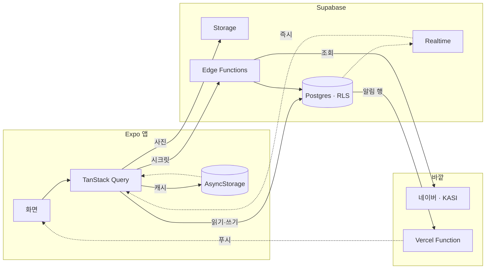

## 화면

### 홈

**이미지** https://wzaqtubtqwpddouevwbk.supabase.co/storage/v1/object/public/project-media/dodori/demo-1.png
**설명** 오늘의 주제와 추천곡, 게임을 하루 단위로 보여 줍니다

### 캘린더

**이미지** https://wzaqtubtqwpddouevwbk.supabase.co/storage/v1/object/public/project-media/dodori/demo-2.png
**설명** 두 사람의 일정과 기념일을 한 달 단위로 봅니다

### 라이브러리

**이미지** https://wzaqtubtqwpddouevwbk.supabase.co/storage/v1/object/public/project-media/dodori/demo-3.png
**설명** 가 보고 싶은 곳을 모아 둡니다

### 데이트 앨범

**이미지** https://wzaqtubtqwpddouevwbk.supabase.co/storage/v1/object/public/project-media/dodori/demo-4.png
**설명** 다녀온 날을 사진과 코스가 붙은 앨범으로 남깁니다

### 피드

**이미지** https://wzaqtubtqwpddouevwbk.supabase.co/storage/v1/object/public/project-media/dodori/demo-5.png
**설명** 게시물과 24시간 스토리를 올립니다

## 데이터와 API

### 네이버 지역검색 API

**용도** 장소를 검색해 후보를 보여 주고 사용자가 담은 곳만 저장한다
**방식** REST · 검색할 때만
**링크** https://developers.naver.com/docs/serviceapi/search/local/local.md
**주의** 하루 25,000건까지 쓸 수 있다. 키를 앱에 두지 않으려고 서버에서 호출한다. 응답 좌표계가 지도와 달라 변환해서 쓴다

### 한국천문연구원 특일정보

**용도** 임시공휴일과 선거일을 받아 달력에 공휴일로 표시한다
**방식** REST · 월 1회
**갱신** 자동
**링크** https://www.data.go.kr/data/15012690/openapi.do
**주의** 매년 규칙이 같은 공휴일은 앱이 직접 계산한다. 그래서 키가 없어도 달력은 정상으로 동작한다

### iTunes Search API

**용도** 추천 곡에 앨범 이미지와 30초 미리듣기를 붙이고 실제로 있는 곡인지 확인한다
**방식** REST · 시드 만들 때만
**아이콘** Apple
**링크** https://performance-partners.apple.com/search-api
**주의** 이름이 비슷하기만 해도 결과를 돌려줘서 가수와 제목이 모두 맞을 때만 쓴다. 실제로 없는 곡도 이 검증에서 걸러진다

### 네이버 지도

**용도** 담은 장소와 하루 동선을 지도에 그린다
**방식** 앱 SDK · 웹 JS
**아이콘** Naver
**링크** https://www.ncloud.com/product/applicationService/maps
**주의** 콘솔에 등록한 주소와 다르면 인증 실패가 에러가 아니라 빈 화면으로 나온다

### 카카오 로그인

**용도** 별도 가입 없이 카카오 계정으로 바로 로그인한다
**방식** 앱 SDK · 웹 OAuth
**아이콘** Kakao
**링크** https://developers.kakao.com/docs/latest/ko/kakaologin/common
**주의** 앱에는 개발용 빌드가 따로 필요하고 안드로이드는 첫 빌드 뒤 콘솔에 키 해시를 등록해야 한다

## 인터뷰

**소개** 커플앱입니다. 일정, 데이트 계획, SNS(스토리, 피드)처럼 있으면 좋을 법한 기능을 다 넣어 봤어요.

**계기** 각자 약속이 생기면 카톡으로 알려 주는데, 그걸 그냥 기억하거나 제 캘린더에 옮겨 적거나 상대가 한 달치 캘린더를 캡처해 보내야 했어요. 어느 쪽도 불편했습니다

## 유저 플로우

### 카카오로 들어와 상대를 초대한다

먼저 들어온 사람이 초대 코드를 받아 링크로 상대에게 보냅니다.

**갈라짐** 링크를 눌렀다 → 코드 없이 바로 수락 / 링크가 막혔다 → 코드 열 자를 직접 입력

### 사귄 날을 정하고 커플이 된다

이때 D-day와 기념일이 함께 만들어집니다.

### 홈에서 오늘의 주제를 고른다

선택지 둘 중 하나를 누르면 끝나요. 3초면 됩니다.

**갈라짐** 내가 골랐다 → 상대 답이 열리고 댓글로 논쟁 / 아직 안 골랐다 → 상대 답은 가려진 채

### 캘린더에 다음 데이트를 잡는다

날짜를 고르고 장소를 검색해 넣습니다. 여러 날에 걸친 일정은 막대로 표시돼요.

### 가보고 싶은 곳을 코스에 담는다

모아 둔 곳을 그날 앨범의 코스에 넣고 순서를 정합니다.

### 다녀와서 사진을 올리고 되돌아본다

사진은 앨범에 붙고 피드와 스토리에도 남습니다.

**갈라짐** 오래 남길 것 → 게시물 / 오늘만 보여줄 것 → 24시간 스토리

## 구조

### 화면 — 훅 호출과 배치만 한다

expo-router 파일 라우팅으로 탭 4개를 구성했고 iOS·Android·Web이 같은 코드로 돌아갑니다. 화면은 훅을 호출하고 컴포넌트를 배치하는 일만 해요. 도메인 규칙은 `lib/` 의 순수 함수에, 서버 접근은 `api/` 의 쿼리 훅에 있습니다.

### TanStack Query — 캐시가 오프라인 저장소를 겸한다

앱의 서버 요청은 전부 TanStack Query를 거칩니다. 쿼리 결과를 AsyncStorage에 저장해 두고, 앱을 다시 켜면 저장된 값을 먼저 보여 준 뒤 새 데이터를 받아요. 세션은 저장 대상에서 뺐습니다.

### Postgres · RLS — 권한 규칙을 DB에 둔다

모든 테이블에 `couple_id` 가 있고, 정책 42개가 전부 `public.my_couple_id()` 함수 하나로 권한을 판단합니다. "내가 마쳐야 상대 답이 열린다" 같은 규칙도 앱이 아니라 RLS와 RPC에 있어요. 행이 바뀌면 Realtime과 알림 트리거로 전달됩니다.

### Storage — 올릴 때 두 장을 만든다

사진은 기기에서 1080(본체)과 360(목록) 두 크기로 만들어 함께 올립니다. 영상은 mp4, 포스터 JPEG, 360 썸네일 세 파일로 올리고, 그림만 필요한 화면에서는 영상을 사진처럼 표시합니다. 서버에서 이미지를 변환하지 않아요.

### Edge Functions — 시크릿과 트랜잭션만 맡는다

바깥 API 키를 클라이언트에서 숨기는 일과, 초대 수락처럼 여러 테이블을 한 번에 바꾸는 일만 맡습니다. `claim-invite`·`search-places`·`daily-release`·`generate-anniversaries`·`sync-holidays`·`notify-game` 여섯 개가 있고, 그 밖의 읽기와 쓰기는 앱이 Postgres에 직접 요청합니다.

### Vercel Function — 알림은 만드는 곳과 보내는 곳이 다르다

알림 행은 Postgres 트리거가 만들고, 이 함수는 만들어진 행을 받아 웹 푸시로 보내기만 합니다. 문구와 이동 경로는 `lib/notifications.ts` 의 순수 함수 하나를 앱과 이 함수가 같이 씁니다.

### Realtime — 상대 쪽 변경이 그대로 들어온다

상대가 투표하거나 게임을 마치면 그 행의 변경이 구독으로 전달되고 홈 카드가 바로 열립니다. 앱이 포그라운드로 돌아오면 `AppState` 가 TanStack Query의 `focusManager` 를 호출해 데이터를 다시 맞춥니다.

## 개발 과정

### 1. 서로의 일정을 같이 보는 것부터

일정부터 시작했어요. 둘이 같이 보는 캘린더를 먼저 만들고 커플에게 꼭 필요한 기능만 골라 붙이기로 했습니다. 일정이 생기니 데이트 계획을 짤 곳이 필요했고, 다녀온 날을 기록할 곳도 필요해졌어요. 매일 앱을 열 이유는 그다음에 고민했는데, 그래서 나온 기능이 오늘의 주제와 게임, 스토리입니다.

### 2. 처음부터 데이터를 둘의 것으로 뒀어요

데이터를 누구 소유로 둘지부터 정했어요. 흔한 방식은 각자 계정에 데이터를 두고 상대에게 공유 권한을 주는 건데, 그러면 화면마다 누구 데이터인지 따져야 하고 헤어질 때 누구 것을 지울지도 문제가 됩니다. 그래서 `couples` 를 최상위에 두고 모든 테이블에 `couple_id` 를 넣었어요. 한 사람은 커플 하나에만 속하고(`couple_members.user_id` unique), RLS 정책은 전부 `public.my_couple_id()` 함수 하나로 판단합니다. 정책이 42개여도 규칙이 하나라 헷갈리지 않았어요.

로그인은 카카오만 뒀습니다. 커플앱은 상대를 데려와야 쓸 수 있는데, 이메일 회원가입을 시키면 그 단계에서 절반이 떨어져요. 초대는 코드 열 자를 발급하고, 수락과 커플 연결, 기념일 생성은 서버 트랜잭션(`claim-invite`) 하나로 처리했습니다.

**붙인 것** Supabase, 카카오 로그인

### 3. 데이트 기록을 앨범으로 바꿨어요

처음에는 그냥 "데이트 기록" 목록이었는데 밋밋했어요. 그래서 음악 앨범 콘셉트로 바꿨습니다. **장소가 트랙, 하루가 앨범**이고, 시간순으로 쌓인 데이트 전체가 플레이리스트예요. 앨범에는 자켓(커버 사진)이 있고, 날짜가 지나면 "발매"된 상태가 됩니다. `tracks` 에 상태 컬럼을 두지 않고 `date < 오늘(KST)` 로만 판단하게 해서 자정마다 상태를 바꾸는 배치도 필요 없어졌어요.

PRD에 있던 "싱글(기념일)" 개념은 이때 버렸습니다. 기념일은 캘린더에서 다루면 되고, 앨범과 싱글을 나란히 두면 사용자가 둘의 차이를 따로 배워야 하는데 그럴 만한 가치가 없었어요.

### 4. 매일 열 이유가 없었어요

한 달쯤 써 보니 문제가 보였습니다. 매일 바뀌는 게 없었어요. 데이트는 주 1회, 캘린더는 한 달에 몇 칸, 앨범은 일주일에 한 번 늘어납니다. 홈에 무엇을 두든 지루했고, 캘린더를 크게 키워도 빈 칸만 커졌어요.

그래서 매일 새로 생기는 공유 콘텐츠를 만들기로 하고 후보를 몇 개 검토했어요. 오늘의 한 곡이나 낙서는 매일 하기엔 곡을 떠올리거나 그림을 그리는 부담이 있었어요. 이상형 월드컵은 매일 쓸 새 후보 이미지를 구할 방법이 없었고요. 그래서 **투표**로 정했습니다. 텍스트 한 줄에 선택지 둘이고, 한 번 누르면 끝나요.

규칙은 하나로 통일했습니다. **내가 해야 상대 답이 열린다.** 나중에 붙인 오늘의 게임과 추천곡에도 같은 규칙을 적용했어요. 클라이언트에서 가리면 개발자 도구로 볼 수 있어서 서버에서 강제했습니다(`has_played` RLS + `submit_game_round` RPC).

주제 목록은 세 번 갈아엎었어요. 200개로 시작해 400개까지 늘렸는데, 읽어 보니 "전 애인", "결혼관"처럼 싸움이 날 만한 주제가 섞여 있었어요. 재미로 만든 기능이 싸움으로 이어지면 안 돼서 관계를 캐묻는 주제를 통째로 버리고 가상 소재 320개로 다시 짰습니다.

실시간 동시 대결은 두 사람의 접속 시간이 안 맞으면 쓸 수 없어서 넣지 않았고, 비동기 점수 대결로 충분했어요. 수익화도 접었습니다. 사용량으로 과금하면 가장 열심히 쓰는 소수에게만 청구서가 가는데, 그렇게 받아도 총액은 얼마 안 되는 구조였어요.

**붙인 것** iTunes Search API

### 5. 인스타그램을 기준으로 삼았어요

스토리와 피드를 붙이면서 UI를 어디까지 다듬을지 애매했는데, 인스타그램과 나란히 놓고 다른 부분을 하나씩 고치기로 했습니다. 사람들이 이미 익숙한 동작이라 비슷하면 설명이 필요 없고, 조금만 달라도 어색하거든요.

커밋이 유난히 많이 쌓인 구간이에요. 사진을 9:16 캔버스에 꽉 채우기, 핀치로 줄인 크기가 유지되게 하기, 텍스트 입력을 전체화면으로 띄우기, 입력하는 위치와 놓이는 위치를 맞추기, 길게 누르면 정지하기까지 스토리 편집기 하나에 커밋이 스무 개 넘게 들어갔어요. 편집 결과는 레이어를 따로 저장하지 않고 **화면을 이미지 한 장으로 합성해** 올립니다. 웹에서는 canvas로 같은 처리를 해서 네이티브와 웹의 결과를 맞췄어요.

스토리 편집기의 크롭 제스처(`StoryCanvas`·`cropToCanvas`)는 게시물 업로드 크롭에 그대로 재사용했어요. 프레임 비율도 `postFrameRatio` 하나로 묶어 업로드 크롭과 피드 표시가 같은 값을 쓰게 했습니다. 전에는 한쪽만 바꾸면 둘이 어긋났어요.

### 6. 청구서가 걱정되기 시작했어요

앱을 사람들에게 공개하려니 서버 비용이 걱정됐습니다. 요금표를 확인해 보니 이미지 변환이 문제였어요. Supabase Pro의 이미지 변환 무료분은 원본 100장뿐인데, 저는 썸네일을 `createSignedUrl(..., { transform })` 로 서버에서 만들고 있었어요. Spend Cap을 켜면 베타 첫 주에 앱 전체 썸네일이 깨지고, 끄면 사진 10만 장에 월 $500이 나옵니다. 비용 상한을 고정하면서 서버 변환을 계속 쓸 수는 없었어요.

그래서 서버 변환을 없애고 **업로드할 때 기기에서 1080과 360 두 크기를 만들어 함께 올리는** 방식으로 바꿨습니다. 보관 최대 크기도 2048에서 1080으로 낮췄어요. 서명 URL은 24시간 캐시하고, 업로드할 때 `Cache-Control: 31536000` 을 넣었습니다. 경로가 uuid라 같은 주소의 내용이 바뀌지 않아서 1년을 캐시해도 안전해요. 첫 화면을 열 때 40번 오가던 서명 요청은 배치로 묶어 2번으로 줄였습니다.

저장 한도도 바꿨어요. 처음에는 "커플당 사진 100장"으로 세고 결제를 유도하는 지점으로 쓰려 했는데, 수익화를 접으면서 그럴 이유가 없어졌습니다. 동영상을 붙이자 장수로 셀 수도 없게 됐어요. 15초 영상 하나가 사진 27장 용량이거든요. 그래서 장수 대신 바이트 총량으로 바꿨습니다. `couples.storage_quota_bytes`(무료 200MB)와 `photos.bytes` 합계를 비교해 insert 트리거가 강제해요. 이미 올린 사진이 사라지면 앱을 쓸 이유가 없으니, 한도에 닿아도 기존 사진은 지우지 않고 계속 볼 수 있게 했습니다. 새 업로드만 막아요.

### 7. 웹으로도 열고 데모를 만들었어요

iOS 빌드는 맥이 있어야 하고 심사도 기다려야 해서 React Native Web으로 웹부터 열었습니다. Vercel에 배포하고, 홈 화면에 추가하면 앱처럼 뜨는 PWA로 만들었어요. 그러자 플랫폼 차이가 줄줄이 나왔습니다. `Alert` 는 웹에서 뜨지 않아 전부 `dialog` 헬퍼로 바꿨고, `useSafeAreaInsets` 로 잰 안전영역은 여백이 생겼다 없어졌다 해서 CSS `env()` 로 바꿨어요. 사파리에서는 핀치 제스처를 브라우저가 가져갔고, `Keyboard.metrics` 는 웹에 아예 없었습니다.

알림은 웹 푸시로 붙였어요. 알림 행을 클라이언트에서 만들면 앱이 꺼져 있을 때 유실되고 배지 숫자도 금방 틀어집니다. 그래서 알림 행은 Postgres 트리거만 만들게 하고, 발송은 Edge Function을 늘리지 않고 Vercel Function에 맡겼어요. DB가 이 함수를 깨우는 신호(pg_net)는 실패해도 괜찮게 설계했습니다. Supabase에 묶이는 부분은 이 신호 하나뿐이라, 떠나더라도 cron 폴링으로 바꾸면 됩니다.

마지막으로 포트폴리오용 둘러보기를 붙였어요. 커플앱은 로그인하고 상대까지 연결해야 화면이 보여서 처음 보는 사람에게 보여 줄 수가 없어요. 그래서 `/demo` 로 들어오면 가상 커플 계정으로 자동 로그인되고, 데이터는 서버가 매일 새벽 4시에 되돌립니다. **데모를 아는 파일은 `demo.tsx` 하나뿐**이고, 로그인한 뒤에는 일반 사용자와 같은 경로(진입 가드 → 홈)로 움직여요. 화면마다 데모 분기를 넣으면 데모에서만 깨지는 화면이 생기는데, 포트폴리오에서는 그게 가장 큰 문제라 피했습니다.

**붙인 것** Vercel

## 시행착오

### NativeWind 때문에 카카오 버튼 배경이 사라졌어요

**증상** 카카오 로그인 버튼에 배경색이 없고 글자만 보였어요. 스타일 값은 맞는데 화면에만 적용되지 않았습니다.

**시도** 처음에는 색 토큰이나 순서 문제로 보고 스타일 코드를 뒤졌어요. 다음에는 RN 0.86과 Metro의 가상 파일시스템 충돌을 의심해 `forceWriteFileSystem` 로 우회 패치까지 넣었는데 버튼은 그대로였습니다.

**결론** 원인은 NativeWind v4였어요. `jsxImportSource: 'nativewind'` 가 모든 JSX를 css-interop으로 감싸는데, 이 과정에서 `Pressable` 의 함수형 `style`(`({pressed}) => …`)이 에러도 경고도 없이 버려졌습니다. 그런데 `className` 사용처가 프로젝트에 0개였어요. 쓰지도 않는 라이브러리가 렌더링을 망가뜨리고 있었습니다. NativeWind를 제거하고 RN `style` 과 토큰으로 통일하니 Metro 우회 패치도 필요 없어졌어요.

### 서버 이미지 변환을 계속 쓰면 비용 상한을 넘게 돼 있었어요

**증상** 베타를 열기 전에 요금을 계산해 보니 이상했어요. Supabase Pro의 이미지 변환 무료분이 "origin image 100장"인데, 앱은 모든 썸네일을 서버 변환으로 만들고 있었습니다.

**시도** 처음에는 "데이터를 기기에 저장하고 프리미엄만 클라우드"로 가면 되겠다고 생각했어요. 그런데 도돌이의 모든 테이블은 두 사람이 같이 보는 데이터라 로컬에만 두면 상대 기기에서 보이지 않아 앱을 쓰는 이유가 사라져요. 무료 플랜이 혼자 쓰는 메모장이 돼서 이 방향은 버렸습니다.

**결론** 과금 단위는 요청 수가 아니라 **그 달에 변환된 원본 장수**였어요. Spend Cap을 켜면 베타 첫 주에 앱 전체 썸네일이 깨지고, 끄면 사진 10만 장에 월 $500입니다. "$25 고정 상한"과 서버 변환은 함께 쓸 수 없어서, 변환을 없애고 업로드할 때 기기에서 두 크기를 만들게 바꿨어요. 조사하다가 더 나쁜 문제도 발견했습니다. Free 플랜에는 변환이 아예 제공되지 않아 `transform` 옵션이 무시됐고, 캘린더의 124px 칸에도 2048px 원본이 그대로 내려오고 있었어요. 테스트 사용자가 두 명뿐이라 드러나지 않았습니다.

### 쿼터 트리거가 파일 업로드는 못 막았어요

**증상** 쿼터를 DB 트리거로 강제해 뒀는데, 한도에 닿은 커플이 업로드하면 DB 행은 생기지 않고 스토리지 용량만 늘어났습니다.

**시도** 트리거 조건과 RLS부터 확인했는데 둘 다 정상이었고 거부도 제대로 일어나고 있었어요.

**결론** 순서가 문제였습니다. 업로드는 스토리지에 파일 2개를 먼저 올린 다음 `photos` insert를 하는데, 트리거는 insert의 `before insert` 에 걸려 있어요. 그래서 거부되면 **DB 행 없이 파일만 남고**, 롤백도 없어 재시도할수록 스토리지가 계속 늘어납니다. 실패한 항목이 올린 파일을 지우도록 고쳤어요. 같이 찾은 누수가 둘 더 있었습니다. 아바타는 바꿀 때마다 새 uuid로 올리고 이전 파일을 지우지 않았고(20번 바꾸면 20개), 커플을 삭제하면 DB 행만 cascade로 지워지고 스토리지 파일은 계속 남았어요.

### 사진 위에서 세로 스크롤이 안 돼 다섯 번 고쳤어요

**증상** 피드에서 사진에 손가락을 대고 위아래로 밀면 스크롤되지 않았어요. 사진 바깥 여백에서 시작하면 정상이었습니다.

**시도** 인라인 핀치 줌을 제거하니 스크롤은 됐지만 인스타그램처럼 확대하는 기능이 없어졌어요. 되살리니 스크롤이 다시 안 됐습니다. 캐러셀을 `Gesture.Native` 래퍼로 감싸 봤는데, 이번에는 사진에서 시작한 스크롤만 안 됐어요. 래퍼를 걷어냈다가 다시 붙이기를 반복해서 커밋 로그에 같은 증상이 다섯 번 나옵니다.

**결론** 답이 하나가 아니어서 **플랫폼별로 우선순위를 나눴어요.** 네이티브에서는 RNGH로 핀치와 스크롤을 동시에 인식하게 했고, 웹에서는 핀치를 포기하고 스크롤을 우선했습니다. 웹은 나중에 브라우저 확대를 허용했다가 페이지 전체가 확대되는 게 어색해서 되돌리고, 사진에만 웹 핀치를 직접 붙였어요. 비슷한 문제가 데이트 상세(세로 스크롤과 좌우 스와이프)와 스토리 편집기(글자를 끌면 배경 사진도 따라옴)에서도 반복됐습니다.

### 스플래시에서 i의 점을 움직이려니 글꼴이 걸렸어요

**증상** 마크 𝄆 의 아래 점이 떨어져 나와 워드마크 "dodori"의 i 위에 앉는 모션을 만들려 했는데, 그 위치에 이미 글꼴의 점이 있었어요.

**시도** 점 없는 글자 `ı`(dotless i)로 워드마크를 그리고 그 위에 공을 올리려 했습니다. 그런데 `ı` 는 폭과 자간이 `i` 와 조금 달라서 워드마크 전체 균형이 어긋났어요.

**결론** `ı` 를 버리고 반대로 했습니다. **진짜 `i` 를 그려 두고 점만 배경색 덮개로 가린 뒤**, 공이 도착하는 순간 점과 겹친 다음 덮개를 치웁니다. 글꼴은 원본 그대로예요. 처음에는 덮개를 먼저 치워서 점이 두 개로 보였고, 순서를 고쳤습니다. 튀는 모션도 여러 번 다듬었어요. 제자리 도약이 생겨서 밟고 있는 글자를 홉 목록에서 뺐고, 홉 높이를 이동 거리에 비례시켰고, 감쇠를 물리 법칙대로 줘서 첫 홉이 가장 높게 했습니다.

### cron이 몇 달간 401로 실패했는데 몰랐어요

**증상** 매일 도는 `daily-release` 와 월 1회 `sync-holidays` 가 실행은 되는데 아무 일도 일어나지 않았어요.

**시도** 함수 코드와 cron 등록부터 확인했는데 둘 다 정상이었어요.

**결론** Vault의 service role 키 자리에 **문서의 자리표시자 문자열이 그대로 들어 있었습니다.** 설정 안내를 복사해 실행하면서 `<SERVICE_ROLE_KEY>` 를 실제 키로 바꾸지 않았어요. cron은 401을 받고 그냥 넘어갔고, 화면에 실패가 드러나는 기능도 아니라 몇 달간 몰랐습니다. 지금은 배포 후 수동으로 설정할 항목과 설정하지 않으면 안 되는 기능을 CLAUDE.md에 경고와 함께 적어 뒀어요.

## 남은 것

- 동영상은 아직 올릴 수 없어요. 사진만 주고받는 상태라, 기록이 길어질수록 아쉬운 자리입니다.
- 알림이 앱을 켜 둔 동안에만 와요. 앱 밖에서도 받게 하려면 푸시를 마저 붙여야 합니다.
- 계정을 삭제하는 기능이 없어요. 떠나는 사람이 자기 기록을 정리할 방법이 있어야 합니다.
- 주제가 317개라 반년치예요. 그 안에 보충하지 않으면 오늘의 주제를 더 낼 수 없습니다.
