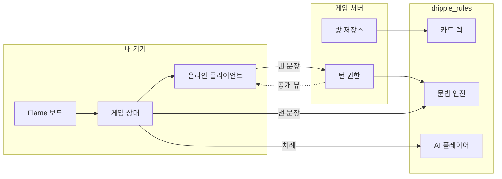

## 화면

### 홈

**파일** ./screens/01-home.png
**설명** 바로 플레이하거나 처음이면 배우기로 들어갑니다

### 모드 선택

**파일** ./screens/02-mode-select.png
**설명** 혼자 할 모드와 친구와 할 모드를 나눠 보여 줍니다

### 대전 시작

**파일** ./screens/03-battle.png
**설명** 일곱 장을 받고 덱에서 한 장 가져오며 차례가 시작됩니다

### 내 차례

**파일** ./screens/04-my-turn.png
**설명** 카드를 뽑은 뒤에야 카드를 위로 밀어 문장을 낼 수 있습니다

### 문장 만들기

**파일** ./screens/05-sentence.png
**설명** 손패에서 위로 민 카드가 그대로 문장이 됩니다

### 배우기

**파일** ./screens/06-tutorial.png
**설명** 아홉 단계를 따라 한 판을 하며 규칙을 익힙니다

### 설정

**파일** ./screens/07-settings.png
**설명** 밝기를 고르고 효과음, 배경 음악, 진동을 조절합니다

## 인터뷰

**소개** 영어 단어가 한 장에 하나씩 적힌 카드를 들고, 어순에 맞게 늘어놓아 문장을 만드는 카드 게임이에요. 손에 든 카드를 먼저 다 없앤 사람이 이깁니다.

**계기** 어렸을 때 다니던 영어학원에서 이 카드 게임을 했어요. 그때는 보드지를 잘라 만든 카드로 보드게임처럼 했습니다. 재밌었던 기억이 남아 있어서 앱으로 만들어 보고 싶었어요.

**사용자** 나이와 상관없이 영어를 배우는 사람 모두예요. 처음에는 6~10세 아이만 생각하고 만들다가 도중에 어른 학습자까지 넓혔습니다.

**배운 것** 답안 판정 로직이 제일 빡셌어요. 문장이 맞았는지 틀렸는지 가르는 기준을 한 줄로 정하는 데 제일 오래 걸렸습니다.

## 구상

- 단어 카드를 손에 들고 어순에 맞게 늘어놓는다
- 늘어놓은 문장이 맞는지 바로 판정해 준다
- 혼자서도 AI를 상대로 대전할 수 있다
- 특수 카드로 상대를 방해한다
- 나중에는 친구와 온라인으로 대전한다

## 유저 플로우

### 모드를 고른다

혼자 배울지, AI와 대전할지, 친구를 부를지 정합니다.

**갈라짐** 처음이다 → 배우기 / 해봤다 → AI 대전이나 방 만들기

### 카드를 한 장 가져온다

덱 맨 위나 버림 더미 맨 위에서 한 장을 뽑습니다. 뽑기 전에는 아무것도 할 수 없어요.

### 손패에서 문장을 짠다

카드를 옆으로 밀면 손패 안에서 순서가 바뀌고, 위로 밀면 테이블에 놓입니다.

### 문장을 완성한다

버튼을 누르면 문법 엔진이 판정합니다.

**갈라짐** 맞았다 → 카드가 손에서 영영 빠진다 / 틀렸다 → 카드가 손으로 돌아오고 차례는 그대로

### 손패를 다 비운다

먼저 비운 사람이 이깁니다.

## 구조

### Flame 보드

카드를 그리고 터치 입력을 받습니다. 손패는 겹친 채 부채꼴로 놓이고, 테이블에 올린 카드는 겹치지 않습니다.

### 게임 상태

지금 누구 차례인지, 누가 어떤 카드를 가졌는지 저장합니다. 오프라인 게임에서는 여기서 심판 역할까지 해요.

### dripple_rules

Flutter에 의존하지 않는 순수 Dart 패키지입니다. 문법 엔진, AI, 카드 덱이 들어 있고 앱과 서버가 같은 코드를 씁니다.

### 게임 서버

온라인 방을 관리합니다. 덱을 섞고 손패를 나눠 주고, 지금 낸 문장이 차례인 사람의 것인지 확인합니다. 요청 사이에 아무것도 기억하지 않고, 요청마다 방을 읽어 동작 하나를 적용한 뒤 다시 저장합니다.

## 개발 과정

### 1. 보드지 카드를 화면에 옮기는 것부터

보드지를 잘라 쓰던 카드를 화면으로 옮기는 일부터 시작했어요. 앱의 기본 구조는 Flutter로 만들고, 카드를 끌어 옮기는 부분은 Flame으로 구현했습니다. 문법 판정은 처음에 문장 템플릿 목록을 두고 손패가 그중 하나에 맞는지 확인하는 방식이었어요. 캐릭터 리액션, 이모트, 효과음 21종, 진동까지 붙여서 전체를 한 번 돌려 봤습니다.

**붙인 것** Flutter, Flame, Riverpod

### 2. 규칙대로 하니 문장을 낼 수 있는 일이 거의 없었어요

돌려 보니 규칙에 큰 문제가 있었습니다. 문장은 최소 다섯 장부터 인정했는데, 무작위로 받은 일곱 장으로 다섯 장짜리 문장을 만들 수 있는 경우가 거의 없었어요. AI도 사람도 매 턴 카드만 뽑았고, 93턴쯤 지나 덱이 떨어져서 게임이 끝났습니다.

그래서 규칙을 러미 방식으로 완전히 바꿨어요. 한 장을 뽑고 동작을 한 가지 합니다. 버림 더미를 두고, 덱이 떨어지면 버림 더미를 섞어 다시 넣어요. 최소 길이 제한은 없앴습니다. 문장이 길수록 손패가 빨리 줄어서, 규칙으로 강제하지 않아도 긴 문장이 유리하더라고요.

카드 버리기를 의무로 두면 안 된다는 것도 이때 알았어요. 차례를 끝낼 때 반드시 버려야 한다면, 한 장 뽑고 한 장 버리는 사람은 손패 수가 그대로여서 절대 이길 수 없습니다. 그래서 패스를 실제로 고를 수 있는 동작으로 넣었어요.

### 3. 템플릿을 버리고 파서를 썼어요

템플릿 목록은 아무리 늘려도 부족했습니다. 문장 하나를 더 인정하려고 목록에 한 줄씩 추가하다가, 영문법 책에 있는 대로 재귀 청크 파서를 짰어요. 명사구, 형용사구, 전치사구, 동사구를 각각 정의하고, 문장은 이들의 조합으로 판단합니다.

그 위에 규칙 다섯 개를 더했어요. 관사 일치, 수 일치, 주어-동사 일치, 형용사 어순, 동사 자릿수(valency)입니다. 자릿수를 넣고 나서야 `apples run a friend` 같은 문장이 걸러졌어요. `run`이 목적어를 받지 못한다는 규칙은 의미가 아니라 문법에 속합니다.

### 4. 카드가 카드처럼 보여야 했어요

기능은 돌아가는데 화면이 학습 앱처럼 보였어요. 디자인 토큰을 별도 패키지로 분리하고 화면을 전부 다시 그렸습니다. 재료는 두 가지만 뒀어요. 종이에는 브랜드 색을, 가구(테이블·레일)에는 크림색을 씁니다.

처음에는 초록 펠트에 황동 테두리를 둘렀는데, 황동 때문에 화면의 모든 선이 노랗게 보였어요. 그래서 황동을 빼고 크림색으로 바꿨습니다. 그래도 초록 테이블에 스포트라이트가 남아 있어서 카지노처럼 보였어요. 초록도 빼고 색이 아예 없는 `#15181C` 바닥으로 바꿨습니다. 이제 화면에서 색이 있는 부분은 카드에 인쇄된 것뿐이에요.

카드 앞면도 다시 디자인했습니다. 단어를 가운데에 두면 손패가 겹쳤을 때 맨 위 한 장만 읽혀요. 겹친 카드는 왼쪽 끝만 보이기 때문에 단어를 전부 왼쪽으로 옮겼더니 일곱 장이 다 읽혔습니다. 그러고 나니 인쇄된 테두리, 양쪽 구석의 인덱스, 단어와 뜻 사이의 줄이 모두 필요 없어져서 지웠어요.

나중에 낮 모드도 넣었습니다. 안내문과 설정을 종이에서 빼고 바닥에 직접 올리고 나니, 밝은 부분이 하나도 없는 어두운 앱이 됐더라고요. 두 재료 중 낮 모드에서 바뀌는 쪽은 바닥뿐입니다. 바닥은 방의 불빛에 따라 달라지지만 카드는 인쇄물이라 불을 켠다고 다시 인쇄되지 않아요. 그래서 테이블, 레일, 바닥 위의 글자만 바뀌고 카드는 그대로입니다. 낮 모드의 바닥은 카드 종이와 같은 흰색이에요. 회색을 먼저 써 봤는데 밝은 화면이 아니라 어두운 화면에 불만 켠 것처럼 보여서 버렸어요. 카드가 바닥 위에 놓인 물건처럼 보이지 않을까 걱정했는데, 카드에 원래 그림자가 두 개 있어서 여전히 놓인 물건처럼 보였습니다.

창을 넓게 열면 카드 게임처럼 보이지 않는 문제도 이때 고쳤어요. 보드의 모든 치수는 주어진 폭을 기준으로 계산하는데, 폰에서는 폭 제한이 필요 없어서 두지 않았거든요. 1920px에서는 일곱 장이 화면을 가로질러 일렬로 늘어서서 손패를 한눈에 읽을 수 없습니다.

여는 화면도 고쳤어요. 마크가 카드 두 장이라 카드가 나타나면서 동시에 갈라졌는데, 그러면 어떤 게임인지 보여 줄 첫 장면이 그냥 지나가 버립니다. 그래서 한 장이 260ms 동안 놓이고, 180ms 동안 아무 일도 없다가, 두 번째 카드가 갈라져 나오게 했어요. 장식처럼 보여도 이 멈춤이 있어야 첫 상태가 읽힙니다. 앱 이름은 유일하게 Pretendard가 아닌 글자로 썼어요. UI 서체로 쓰면 "Dripple이라고 적힌 제목"처럼 읽히고 로고로 읽히지 않더라고요.

### 5. 배우기를 실제 게임과 따로 만들었어요

처음에는 실제 게임 위에 코치 마크를 띄우려고 했어요. 그런데 손패가 무작위로 나와서, "문장을 만들어 보세요"라고 안내해도 그 손패로 만들 수 있는 문장이 없을 수 있습니다. 그러면 배우는 사람은 "이 게임 고장 났네"라고만 생각하게 돼요.

그래서 배우기를 별도 모드로 분리했습니다. `the cat runs`가 나오도록 짠 손패와 덱 맨 위에 `big`을 올려 둔 1인용 판을 따로 돌려서, 모든 안내를 실제로 따를 수 있게 했어요. 코치 마크는 가리킬 대상이 있을 때만 화면을 덮고, 사용자가 직접 조작해야 하는 단계에서는 목표에 테두리만 두르고 아무것도 가리지 않습니다.

안내문을 담던 종이도 나중에 없앴어요. 종이는 카드에 쓰는 재료인데 안내문까지 종이에 올리니 화면에 카드가 한 장 더 있는 것처럼 보였습니다. 지금은 글자만 바닥에 바로 표시돼요. 몇 번째 단계인지 세는 숫자도 같이 올렸습니다.

### 6. 덱을 어느 플레이어의 폰에도 두지 않았어요

온라인 대전을 붙이려는데, Realtime DB는 데이터를 저장할 뿐 코드를 실행하지 않습니다. 그러면 셔플을 누군가의 폰에서 해야 하는데, 한 사람이 덱과 다른 사람의 손패를 모두 갖고 있으면 카드 게임이 되지 않아요.

그래서 서버를 Dart로 만들었어요. 문법 엔진을 두 번 구현하면 언젠가 둘이 어긋나는데, 그때는 고칠 수 없습니다. 그래서 규칙을 `dripple_rules` 패키지로 분리해 앱과 서버가 같은 코드를 쓰게 했어요.

서버가 내보내는 데이터도 둘로 나눴습니다. 서버가 가진 실제 상태와, 테이블에서 보여도 되는 공개 뷰입니다. 다른 사람의 손패가 유출되지 않는지는 테스트로 확인해요. 대신 문장을 짜고 손패 순서를 바꾸는 일은 전부 기기에서 합니다. 남이 볼 수 없는 동작이라 보낼 이유가 없고, 완성된 문장만 서버로 보내요.

**붙인 것** GitHub Actions

## 시행착오

### 판정 기준을 한 줄로 못 정해서 두 번 바꿨어요

**증상** `the flower reads`가 통과했습니다. 꽃은 글을 읽지 못하니 틀린 문장 같은데, 문법에는 문제가 없어요. 그래서 주어의 생물성(animacy)을 검사해 무생물 주어에는 사람 동사를 쓰지 못하게 막았습니다.

**시도** 그러자 이번에는 게임이 진행되지 않았어요. 카드는 무작위로 나오는데 의미까지 맞아야 하면 낼 수 있는 문장이 거의 없습니다. 기준도 애매해져서 어디까지가 "말이 되는" 문장인지 규칙마다 답이 달랐어요. 중간에 카드 아트 작업이 이 커밋을 덮어써서 되살리는 커밋을 다시 만들었는데, 되살린 뒤에도 문제는 그대로였습니다.

**결론** 생물성 검사를 통째로 없앴어요. 기준은 "문장의 구성이 맞으면 맞는 문장이다, 의미는 보지 않는다" 한 줄로 고정했습니다. 이제 `the flower reads`는 통과하고 `apples run a friend`는 여전히 걸러져요. `run`이 목적어를 받지 못한다는 규칙은 의미가 아니라 문법이기 때문입니다. 반쪽짜리 의미 검사는 아예 없느니만 못했어요.

### AI가 한 판 내내 카드만 뽑았어요

**증상** AI 상대로 돌리면 세 명 모두 매 턴 카드만 뽑고, 덱이 떨어질 때까지 문장을 한 번도 내지 않았습니다.

**시도** 처음에는 AI 전략이 너무 소극적이라고 보고 판단 기준을 고쳤어요. 그래도 문장을 내지 않았습니다. 로그를 보니 문장 후보를 아예 찾지 못하고 있었어요.

**결론** AI의 문장 탐색은 네 장까지만 조합을 만드는데, 당시 최소 문장 길이는 다섯 장이었습니다. 통과할 수 있는 후보가 애초에 나올 수 없었어요. AI가 사람과 다른 규칙을 쓰면 상대가 되지 않으니, 탐색을 순열 검색으로 다시 짜고 판정은 사람과 똑같이 문법 엔진에 맡겼습니다.

### 패스를 자유롭게 풀었더니 손패를 비우기 전에 덱이 떨어졌어요

**증상** AI에게도 패스를 허용했더니 게임이 길어졌습니다. 손패를 비우기 전에 덱이 떨어져서 끝나는 판이 늘었어요.

**시도** AI끼리 60판을 돌려 측정했습니다. 패스를 막았을 때는 60판 중 59판이 손패를 비워서 끝났는데, 자유롭게 허용하니 41판으로 줄었어요. 패스한 카드는 버림 더미를 거치지 않고 덱에서 사라져서, 버림 더미를 다시 섞어도 돌아오지 않습니다.

**결론** 패스에 조건을 걸었어요. 버리려던 카드가 자기에게 필요한 카드이고, 손패가 난이도별 한도(쉬움 6·보통 5·어려움 4) 아래이고, 덱에 아직 한 판 나눠 줄 만큼 카드가 남아 있을 때만 패스합니다. 이 규칙으로 다시 60판을 돌리니 48판이 손패를 비워서 끝났어요.

### 손패를 읽는 제스처를 만들었다가 지웠어요

**증상** 손패가 겹쳐 있어서 가려진 카드를 읽을 수 없었어요. 그래서 카드를 누르면 손패가 "읽기 상태"로 바뀌고, 레일을 따라 손가락을 밀면 카드가 차례로 떠오르는 제스처를 만들었습니다. 카드를 집는 동작은 위로 16px 당겼을 때만 되게 했어요.

**시도** 만들고 나니 옆으로 밀어도 더 이상 드래그가 되지 않았어요. 손패 순서를 바꾸려면 카드를 일단 부채꼴 밖으로 빼야 했고, 위쪽으로 빼야 한다는 걸 화면에서 알려 주는 것도 없었습니다.

**결론** 제스처가 아니라 카드 앞면이 문제였어요. 단어를 왼쪽 끝으로 옮기자 가려진 카드도 읽혀서 이 제스처를 둘 이유가 없어졌습니다. 통째로 지우고 더 직접적인 조작으로 되돌렸어요. 누르면 들리고, 옆으로 밀면 순서가 바뀌고, 위로 밀면 냅니다. 8월 26일에 넣었다가 9월 3일에 뺐습니다.

## 남은 것

- 온라인은 폴링으로 방을 다시 읽어 와요. 상대가 낸 문장이 바로 뜨지 않고 조금 늦게 나타납니다.
- 친구 목록도 랜덤 매칭도 없어요. 방 코드를 직접 알려 줘야 같이 할 수 있습니다.
- 문장이 틀렸을 때 나오는 이유가 영어로만 표시돼요. 카드에 붙는 뜻은 앱 언어를 따르는데 판정 이유는 아직 그렇지 않습니다.
- 판정 결과에 반응하는 캐릭터를 아직 게임 판에 넣지 못했어요. 이기고 지는 순간이 조용합니다.
- 카드를 그리는 게임 보드가 캔버스라서 화면 낭독기가 읽지 못해요.
