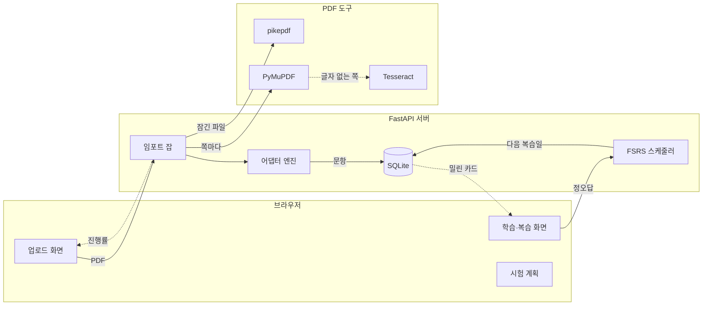

## 화면

### 홈

**파일** ./screens/01-home.png
**설명** 시험까지 남은 날과 하루에 풀 문항 수가 맨 위에 뜹니다

### 업로드

**파일** ./screens/02-upload.png
**설명** 덤프 PDF 한 권에서 725문항을 뽑아 세션을 만듭니다

### 문제 풀이

**파일** ./screens/03-study.png
**설명** 실제 시험장 화면처럼 한 문제와 보기 네 개만 띄웁니다

### 정답

**파일** ./screens/04-correct.png
**설명** 제출하면 맞은 보기가 초록으로 켜지고 풀이가 붙습니다

### 오답

**파일** ./screens/05-wrong.png
**설명** 고른 보기는 빨강, 정답은 초록으로 같이 보여줍니다

### 복습

**파일** ./screens/06-review.png
**설명** 오늘 밀린 문제 수와 오답·북마크·건너뛴 문제를 모읍니다

### 복습 채점

**파일** ./screens/07-review-graded.png
**설명** 맞히면 다음 복습이 며칠 뒤로 밀리는지 바로 알려줍니다

### 시험 가이드

**파일** ./screens/08-guide.png
**설명** 시험 형식과 도메인 비중, 응시 방법을 한 페이지에 모았습니다

## 인터뷰

**소개** 자격증 덤프 PDF를 올리면 문항·보기·정답을 뽑아 한 문제씩 풀게 해 주고, 틀린 문제는 잊을 때쯤 다시 물어보는 웹앱이에요. 지금은 AWS SAA-C03 시험 준비에 맞춰 다듬어 두었습니다
**계기** 덤프가 PDF로만 있어서 폰으로 확대해 보기도 불편하고 내가 어디까지 봤는지도 모르겠더라고요. 마침 OCR도 궁금해서 파이프라인을 직접 만들어 봤어요
**계기** 처음엔 아무 문제집이나 넣는 도구였는데, 올해 안에 SAA-C03을 따기로 하면서 그 시험 하나에 맞춰 좁혔습니다
**사용자** 저 혼자 써요. 로그인도 없고 시험 날짜까지 남은 날을 세면서 하루 몇 문제씩 푸는 용도입니다

## 구상

- PDF를 올리면 문항이 알아서 뽑힌다
- 한 문제씩 카드로 풀고 그 자리에서 정답을 본다
- 어디까지 풀었는지 남아서 다음에 이어 푼다
- 틀린 문제와 북마크한 문제만 모아 다시 푼다
- 스캔본 PDF도 OCR로 읽어 낸다

## 유저 플로우

### PDF 문제집을 올린다

홈에서 끌어다 놓으면 파일 이름과 크기만 확인하고 끝이에요.

**갈라짐** 잠긴 PDF → 비밀번호를 넣고 다시 / 안 잠긴 PDF → 바로 추출

### 세션 이름을 붙이고 분석을 건다

진행률이 차오르는 동안 기다리면, 다 끝났을 때 문제집 하나가 학습 세션 하나가 됩니다.

### 시험일을 정한다

가이드 페이지에서 시험일과 평일·주말 공부 시간을 넣으면 홈에 D-day 카드가 뜹니다. 하루에 몇 문항씩 풀어야 하는지도 같이 나와요.

### 한 문제씩 푼다

보기를 고르고 제출하면 그 화면에서 바로 채점돼요. 숫자키와 Enter로만 끝까지 갈 수 있습니다.

**갈라짐** 맞았다 → 다음 문제 / 틀렸다 → 정답을 보고 다음 문제 / 지금 안 풀겠다 → 건너뛰기

### 밀린 복습부터 한다

다음에 들어오면 세션 카드에 "복습 3"처럼 떠 있고, 누르면 오늘 몫만 차례로 나옵니다.

**갈라짐** 맞혔다 → 다음 복습이 며칠 뒤로 밀림 / 틀렸다 → 다음에 열 때 맨 앞으로

## 구조

### 임포트 잡

업로드된 PDF 하나를 맡아 텍스트 추출부터 저장까지 끌고 가고 그 사이 진행률과 단계 문구를 계속 갱신해요. 잠긴 파일은 받은 자리에서 풀어 두기 때문에 뒤 단계는 비밀번호를 모릅니다.

### 어댑터 엔진

문제집 형식마다 다른 규칙을 YAML 파일에 따로 두고, 텍스트에 가장 잘 맞는 어댑터를 점수로 골라 문항·보기·정답·해설로 자릅니다.

### FSRS 스케줄러

맞혔는지 틀렸는지만 받아서 그 문제의 안정성·난이도를 갱신하고 다음 복습일을 돌려줘요. 세션×문제마다 카드를 한 장씩 둡니다.

### 학습·복습 화면

앞에서부터 푸는 학습과, 밀린 카드만 받는 복습이 같은 문제 화면을 씁니다. 복습에서는 이번에 푼 문제 번호를 들고 있다가 다음 요청에 실어 보내서 한자리에서 같은 문제를 두 번 만나지 않아요.

### 시험 계획

시험일과 하루 공부 시간은 서버가 아니라 브라우저에만 저장돼요. 홈의 D-day 카드가 이 값과 남은 문항 수로 하루 권장 문항을 계산합니다.

## 개발 과정

### 1. 파서보다 푸는 화면이 먼저 궁금했어요

PDF를 어떻게 자를지는 나중 일이었어요. 한 문제씩 넘기는 감각부터 보고 싶었거든요. FastAPI에 문제·세션·시도 모델을 잡고, 더미 문제를 심어서 푸는 화면부터 세웠습니다. PDF는 아직 안 붙었는데도 문제가 넘어가니까 만들 맛이 나더라고요.

**붙인 것** FastAPI, Next.js, SQLModel

### 2. 업로드를 붙이고 글자부터 긁었어요

PDF를 올리면 서버가 받아서 쪽마다 글자를 뽑게 했어요. 처음부터 OCR을 다 돌릴 생각은 없었어요. 글자층이 있는 쪽은 PyMuPDF로 긁고 글자가 거의 안 나오는 쪽만 Tesseract로 넘겼습니다. 덤프처럼 텍스트가 살아 있는 파일은 OCR을 아예 안 타니까 훨씬 빨랐어요. 받아 둔 덤프 중에 열람 암호가 걸린 게 있어서 비밀번호를 받는 길도 이때 냈고요.

**붙인 것** PyMuPDF, Tesseract

### 3. 규칙을 코드에서 빼서 YAML로 옮겼어요

문제집마다 번호 매기는 방식이 제각각이에요. "1.", "문제 1)", "Q1"… 이걸 파이썬 파일에 계속 넣다 보니 문제집 하나 늘 때마다 파서를 뜯게 되더라고요. 그래서 규칙을 어댑터 YAML로 빼고 텍스트를 보고 어느 어댑터가 제일 잘 맞는지 점수로 고르게 바꿨습니다. ExamTopics 덤프는 형식이 워낙 일정해서 전용 어댑터를 하나 따로 뒀어요.

### 4. 이어 풀게 만들고, 화면을 걷어냈어요

문제만 쌓아 두니 "내가 어디까지 봤는지"가 없었어요. 업로드 한 건이 곧 학습 세션 하나가 되게 하고, 세션이 지금 문제 번호를 들고 있게 했습니다. 그다음엔 화면이 문제였어요. 카드가 흩어져 있고 그라디언트에 설명문까지 붙어서 정작 문제가 안 읽혔거든요. 장식을 걷어내다 보니 북마크·건너뛰기·단축키 안내가 **아무 데도 연결돼 있지 않다**는 걸 알았어요. 눌러도 아무 일이 없는 버튼이었습니다. 지우지 않고 붙이는 쪽으로 갔어요. 로그인은 끝까지 안 넣기로 했고요. 혼자 쓰는 도구에 계정이 붙는 순간 만들 게 두 배가 됩니다.

### 5. 앞에서 뒤로 한 번 훑고 끝나는 게 아쉬웠어요

한 번 푼 문제는 다시 안 나오니까 사흘 뒤엔 기억에 없더라고요. 그래서 문제마다 다음 복습일을 들고 있는 카드를 두고, 정오답을 넣으면 다음 날짜를 돌려주는 스케줄러를 붙였어요. SM-2와 저울질하다가 Anki도 넘어간 FSRS를 골랐습니다. 파이썬 구현이 있어서 오히려 짤 게 적었어요.

FSRS는 원래 "쉬움/보통/어려움"을 사용자가 눌러 주는 걸 전제하는데, 객관식은 맞았는지 틀렸는지를 앱이 이미 알아요. 정답이면 Good, 오답이면 Again으로 자동으로 넘기고 버튼을 없앴습니다. 조절하고 싶을 때 쓰라고 "어려웠음" 하나만 남겼어요.

**붙인 것** FSRS

### 6. 시험이 정해지고 나서 SAA-C03 하나에 맞췄어요

올해 안에 SAA-C03을 보기로 하니까, 아무 문제집이나 넣는 도구로는 부족하더라고요. 시험이 65문항·130분이라는 것, 도메인 넷의 비중, 예약은 어떻게 하는지 같은 걸 매번 찾아보고 있었거든요. 그걸 한 페이지로 모은 시험 가이드를 붙였습니다. 덤프를 풀다 보면 "최소 운영 오버헤드면 서버리스" 같은 조건어 패턴이 계속 나와서 그 표도 같이 넣었어요.

시험일을 넣으면 홈에 D-day와 하루 권장 문항이 뜨게 했는데, 이건 일부러 서버를 안 건드렸어요. 날짜 하나와 시간 두 개라 브라우저에 두면 충분했습니다. 공부 시간 기록이나 단계별 로드맵도 떠올렸지만 범위 밖으로 뺐어요.

화면도 이때 통째로 갈았어요. 다크 테마와 테마 토글을 없애고, 파란 액센트 하나에 흰 카드만 쓰는 밝은 화면으로 바꿨습니다. 상단에 홈·복습·시험 가이드 내비를 두니 페이지 사이를 오가는 게 훨씬 편해졌고요. 문제 푸는 화면만은 일부러 다르게 갔어요. 남색 상단 바, 경과 시간, `Question 2 of 725`, Flag for Review까지 Pearson VUE 시험 화면을 그대로 흉내 냈습니다. 시험장에 앉았을 때 낯설지 않게 하려고요.

### 7. 두 갈래로 갈라진 작업을 다시 합쳤어요

배포를 생각하고 레포를 정리하다가 일이 커졌어요. 커밋돼 있던 캐시와 `.env`를 걷어내고 백엔드에 Dockerfile을 넣었는데, 그 사이 원격 쪽은 큰 파일을 덜어내느라 히스토리가 새로 쓰였고 복습 기능까지 앞서가 있었습니다. 그냥 합칠 수가 없어서 로컬 백엔드 작업을 원격 위에 하나씩 다시 얹었어요. 열어 보니 파서의 같은 구멍 셋을 양쪽이 따로 메워 두었더라고요. 어느 한쪽을 버리지 않고 구멍마다 더 잘 버티는 쪽을 골라 붙였습니다.

**붙인 것** Docker

## 시행착오

### 725문항 중 정답이 붙은 게 하나도 없었다

**증상** 문항은 다 들어왔는데 정답 칸이 전부 비어 있었어요. 어떤 보기를 골라도 채점이 안 됐습니다.

**시도** 처음엔 정답 줄을 못 잡는 줄 알았어요. 그런데 `Answer: A` 는 정규식에 잘 걸리고 있었고 문제는 그다음이었습니다.

**결론** 뽑힌 값은 `A` 인데 보기 기호 목록은 `A.`, `B.` 처럼 점이 붙어 있어서 짝을 못 찾고 비어 버린 거였어요. 기호에서 문장부호를 떼고 맞춰 보게 고치니 725문항 중 627문항에 정답이 붙었습니다. 두 갈래를 합치면서 정답 찾는 규칙을 더 다듬었고 지금은 639문항까지 붙어요.

### 틀린 문제가 1분 뒤에 또 나왔다

**증상** 복습을 붙이자마자 틀린 문제가 1분 뒤로 예약됐어요. 출퇴근길에 5분 쓰는 사람에게는 방금 틀린 게 곧바로 또 나오는 셈이었습니다.

**시도** 아예 하루 단위로만 돌릴까 했어요. 그러면 틀린 문제도 최소 하루 뒤가 됩니다.

**결론** 시뮬레이션을 돌려 보니 하루 한 번 여는 사람에게는 두 방식 결과가 똑같았어요. 밀린 카드는 사라지지 않고 다음에 열 때 맨 앞에 있으니까요. 오히려 하루를 넘겨 맞히면 안정성이 훨씬 크게 오릅니다(1.89 대 0.25). 그래서 학습 단계를 10분 하나로 줄이고 한자리에서 방금 푼 문제는 큐에서 빼는 쪽으로 갔어요.

### 잠긴 PDF가 들어오는 길마다 다르게 굴었다

**증상** 암호 걸린 PDF를 올리면, 어느 경로로 들어오느냐에 따라 나오는 메시지가 달랐어요.

**시도** pikepdf로 암호를 확인하고 임시 파일로 푸는 유틸을 따로 만들었는데, 업로드 쪽에는 PyMuPDF로 잠김 여부를 보는 검사가 또 있었어요. 게다가 pikepdf가 의존성 목록에 빠져 있어서 그 유틸은 "모듈 없음"으로 떨어지고, 실제 판정은 전부 PyMuPDF가 하고 있었습니다.

**결론** 두 갈래를 합치면서 pikepdf를 정식으로 넣고 업로드를 받은 자리에서 파일을 바로 풀어 두게 바꿨어요. 그 뒤 단계는 비밀번호를 몰라도 되니, 잠긴 파일을 따로 신경 쓰는 곳이 업로드 한 군데로 줄었습니다.

### 통계가 500을 뱉었는데, 고치고 나니 또 500이었다

**증상** 합친 걸 로컬에서 돌려 보니 홈 통계가 전부 500이었고 DB 상태 확인은 멀쩡한 DB를 "연결 안 됨"이라고 했어요.

**시도** 먼저 집계 쪽 형 변환에 파이썬 기본형을 넘기고 있던 걸 고쳤어요. 그런데 에러가 사라지지 않고 다른 자리에서 다시 났습니다.

**결론** 첫 에러가 두 번째 에러를 가리고 있었어요. SQLite의 날짜 함수는 날짜가 아니라 문자열을 돌려주는데, 그걸 날짜로 다루다 터지고 있었습니다. DB 상태 확인은 SQLAlchemy 2가 날 SQL을 감싸서 넘기라고 요구하는 걸 안 지켜서 실패하고 있었고요. 셋 다 합치기 전부터 있던 버그라, 앱을 실제로 띄워 본 덕에 드러났어요.

## 남은 것

- 725문항 중 86문항에는 아직 정답이 안 붙어요. 덤프 안에 정답 줄이 아예 없거나 형식이 다른 문항들입니다.
- 해설이 엉뚱한 줄을 끌고 올 때가 있어요. 덤프에서는 해설 뒤에 문장이 흩어져 있어서 어디까지가 해설인지 끊기 어렵습니다.
- 개발자 도구를 열면 정답이 보여요. 채점은 서버가 하는데, 문제를 내줄 때 정답과 해설을 같이 실어 보냅니다.
- 복습 간격이 아직 내 기록에 맞춰지지 않아요. 기록이 쌓여도 그걸로 스케줄러를 다시 맞추는 과정이 없습니다.
- 앞으로 며칠에 몇 문제가 밀려 있는지 안 보여요. 숫자 몇 개뿐이라 시험일까지 계획을 세우기엔 부족합니다.
- 시험일은 쓰던 브라우저에만 남아요. 다른 기기에서 열면 다시 넣어야 합니다.
