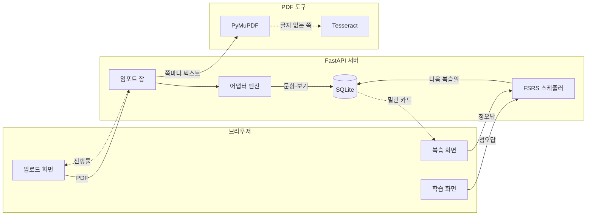

## 화면

### 홈

**이미지** https://wzaqtubtqwpddouevwbk.supabase.co/storage/v1/object/public/project-media/examply/demo-1.png
**설명** PDF에서 뽑은 725문항을 세션 하나로 묶고 푼 위치를 남깁니다

### 업로드

**이미지** https://wzaqtubtqwpddouevwbk.supabase.co/storage/v1/object/public/project-media/examply/demo-2.png
**설명** PDF를 올리고 세션 이름만 붙이면 준비가 끝납니다

### 문제 풀이

**이미지** https://wzaqtubtqwpddouevwbk.supabase.co/storage/v1/object/public/project-media/examply/demo-3.png
**설명** 한 문제와 보기 네 개만 보여 줍니다

### 채점

**이미지** https://wzaqtubtqwpddouevwbk.supabase.co/storage/v1/object/public/project-media/examply/demo-4.png
**설명** 내가 고른 보기는 빨강, 정답은 초록으로 함께 표시합니다

### 복습

**이미지** https://wzaqtubtqwpddouevwbk.supabase.co/storage/v1/object/public/project-media/examply/demo-5.png
**설명** 오늘 밀린 분량과 오답·북마크·건너뛴 문제를 세션별로 모읍니다

### 복습 채점

**이미지** https://wzaqtubtqwpddouevwbk.supabase.co/storage/v1/object/public/project-media/examply/demo-6.png
**설명** 이 문제를 다음에 언제 다시 볼지 바로 알려 줍니다

## 인터뷰

**소개** 자격증 덤프 PDF를 올리면 문항과 보기, 정답을 뽑아 한 문제씩 풀게 해 주고, 틀린 문제는 망각 곡선에 맞춰 다시 물어보는 웹앱이에요
**계기** 자격증 덤프는 PDF로만 있어서 폰으로 보려면 확대해야 하고, 어디까지 봤는지도 알 수가 없었어요. 마침 OCR도 궁금해서 파이프라인을 직접 만들어 봤습니다
**사용자** 덤프 PDF로 자격증을 준비하는 사람이요. 저 혼자 쓰려고 만든 도구예요

## 구상

- PDF를 올리면 문항이 자동으로 뽑힌다
- 한 문제씩 카드로 풀고 바로 정답을 본다
- 어디까지 풀었는지 남아서 다음에 이어 푼다
- 틀린 문제와 북마크한 문제만 모아 다시 푼다
- 스캔본 PDF도 OCR로 읽는다

## 유저 플로우

### PDF 문제집을 올린다

파일을 끌어다 놓으면 이름과 크기만 확인해요.

### 세션 이름을 붙이고 분석을 시작한다

목록에서는 이 문제집이 이 이름으로 나옵니다.

**갈라짐** 잠긴 PDF → 비밀번호를 넣고 다시 / 안 잠긴 PDF → 바로 추출

### 앞에서부터 한 문제씩 푼다

보기를 고르고 제출하면 그 화면에서 바로 채점돼요. 숫자키와 Enter만으로 끝까지 풀 수 있습니다.

**갈라짐** 맞았다 → 다음 문제 / 틀렸다 → 정답을 보고 다음 문제 / 지금 안 풀겠다 → 건너뛰기

### 다음에 들어와 밀린 복습부터 한다

홈에 "복습 3"처럼 표시되고, 누르면 오늘 풀 문제만 큐로 나옵니다.

### 복습에서 같은 문제를 다시 푼다

맞히면 다음 복습까지 간격이 늘어나고, 틀리면 다음에 열 때 맨 앞에 다시 나옵니다.

## 구조

### 임포트 잡

업로드된 PDF 하나를 텍스트 추출부터 저장까지 처리하고, 그동안 진행률과 단계 문구를 계속 갱신합니다. 화면은 2초마다 이 잡의 상태를 조회해요.

### 어댑터 엔진

문제집 형식마다 다른 규칙을 파일로 두고, 텍스트에 가장 잘 맞는 어댑터를 점수로 골라 문항과 보기, 정답으로 나눕니다.

### FSRS 스케줄러

문제를 맞혔는지 틀렸는지만 받아서 그 문제의 안정성과 난이도를 갱신하고 다음 복습일을 돌려줍니다. 카드는 세션과 문제의 조합마다 한 장씩 둡니다.

### 복습 화면

밀린 카드를 큐로 받아 하나씩 보여 줍니다. 한 번 앉아서 푸는 동안 같은 문제가 두 번 나오지 않도록, 이번에 푼 문제 번호를 기억해 뒀다가 다음 요청에 함께 보내요.

## 개발 과정

### 1. 푸는 화면부터 만들었어요

처음에는 파서를 어떻게 만들지보다 화면이 궁금했어요. FastAPI에 문제·세션·시도 모델을 만들고 더미 문제를 넣어서 푸는 화면부터 만들었습니다. PDF를 아직 붙이지 않았는데도 한 문제씩 넘겨 보니 만들 맛이 났어요.

**붙인 것** FastAPI, Next.js, SQLModel

### 2. 업로드를 붙이고 텍스트부터 뽑았어요

PDF를 올리면 서버가 받아서 쪽마다 글자를 뽑게 했어요. 처음부터 OCR을 돌릴 생각은 없었습니다. 글자층이 있는 PDF는 PyMuPDF로 읽고, 글자가 거의 안 나오는 쪽만 Tesseract로 넘겼어요. 덤프처럼 글자층이 있는 파일은 OCR을 아예 거치지 않아서 훨씬 빨랐습니다.

**붙인 것** PyMuPDF, Tesseract

### 3. 문제집마다 다른 번호 형식을 규칙 파일로 뺐어요

문제집마다 번호를 매기는 방식이 달라요. "1.", "문제 1)", "Q1" 같은 식이에요. 이 규칙을 파서 안에 계속 넣다 보니 문제집이 하나 늘 때마다 파서를 고쳐야 했어요. 그래서 규칙을 바깥 파일로 빼고, 텍스트에 어느 규칙이 가장 잘 맞는지 점수로 고르게 바꿨습니다. ExamTopics 덤프는 형식이 아주 일정해서 전용 규칙을 따로 하나 뒀어요.

### 4. 잠긴 PDF에서 한 번 막혔어요

받아 둔 덤프 중에 열람 암호가 걸린 파일이 있었어요. 비밀번호를 입력받아 임시 파일로 풀고, 작업이 끝나면 그 임시 파일을 덮어쓴 뒤 지우게 했습니다. 비밀번호는 어디에도 저장하지 않고 그 요청 안에서만 써요.

### 5. 세션을 넣어 이어 풀게 했어요

문제만 쌓아 두니 어디까지 봤는지 알 수 없었어요. 그래서 업로드 한 건이 학습 세션 하나가 되게 하고, 세션에 현재 문제 번호를 저장했습니다. 이때부터 화면 구성이 목록 → 세션 → 문제로 정리됐어요.

로그인은 끝까지 넣지 않았어요. 혼자 쓰는 도구인데 계정을 붙이면 만들 게 두 배로 늘거든요. 그래서 진도는 계정이 아니라 세션에 저장합니다.

### 6. 화면에서 장식을 뺐어요

카드가 여기저기 흩어져 있고 그라디언트와 색 점, 설명문까지 붙어 있어서 문제가 잘 안 읽혔어요. 홈을 세로 한 줄로 다시 구성하고 장식을 모두 뺐습니다. 그러다 화면에 있던 북마크, 건너뛰기, 단축키 안내가 아무 기능에도 연결돼 있지 않다는 걸 알았어요. 눌러도 아무 일도 일어나지 않는 버튼이었습니다. 지울지 연결할지 정해야 했는데, 연결하기로 했어요.

### 7. 한 번 풀고 끝나는 앱으로는 부족했어요

앞에서 뒤까지 한 번 풀고 나면 그걸로 끝이었어요. 푼 문제는 다시 나오지 않으니 사흘 뒤에는 기억나지 않았고요. 그래서 문제마다 다음 복습일을 담은 카드를 두고, 정오답을 넣으면 다음 날짜를 돌려주는 스케줄러를 붙였습니다. SM-2도 고민했지만 Anki도 옮겨 간 FSRS를 골랐어요. 파이썬 구현이 있어서 직접 구현할 양이 오히려 적었고, 필수 의존성이 하나뿐이라 서버가 무거워지지도 않았습니다.

**붙인 것** FSRS

### 8. 난이도를 매번 묻지 않기로 했어요

FSRS는 원래 사용자가 "쉬움/보통/어려움"을 직접 누르는 걸 전제로 합니다. 그런데 Examply는 객관식이라 맞았는지 틀렸는지를 앱이 이미 알아요. 그래서 정답이면 Good, 오답이면 Again을 자동으로 넣고 버튼을 없앴습니다. 직접 조절하고 싶은 사람을 위해 "어려웠음" 하나만 선택 사항으로 남겼어요.

### 9. 어디에든 올릴 수 있게 컨테이너로 묶었어요

로컬에서만 돌리기는 아까워서 백엔드를 컨테이너 하나로 띄울 수 있게 정리했어요. 어디에 올릴지는 아직 정하지 않았지만, 정하면 바로 올릴 수 있는 상태입니다.

**붙인 것** Docker

## 시행착오

### 정답 문자와 보기 기호가 달라 정답이 안 붙었어요

**증상** 725문항이 모두 들어왔는데 정답이 붙은 문항이 하나도 없었어요. 화면에서는 어떤 보기를 골라도 채점되지 않았습니다.

**시도** 정답을 찾는 규칙(`Answer: A`)은 제대로 동작했어요. 오류는 그다음 단계에서 났습니다.

**결론** 규칙이 뽑아 주는 값은 `A` 인데 보기 기호 목록에는 `A.`, `B.` 처럼 점이 붙어 있어서, 목록에서 찾지 못하고 정답이 비어 있었습니다. 기호에서 문장부호를 떼고 비교하게 고치니 725문항 중 627문항에 정답이 붙었어요.

### 틀린 문제가 1분 뒤에 다시 나왔어요

**증상** 복습을 붙이자 틀린 문제가 바로 1분 뒤로 예약됐어요. 오래 앉아서 푸는 사람에게는 맞는 동작이지만, 출퇴근길에 5분 쓰는 사람에게는 방금 틀린 문제가 곧바로 또 나왔습니다.

**시도** 아예 일 단위로만 돌릴까 생각했어요. 그러면 틀린 문제도 최소 하루 뒤에 나옵니다.

**결론** 시뮬레이션을 돌려 보니 하루에 한 번 여는 사람에게는 두 방식의 결과가 똑같았어요. 밀린 카드는 사라지지 않고 다음에 열 때 큐 맨 앞에 있기 때문입니다. 오히려 하루를 넘겨 맞히면 FSRS가 안정성을 훨씬 크게 올려 줘요(1.89 대 0.25). 그래서 학습 단계를 10분 하나로 줄이고, 한 번 앉아서 푸는 동안 방금 푼 문제를 큐에서 빼기로 했습니다.

### 잠긴 PDF 검사 코드가 두 벌로 남았어요

**증상** 암호가 걸린 PDF를 올리면 어떤 경로로 들어오느냐에 따라 메시지가 달랐어요.

**시도** 처음에는 pikepdf로 암호화 여부를 확인하고 임시로 푸는 코드를 따로 만들었습니다. 그런데 업로드를 받는 쪽에도 PyMuPDF로 확인하는 검사가 들어 있었어요.

**결론** 의존성 목록에 pikepdf가 없어서 그쪽은 "모듈 없음"으로 처리되고, 실제 판정은 전부 PyMuPDF가 하고 있었습니다. 에러도 경고도 없이 한쪽만 실행되는 상태였어요. 지금도 검사가 두 벌 남아 있어서 한쪽으로 합쳐야 합니다.
