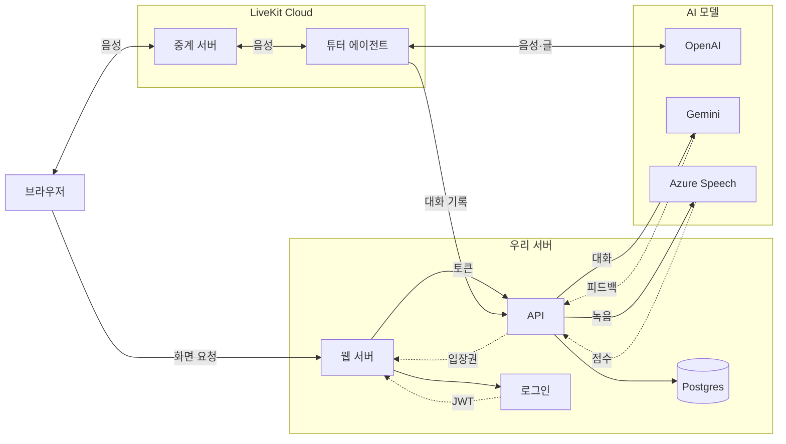

## 화면

### 오늘

**파일** ./screens/01-home.png
**설명** 오늘 할 통화와 복습, 장면 공부를 한눈에 보여 줍니다

### 수신 전화

**파일** ./screens/02-incoming.png
**설명** 정한 시간이 되면 튜터가 먼저 전화를 걸어 옵니다

### 통화

**파일** ./screens/03-call.png
**설명** 튜터와 말을 주고받으며 오늘의 미션 표현을 써 봅니다

### 통화 피드백

**파일** ./screens/04-feedback.png
**설명** 통화에서 고친 문장과 잘 쓴 표현을 정리합니다

### 말로 복습

**파일** ./screens/05-review.png
**설명** 한국어 상황을 보고 표현을 말로 꺼냅니다

### 장면 공부

**파일** ./screens/06-scene.png
**설명** 짧은 장면을 듣고 한 줄씩 따라 말합니다

### 꾸미기

**파일** ./screens/07-shop.png
**설명** 공부로 모은 깃털로 부엉이를 꾸밉니다

### 소개

**파일** ./screens/08-intro.png
**설명** 전화를 받고 복습하기까지의 하루를 스크롤로 따라갑니다

## 데이터와 API

### LiveKit

**용도** 브라우저와 튜터 에이전트 사이의 실시간 음성을 잇는다
**방식** WebRTC · 호스팅
**링크** https://docs.livekit.io/agents/
**비용** 클라우드 요금이 분당 $0.01이라 통화 원가를 크게 늘린다. 통화량이 늘면 직접 운영을 검토한다

### OpenAI

**용도** 통화의 받아쓰기, 튜터 답변, 목소리를 맡는다
**방식** 실시간 전사 · 스트리밍
**링크** https://developers.openai.com/api/docs/guides/speech-to-text
**고른 기준** gpt-4o-transcribe만 틀린 문장 8개를 고치지 않고 그대로 받아썼다
**주의** 지금 쓰는 TTS는 2027-01-06, STT는 2027-02-26에 종료된다

### Gemini

**용도** 통화 피드백, 복습 판정, 복습 상황, 장면 대본을 만든다
**방식** REST · 구조화 출력
**링크** https://ai.google.dev/gemini-api/docs/structured-output
**대체** 끝내 실패하면 OpenAI로 한 번 더 보낸다

### Azure AI Speech

**용도** 따라 말한 문장을 단어와 음소 단위로 채점한다
**방식** 짧은 음성 REST
**링크** https://learn.microsoft.com/en-us/azure/ai-services/speech-service/how-to-pronunciation-assessment
**아이콘** Microsoft Azure
**절약** 과금이 오디오 길이 기준이라 앞뒤 무음을 잘라서 보낸다

### Supabase Auth

**용도** 이메일과 구글 로그인을 맡고, 운영 Postgres도 여기에 둔다
**방식** JWT · API에서 검증
**링크** https://supabase.com/docs/guides/auth

### Resend

**용도** 가입 확인과 비밀번호 재설정 메일을 보낸다
**방식** SMTP
**링크** https://resend.com/docs

### VOA Learning English

**용도** 관용구 시리즈 1,706편에서 표현 사전 후보를 뽑는다
**방식** 글 수집 · LLM 추출
**갱신** 수동 실행
**링크** https://learningenglish.voanews.com/
**주의** 2025년 3월 이후 새 글이 없어 아카이브로만 쓴다

### PHRASE · PHaVE List

**용도** 말하기에서 흔한 덩어리 표현과 구동사의 후보와 빈도를 정한다
**방식** 연구용 목록
**갱신** 수동 실행
**링크** https://www.norbertschmitt.co.uk/vocabulary-resources
**주의** 오픈 라이선스가 아니라 원본 목록은 레포에 넣지 않는다

### American English

**용도** 미국 국무부 학습 자료에서 관용구 48개를 더한다
**방식** PDF 추출
**갱신** 수동 실행
**링크** https://americanenglish.state.gov

## 인터뷰

**소개** 정한 시간이 되면 AI 튜터가 먼저 전화를 걸어오는 영어 말하기 앱이에요. 전화를 받아 5분 떠들고 끊으면 고친 문장과 복습할 표현이 정리돼 있고, 그걸 말로 다시 꺼내면 하루 공부가 끝납니다.
**계기** 전화영어는 비싸고 시간 맞추기가 어려워요. AI 회화 앱은 편한데 대화가 끝나면 남는 게 없고요. 어떤 표현을 틀렸는지, 뭘 다시 봐야 하는지가 다 흩어지더라고요.
**계기** 드라마 섀도잉처럼 좋은 공부법도 스크립트 준비에 엑셀 정리, 복습 관리까지 손으로 하다 보니 오래 못 갔어요.
**이름** fellow와 owl을 붙였어요. 매일 수다 떠는 영어 친구라는 뜻이고, 그래서 마스코트도 부엉이입니다.
**사용자** 지금은 주로 저 혼자 써요. 말하기가 약한 성인 중급 학습자이고, 책상에 앉아 PC Chrome으로 공부합니다.
**비용** 2026년 10월에 틀린 문장을 섞어 시험해 보니 통화 1분에 모델값이 약 $0.016 들었어요. 여기에 LiveKit Cloud 요금이 분당 $0.01쯤 붙습니다.
**배운 것** 자연스러운 전화 경험을 주는 게 생각보다 어려웠어요. 말이 끊겼을 때 사용자가 생각 중인지 다 말한 건지 알 수가 없으니까, 튜터가 자꾸 끼어들더라고요.

## 구상

- 정한 시간이 되면 튜터가 먼저 전화를 걸어온다
- 통화를 끊으면 요약과 더 자연스러운 표현이 정리돼 있다
- 정리된 표현을 말로 다시 꺼내야 하루가 끝난다
- 적어 둔 표현을 다음 통화에서 써 본다
- 장면을 따라 말하면서 다음 통화를 준비한다

## 유저 플로우

### 전화 시간을 정한다

처음 들어오면 전화 받을 시간과 요일부터 골라요. 이어서 표현 뜻을 맞히는 짧은 테스트로 레벨을 정합니다.

**갈라짐** 테스트를 본다 → 결과에 맞는 레벨로 / 건너뛴다 → B1로

### 전화를 받는다

정한 시간이 되면 앱 위로 수신 화면이 뜨고 벨이 울려요. 오늘 써 볼 표현도 같이 보입니다.

**갈라짐** 받는다 → 통화 시작 / 거절한다 → 10분 뒤 다시 / 오늘은 쉰다 → 연속 학습 보호권 사용

### 5분 동안 떠든다

튜터와 번갈아 말하면서 오늘의 미션 표현을 써 봐요. 생각할 시간이 필요하면 "잠깐만요"를 누르고, 다 말하면 스페이스 키로 차례를 넘깁니다.

### 고친 문장을 확인한다

끊자마자 방금 통화를 돌아보는 화면이 뜨고, 곧 피드백이 도착해요. 고친 문장을 듣고 따라 말하면 단어별로 채점됩니다. 마음에 드는 표현은 표현 노트에 담아요.

### 말로 복습한다

한국어 상황을 보고 표현을 말로 꺼내요. 눈으로 보고 넘기는 카드가 아니라, 소리 내서 말해야 넘어갑니다.

**갈라짐** 복습이 남았다 → 다음 문제 / 다 끝냈다 → 하루 완주

### 장면을 따라 말한다

선택 단계예요. 시트콤 같은 짧은 장면을 듣고 한 줄씩 따라 하면서 원어민 억양 곡선과 내 곡선을 겹쳐 봅니다.

## 구조

### 브라우저

화면을 그리고 마이크 소리를 보내고 튜터 목소리를 틀어요. 오브와 음량 막대는 실제 오디오 값으로 움직이고, 억양 곡선도 브라우저가 소리에서 직접 뽑습니다.

### 웹 서버

로그인 세션을 쿠키로 관리하고, 로그인 토큰을 붙여 API를 불러요. DB는 직접 읽지 않습니다.

### API

표현, 복습, 통화, 장면, 스트릭의 규칙을 전부 들고 있고 Postgres를 읽고 쓰는 유일한 곳이에요. LLM과 발음 채점도 여기서 부르고, 사용자별·서비스 전체 하루 한도를 셉니다.

### 튜터 에이전트

통화 내내 붙어 있는 프로세스예요. 받아쓰기, 답변, 목소리를 이어 주고, 말 차례를 판단하고, 대화와 사용량을 API에 기록합니다.

### AI 모델

통화 중에는 OpenAI가 모든 턴을 맡아요. Gemini는 통화 뒤 피드백처럼 시간 여유가 있는 일을, Azure는 따라 말하기 채점을 맡습니다.

## 개발 과정

### 1. 혼자 쓸 거니까 화면부터 만들었어요

처음엔 정말 저 혼자 쓸 생각이었어요. 그래서 로그인도 결제도 빼고, 데이터는 SQLite 파일 하나에 넣었습니다. 대신 화면은 공들였어요. 공부하는 화면을 녹화해서 유튜브 학습 영상도 찍어 볼 생각이라 보기 좋아야 했거든요. 디자인 시안과 토큰, 공통 컴포넌트를 먼저 만들고 표현 노트, 복습, 통화, 장면 순서로 하나씩 조립했습니다.

통화도 처음엔 브라우저에 있는 음성 인식과 TTS로 붙였어요.

**붙인 것** Next.js, SQLite, Gemini

### 2. 브라우저 음성으로는 공부가 안 됐어요

브라우저 음성 인식은 한국인 억양에 약하고, 무엇보다 제 문법 실수를 고쳐서 받아써 버렸어요. 틀린 문장이 받아쓰기에서 사라지면 통화 뒤 피드백에서 고쳐 줄 게 없어집니다. 그래서 틀린 문장 8개로 받아쓰기 API들을 시험했는데, gpt-4o-transcribe 하나만 원문 그대로 받아썼어요.

음성을 넣으면 음성이 나오는 API도 저울질했어요. 10분 통화로 따져 보니 받아쓰기, LLM, TTS를 잇는 쪽이 약 $0.125, 음성 API는 $0.5를 넘더라고요. 통화 원가를 낮추는 게 제일 중요해서 잇는 구조로 갔고, 말 끝 감지와 끼어들기가 들어 있는 LiveKit Agents를 붙였습니다. 나중에 음성 API를 한 번 더 시험했을 때도 교정이 지나쳐서 이 결정은 유지했어요.

**붙인 것** LiveKit, OpenAI

### 3. 혼자 쓰는 도구에서 서비스로 마음을 바꿨어요

만들다 보니 다른 사람도 쓸 수 있는 물건으로 키우고 싶어졌어요. 앱까지 생각하니 API 서버와 로그인이 필요했고, 에이전트가 Python이니 백엔드도 Python으로 맞췄습니다. 한 번에 갈아엎지 않고 도메인 단위로 옮겼는데, 처음 정한 순서대로 하면 한 번의 쓰기가 SQLite와 Postgres에 걸치는 곳이 생겨서 중간에 순서를 바꿨어요. 묶여 있는 도메인은 같이 옮기는 식으로요.

배포는 API를 AWS Lambda에 올리려다 하루 만에 접었어요. 에이전트는 통화 내내 붙어 있어야 해서 Lambda에 못 올리고, 응답 뒤 작업도 보장되지 않거든요. 응답 뒤에 만들던 피드백은 화면과 에이전트 중 먼저 요청한 쪽이 맡아서 끝까지 만들도록 바꿨습니다. 그렇게 웹과 API는 Vercel, 에이전트는 LiveKit Cloud로 정리됐어요.

**붙인 것** FastAPI, PostgreSQL, Supabase, Vercel

### 4. 어떤 소리가 틀렸는지 짚어 주고 싶었어요

채점은 단어 단위로 시작했어요. 그런데 말하기를 고치려면 단어 점수로는 부족해서, "think의 th가 s처럼 들렸어요"까지 짚을 수 있는 음소 단위 발음 평가를 붙였습니다. 억양은 내 곡선의 높낮이 폭만 재다가, 원어민 음성 곡선과 모양을 맞대 보는 쪽으로 바꿨어요. 이건 브라우저에서 계산하니 추가 비용이 없습니다.

쓰다 보니 듣는 쪽도 손볼 게 많았어요. 말하는 중에 내 곡선을 실시간으로 보여 주고, 녹음 직후 내 목소리를 다시 들려주고, 키보드로 입력하는 칸은 없앴습니다. 말하기 앱이니 말로만 하게요.

**붙인 것** Azure AI Speech

### 5. 콘텐츠를 LLM에게 맡겼다가 도로 사람이 읽었어요

매일 새 표현을 추천하려면 사전이 필요했어요. 처음엔 Gemini에게 만들게 했는데 믿을 수가 없어서, 검증된 목록을 후보로 쓰는 쪽으로 돌아섰습니다. 장면도 비슷했어요. 안 쓴 관용구를 골라 시트콤 대본을 쓰게 하는 데까지는 자동이지만, 관용구를 잘못 쓴 대사가 나와서 전부 다시 읽고 고쳤습니다.

음성은 캐릭터마다 전용 목소리로 다시 녹음하고, 받아쓰기로 48줄이 대사와 일치하는지 확인했어요. 캐릭터 그림은 동물로 시작했다가 몸 모양과 눈으로 성격을 보여 주는 단색 덩어리 캐릭터로 바꿨습니다.

**붙인 것** VOA Learning English, PHRASE List

### 6. 쓰다 보니 많이 빼게 되더라고요

표현 노트가 뭘 하는 곳인지 제가 봐도 바로 안 보였어요. 교정, 튜터 표현, 추천 표현이 알아서 쌓이고, 복습도 세 군데로 나뉘어 있었거든요. 그래서 노트는 내가 담은 것만 두고, 복습은 한 곳으로 모으고, 처음 구상에 있던 직접 추가는 뺐습니다.

피드백을 기다리는 30초도 고쳤어요. LLM 없이 받아쓰기만으로 말한 문장 수와 제일 길게 말한 문장을 먼저 보여 주니까 기다리는 시간이 통화를 돌아보는 시간이 됐습니다. 통화 한도도 요금제 설계에 맞춰 10분에서 하루 5분으로 줄였어요.

### 7. 남에게 보여 주려니 돈과 장애가 걱정됐어요

지인에게 보여 줄 준비를 하면서 전체를 점검했어요. 받아쓰기처럼 한도 없이 돈이 나가던 기능에 한도를 걸고, 서비스 전체 하루 상한을 뒀습니다. Gemini가 막히면 OpenAI로 넘기고, 모델이 다 실패하면 침묵 대신 미리 만든 사과 한마디가 나오게 했어요.

DB 변경 없이 코드가 먼저 배포돼 로그인한 사용자에게 500이 난 적도 있어요. 그 뒤로 운영 DB가 뒤처지면 상태 확인이 503을 돌려주고, 새 마이그레이션을 만들면 테스트가 확인하게 했습니다.

**붙인 것** Sentry, GitHub Actions, Resend

## 시행착오

### 튜터가 자꾸 말을 끊어요 — 끼어들기를 다듬다가 껐어요

**증상** 영어로 말하다 단어를 고르느라 멈추면 튜터가 다 말한 줄 알고 답을 시작했어요. 반대로 책상 소음이나 기침에 튜터 말이 끊기기도 했고요. 끊긴 튜터 말은 들리지도 않은 부분까지 기록에 남았습니다.

**시도** 먼저 문장이 덜 끝난 것 같으면 5초까지 기다리게 했는데, 튜터 말에 끼어든 턴은 늘 덜 끝난 걸로 판단돼서 5초 정적이 생겼어요. 운영에서 재 보고 2.5초로 줄였습니다. 그다음엔 끊긴 말을 말한 시간으로 어림해 지우고, 소리 모델에 판단을 맡겼어요. 그런데 이 모델은 길이 조건 없이 끊어서, 소리 1초 이상에 받아쓴 단어 3개 이상일 때만 끊기게 바꿨습니다. 그래도 소음과 울림이 남았어요.

**결론** 문턱값을 고쳐서 풀 문제가 아니었어요. 멈춘 사람이 생각 중인지 다 말한 건지는 소리만으로 알 수가 없습니다. 그래서 끼어들기를 끄고 번갈아 말하게 한 뒤, 내 말 끝은 최대 8초까지 기다리게 했어요. 그래도 더 생각하고 싶을 때가 있어서 차례를 직접 붙잡는 "잠깐만요" 버튼과, 15초 뒤 저절로 풀리는 안전장치를 넣었습니다. 이때 튜터가 말하는 중에 차례를 넘기면 SDK가 내 차례를 버리고 튜터가 답을 멈추는 문제도 나와서, 실제 세션으로 도는 테스트를 추가했어요. 판단을 모델에서 사용자에게 넘겼어요.

### 표현 사전의 뜻이 틀려요 — LLM이 만든 553개를 버렸어요

**증상** Gemini로 만들고 다른 프롬프트로 검사한 첫 사전 553개를 사람 눈으로 다시 보니 틀린 게 나왔어요. 독립 검수에서만 97개를 고치고 30개를 지웠고, pay through the nose가 "바가지"로 잘못 적혀 있기도 했습니다.

**시도** 프롬프트에 구어체 예문과 제외 기준을 더하고 검사를 강화했어요. 그래도 LLM이 고른 표현이 실제로 쓰이는 말인지는 보장할 근거가 없어서, 생성 스크립트와 매일 사전을 늘리는 루틴을 통째로 지웠습니다. VOA 관용구, PHRASE와 PHaVE 목록, 국무부 자료로 후보를 바꿔 1,832개를 채웠어요.

**결론** 무엇을 넣을지는 검증된 출처가 정하고 LLM은 뜻과 예문만 쓰게 했어요. 그런데도 한 줄씩 전수 검수를 하니 468개를 고치고 144개를 뺐고, 2차에서 33개를 더 빼 1,617개가 됐습니다. 출처를 바꿔도 LLM이 쓴 설명은 읽어 봐야 한다는 걸 배웠어요.

### 스크롤에 맞춘 화면이 정신없어요 — 소개 페이지를 하루 만에 일곱 번 뒤집었어요

**증상** 소개 페이지의 "하루 이야기"는 오른쪽 화면을 고정하고 스크롤에 따라 장면을 바꾸는 구성이었어요. 그럴듯해 보였는데, 막상 내려 보면 화면이 다 그려지기 전에 넘어가서 내용을 읽을 수가 없었습니다.

**시도** 단계를 7개에서 5개로 줄이고, 간격을 늘리고, 전환 방식을 카드 넘기기로 바꿨어요. 스크롤의 80%는 아무것도 안 움직이게 고정해 보기도 했습니다. 고정을 빼고 스크롤한 만큼 화면 속이 그려지게도 해 봤는데, 이것도 몇 시간 못 가 걷어 냈어요.

**결론** 스크롤과 그림을 묶는 걸 포기했어요. 화면은 다 그린 상태로 펼쳐 두고, 첫 화면 하나만 보이는 자리에 오면 전화를 받아 통화로 넘어갑니다. 화려한 전환보다 읽을 시간이 먼저였어요.

### 목소리 모델이 종료돼요 — 후보를 다 시험했는데 아직 못 바꿨어요

**증상** 통화 목소리로 쓰는 gpt-4o-mini-tts가 2027년 1월에 종료된다는 메일이 왔어요. 공식 대체 모델은 발표되지 않았습니다.

**시도** 첫소리가 0.27초로 빠른 Inworld를 들어 보니 한국 지명을 어색하게 읽었어요. realtime 모델을 TTS로만 쓰면 교정 문장을 통째로 빼먹거나 지시를 대답으로 받았고요. 음성 그대로 통화하는 구조로 바꿔 시험하니 원가가 올라가고 매 턴 대놓고 고치려 들었습니다. Gemini TTS는 유료 등급인데도 분당 10건에서 막혔어요. 받아쓰기는 문법 실수를 그대로 남기는지가 기준이었다면, 목소리는 한국 고유명사를 읽는지와 원문을 빠짐없이 읽는지가 기준이 됐습니다.

**결론** 아직 끝나지 않은 문제예요. 지금은 구조는 그대로 두고 TTS만 바꾸는 쪽으로 기울어 있습니다. 2026년 11월 재측정에선 Inworld TTS 2.0 Flash가 첫소리 0.25초에 Haeundae와 Jiwoo를 맞게 읽었는데, 받아쓰기로 확인한 결과라 귀로 다시 들어 봐야 해요.

## 남은 것

- 전화는 앱 탭이 열려 있어야 울려요. 실제 전화망이 아니라 브라우저 안에서 울리는 수신 화면이라서요.
- 폰으로는 전화를 못 받아요. 지금은 PC Chrome에서만 쓸 수 있어서 폰으로 열면 PC 안내 화면이 뜹니다.
- 튜터가 말하는 중에는 끊을 수 없어요. 소음에 끊기지 않게 끼어들기를 끈 대가입니다.
- 내가 아는 표현을 직접 등록할 수 없어요. 피드백과 장면에서 담는 것만 되고, 영한 뜻을 받아 올 무료 공개 사전이 없어 뒤로 미뤘습니다.
- 장면이 6개뿐이에요. 다 보고 나면 새 장면 없이 지금 장면에 머뭅니다.
- 통화 중 발음은 채점하지 않아요. 음소 채점은 고친 문장과 장면을 따라 말할 때만 돕니다.
