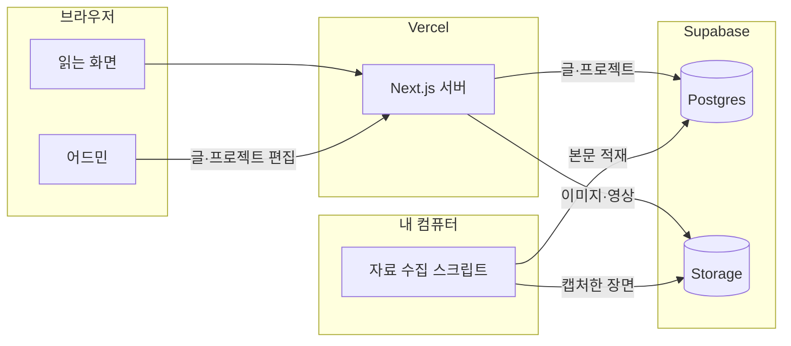

## 화면

### 홈

**이미지** https://wzaqtubtqwpddouevwbk.supabase.co/storage/v1/object/public/project-media/hynu-blog/demo-1.png
**설명** 최근 글을 카테고리·태그와 함께 한 줄씩 보여 줍니다

### 글 상세

**이미지** https://wzaqtubtqwpddouevwbk.supabase.co/storage/v1/object/public/project-media/hynu-blog/demo-2.png
**설명** 커버 사진 위에 제목을 얹고, 목차는 본문을 따라옵니다

### 아카이브

**이미지** https://wzaqtubtqwpddouevwbk.supabase.co/storage/v1/object/public/project-media/hynu-blog/demo-3.png
**설명** 모든 글을 모아 두고 카테고리로 좁혀 봅니다

### 실험실

**이미지** https://wzaqtubtqwpddouevwbk.supabase.co/storage/v1/object/public/project-media/hynu-blog/demo-4.png
**설명** 만든 프로젝트를 화면 표본처럼 네 장씩 늘어놓습니다

### 프로젝트 상세

**이미지** https://wzaqtubtqwpddouevwbk.supabase.co/storage/v1/object/public/project-media/hynu-blog/demo-5.png
**설명** 원고 한 편을 섹션마다 전용 화면으로 보여 줍니다

### 글 관리

**이미지** https://wzaqtubtqwpddouevwbk.supabase.co/storage/v1/object/public/project-media/hynu-blog/demo-6.png
**설명** 작성중인 글을 위에 두고 상태별로 봅니다

### 에디터

**이미지** https://wzaqtubtqwpddouevwbk.supabase.co/storage/v1/object/public/project-media/hynu-blog/demo-7.png
**설명** 왼쪽에 마크다운을, 오른쪽에 발행 화면과 같은 미리보기를 띄웁니다

### 실험실 관리

**이미지** https://wzaqtubtqwpddouevwbk.supabase.co/storage/v1/object/public/project-media/hynu-blog/demo-8.png
**설명** 발행 전의 프로젝트를 숨겨 두고 미리 봅니다

### 통계

**이미지** https://wzaqtubtqwpddouevwbk.supabase.co/storage/v1/object/public/project-media/hynu-blog/demo-9.png
**설명** 글별 조회수를 세어 어떤 글이 읽히는지 봅니다

## 데이터와 API

### Supabase

**용도** 글·프로젝트·조회수와 업로드한 이미지·영상을 저장한다
**방식** Postgres · REST
**갱신** 자동
**링크** https://supabase.com/docs
**주의** 무료 플랜은 일정 기간 요청이 없으면 프로젝트를 일시 중지한다. 그래서 GitHub Actions로 주기적으로 요청을 보낸다

### YouTube

**용도** 영상 글을 쓸 때 소제목마다 해당 장면을 캡처해 본문에 넣는다
**방식** yt-dlp · ffmpeg
**아이콘** YouTube
**링크** https://github.com/yt-dlp/yt-dlp
**주의** 같은 영상을 구간별로 여러 번 받으면 속도 제한에 걸린다. 그래서 낮은 화질로 전체를 한 번만 받고 프레임은 로컬에서 뽑는다

### Vercel Analytics

**용도** 유입 경로와 접속 기기, 화면이 뜨는 속도를 본다
**방식** 스크립트 삽입
**갱신** 자동
**링크** https://vercel.com/docs/analytics
**주의** 글별 조회수는 여기서 보지 않고 직접 센다. 여기서는 유입 경로와 Core Web Vitals만 본다

## 인터뷰

**소개** 제가 보고 읽은 것을 요약해 모아 두는 개인 기록 블로그예요. 읽는 화면부터 어드민, 에디터, 통계까지 필요한 기능을 직접 만들었습니다
**계기** 처음에는 그냥 기록용 블로그를 갖고 싶었어요. 그런데 기존 블로그 플랫폼은 대부분 커뮤니티 기능이라 저한테는 필요가 없었습니다. 쓰지 않을 기능에 화면을 맞추느니, 원하는 기능을 원하는 대로 붙일 수 있는 사이트를 직접 만드는 게 낫겠다고 생각했어요
**사용자** 글은 저 혼자 쓰고, 읽는 사람은 검색으로 들어옵니다
**배운 것** 글의 일관성은 코드가 아니라 규약 문서에서 나왔어요. 제목·문단·인용을 어떻게 쓸지 `POSTING.md` 한 장에 정해 두니 편마다 달랐던 문체가 맞춰졌습니다. 지금도 코드보다 이 문서를 더 자주 고쳐요
**지금** 지금도 계속 글을 쓰고 사이트를 고치고 있습니다

## 구상

- 디자인 시안 아홉 장을 실제로 동작하는 화면으로 옮긴다
- 글을 DB에 저장하고 어드민에서 쓰고 고친다
- 영상과 문서에서 인용할 자료와 장면을 모으는 일을 자동화한다
- RSS, 사이트맵, OG 이미지를 자동으로 만든다
- 검색과 방문자 통계를 붙인다
- 글을 영어로 자동 번역해 `/en` 으로도 낸다

## 유저 플로우

### 읽다가 링크를 붙여 넣는다

영상이든 글이든 남겨 두고 싶은 것이 보이면 주소만 복사해 둡니다.

**갈라짐** 폰이나 태블릿 → 어드민 화면 / 노트북 앞 → 바로 에디터

### 인용할 자료를 뽑는다

영상이면 소제목마다 그 시점의 장면을, 문서면 인용할 부분을 미리 모아 둡니다.

### 에디터에서 쓴다

왼쪽에서 마크다운을 고치면 오른쪽 미리보기가 발행 화면과 똑같이 바뀝니다.

**갈라짐** 한 번에 끝난다 → 제목·태그만 다듬는다 / 더 손볼 게 남았다 → 작성중으로 두고 다시 온다

### 발행한다

카테고리와 작성일을 정하고 발행합니다.

## 구조

### 어드민

글과 프로젝트를 쓰고 고치는 화면입니다. 왼쪽에 마크다운을, 오른쪽에 발행 화면과 같은 미리보기를 띄웁니다.

### Next.js 서버

읽는 화면을 렌더링하고, 어드민에서 편집한 내용을 DB와 Storage에 저장합니다.

### Postgres

글, 프로젝트, 카테고리, 조회수를 저장합니다. 화면이 읽는 테이블과 스크립트가 적재하는 테이블이 같아요.

### 자료 수집 스크립트

제 컴퓨터에서 실행하는 CLI입니다. 영상에서 장면을 뽑아 Storage에 올리고, 정리한 원고를 DB에 적재해요. 외부에서 들어오는 접속은 받지 않고 Supabase로 나가는 연결만 씁니다.

## 개발 과정

### 1. 화면부터 아홉 장 만들었어요

디자인 시안 아홉 장을 먼저 정하고, 그걸 Next.js로 그대로 옮기는 일부터 했습니다. 데이터는 전부 파일에 직접 적은 가짜였어요. 어차피 나중에 바꿀 데이터라, 초반에는 화면 모양만 확정하고 싶었습니다.

**붙인 것** Next.js, Tailwind CSS

### 2. 가짜 데이터를 DB로 바꿨어요

글 하나를 고치려고 매번 다시 배포하는 건 말이 안 됐어요. 파일 기반으로 갈까 고민했지만, 폰에서도 글을 쓰고 싶어질 게 뻔해서 데이터를 서버에 두기로 했습니다. 이때 어드민을 만들었고, 마크다운 본문과 이미지 업로드, 카테고리 트리를 차례로 붙였어요.

**붙인 것** Supabase, Vercel

### 3. 오래 걸리는 작업을 화면에서 분리했어요

영상에서 장면을 뽑고 이미지를 받아 다시 올리는 등, 글에 넣을 자료를 모으는 일은 한 번에 몇 분씩 걸렸어요. 처음에는 어드민이 요청을 받아 바로 처리하게 했는데, 그동안 화면이 멈췄고 응답 시간 제한에도 걸렸습니다.

그래서 어드민은 작업 큐에 한 줄 적기만 하고, 제 컴퓨터에서 도는 워커가 그 줄을 가져가 처리하도록 나눴습니다. 폰에서는 요청만 하고 화면을 닫아도 되고, 워커는 밖으로 나가는 접속만 쓰니 포트를 열 필요도 없었어요. 작업 상태는 같은 테이블에 기록되니 어드민은 목록에서 진행중 표시만 보면 됐습니다.

### 4. 글이 쌓여서 찾아 읽는 기능을 붙였어요

스무 편쯤 넘어가니 제가 쓴 글도 못 찾겠더라고요. 검색, 태그, 시리즈, 연관 글 추천을 붙이고 글별 조회수도 직접 세기 시작했습니다. 이 무렵 영어 자동 번역과 `/en` 라우팅도 만들었는데, 관리할 것이 두 배로 늘어서 화면 노출만 빼고 코드는 남겨 뒀어요.

회원가입, 좋아요, 댓글은 붙이지 않았습니다. 읽고 가는 사이트라 거기까지는 만들지 않기로 했고, 기존 블로그 플랫폼을 쓰지 않은 이유도 그 기능들이었어요.

### 5. 글쓰기 규약을 문서 한 장으로 정했어요

편마다 문체가 달랐어요. 어떤 편은 개조식이고 어떤 편은 번역투였고, 소제목을 나누는 위치도 그때그때 달랐습니다. 제목, 문단 길이, 인용 표기, 이미지 배치를 감으로 정했기 때문이에요. 그래서 규약을 전부 `POSTING.md` 한 장으로 옮기고 글을 쓸 때마다 그 문서를 기준으로 삼았습니다. 적재 스크립트도 같은 문서를 근거로 슬러그와 메타 정보를 검사하게 했어요. 지금은 코드보다 이 문서를 훨씬 자주 고칩니다.

### 6. 실험실을 포트폴리오 화면으로 다시 만들었어요

원래 실험실은 프로젝트 카드 몇 장이 전부였어요. 다른 레포에서 만든 프로젝트를 여기에 모으려니 매번 상세 화면을 새로 만들어야 했습니다. 그래서 원고의 `##` 제목에 따라 렌더러가 정해지도록 규약을 만들었어요. `## 화면`이면 폰 목업 갤러리, `## 구조`면 다이어그램 밴드, `## 시행착오`면 스크롤에 따라 펼쳐지는 카드로 나옵니다. 원고만 넘기면 화면이 자동으로 만들어져서, 프로젝트를 하나 더 올리는 일이 마크다운 한 장 쓰는 일이 됐어요.

### 7. 마지막에 검색 노출과 계측을 붙였어요

만들어 놓고 아무도 안 들어오면 의미가 없어서, 사이트맵과 구조화 데이터, canonical을 정리하고 서치콘솔에 등록했습니다. 태그 표기가 대소문자와 공백 때문에 여러 개로 나뉘어 있던 것도 이때 하나로 합치고, 옛 주소는 301로 넘겼어요.

**붙인 것** Vercel, GitHub Actions

## 시행착오

### 본문 그림을 이미지로 만들다가 되돌린 일

**증상** 단계 카드나 수치 카드 같은 정보 그림을 다이어그램과 별도로 본문에 넣고 싶었는데, 마크다운으로는 표현할 방법이 없었어요.

**시도** 카드를 HTML/CSS로 만들어 두고, 글을 저장할 때 Playwright로 그 화면을 열어 PNG로 만든 뒤 이미지 주소로 바꿨습니다. 처음에는 잘 동작했는데 확대하면 글씨가 흐렸어요. 다크 모드로 바꿔도 카드만 밝게 남았고, 폰에서는 넓은 카드가 그대로 줄어들어 읽을 수 없었습니다. 카드 스타일을 한 줄 고칠 때마다 이미 발행한 글의 그림을 전부 다시 만들어야 하는 문제도 있었어요.

**결론** 이미지로 만들 필요가 없었어요. 본문 렌더러가 이미 mermaid 블록을 컴포넌트로 그리고 있어서, 카드도 같은 곳에서 React 컴포넌트로 그리면 됐습니다. PNG를 만드는 파이프라인과 Playwright 의존성, 렌더 전용 라우트를 전부 제거했어요. 지금은 카드 스타일을 고치면 예전 글의 카드도 같이 바뀝니다.

### 커버 사진 위 제목이 안 보이던 일

**증상** 글 상세 맨 위에 커버 사진을 깔고 그 위에 제목을 얹었는데, 사진에 따라 제목을 아예 읽을 수 없었어요.

**시도** 제목을 흰 글씨로 고정하니 밝은 사진에서 보이지 않았습니다. 그래서 사진 위에 어두운 막을 한 겹 깔았더니, 이번에는 원래 어두운 사진이 전부 시커멓게 뭉개졌어요. 막의 농도를 중간쯤으로 맞춰 봤지만 밝은 사진과 어두운 사진에 모두 맞는 값은 없었습니다.

**결론** 화면에서 판단하지 않고 업로드할 때 밝기를 재 두기로 했어요. 이미지를 올릴 때 sharp로 평균 휘도를 구해 글과 함께 저장합니다. 이 값이 기준을 넘으면 글씨를 어둡게 하고 막을 없애고, 넘지 않으면 흰 글씨에 막을 씌웁니다. 판단은 한 번만 하고, 화면은 저장된 값을 읽어 쓰기만 해요.

### 한글 슬러그가 404 나던 일

**증상** 제목을 그대로 주소로 만들었더니 어떤 글은 열리고 어떤 글은 404가 났어요. 어드민 목록에는 정상으로 나왔습니다.

**시도** 라우팅 설정과 대소문자를 먼저 의심했습니다. 그런데 같은 주소도 어떤 경로로 여느냐에 따라 결과가 달랐어요. 주소에 한글이 들어가면서 인코딩된 형태가 곳곳에서 달라졌기 때문이었습니다.

**결론** 보기 좋은 주소보다 깨지지 않는 주소를 우선해, 주소에 한글을 아예 넣지 않기로 했어요. 슬러그를 만들 때 ASCII만 남기고, 적재 스크립트는 ASCII가 아닌 슬러그를 거부합니다. 제목 규약에도 같이 적어 뒀어요.

### 영상 장면 캡처가 자꾸 끊기던 일

**증상** 영상 글을 쓸 때 소제목마다 그 시점의 장면을 넣으려고 했는데, 몇 장 뽑다 보면 다운로드가 멈췄어요.

**시도** 영상 전체를 받는 건 낭비 같아서 필요한 시점 앞뒤 몇 초씩만 골라 받게 만들었습니다. 소제목이 여덟 개면 여덟 번 받는 방식이에요. 그런데 짧은 시간에 같은 영상을 여러 번 요청하니 속도 제한에 걸려 뒤쪽 구간은 아예 받지 못했어요. 간격을 두고 천천히 받게도 해 봤지만, 이번에는 캡처 한 번에 몇 분씩 걸렸습니다.

**결론** 용량이 아니라 요청 횟수가 원인이었어요. 프레임 몇 장만 뽑으면 되니 화질이 좋을 필요도 없었고요. 그래서 가장 낮은 화질로 영상 전체를 한 번만 받고 프레임은 로컬에서 뽑게 바꿨더니, 요청이 한 번으로 줄어 끊기지 않았습니다.
