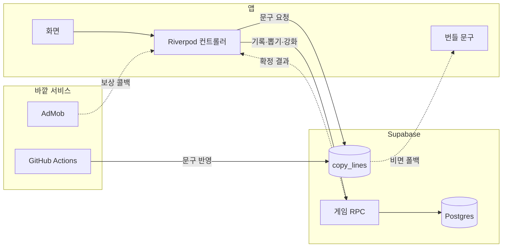

## 화면

### 홈

**이미지** https://wzaqtubtqwpddouevwbk.supabase.co/storage/v1/object/public/project-media/luckypicky/demo-1.png
**설명** 선행을 적을 때마다 클로버에 잎이 하나씩 붙습니다

### 선행 기록

**이미지** https://wzaqtubtqwpddouevwbk.supabase.co/storage/v1/object/public/project-media/luckypicky/demo-2.png
**설명** 오늘 한 선행을 한 줄로 적습니다

### 클로버 완성

**영상** https://wzaqtubtqwpddouevwbk.supabase.co/storage/v1/object/public/project-media/luckypicky/demo-3.mp4
**설명** 잎 네 장을 채우면 클로버가 상단 배지로 날아갑니다

### 행운 뽑기

**이미지** https://wzaqtubtqwpddouevwbk.supabase.co/storage/v1/object/public/project-media/luckypicky/demo-4.png
**설명** 코인 하나로 캡슐 머신을 돌립니다

### 행운지수

**이미지** https://wzaqtubtqwpddouevwbk.supabase.co/storage/v1/object/public/project-media/luckypicky/demo-5.png
**설명** 왕복하는 게이지를 탭해 오늘 점수를 정합니다

### 행운지수 결과

**이미지** https://wzaqtubtqwpddouevwbk.supabase.co/storage/v1/object/public/project-media/luckypicky/demo-6.png
**설명** 잡은 점수와 오늘의 색·숫자·아이템을 한 장에 보여 줍니다

### 보관함

**이미지** https://wzaqtubtqwpddouevwbk.supabase.co/storage/v1/object/public/project-media/luckypicky/demo-7.png
**설명** 뽑은 행운권을 등급별로 모아 둡니다

### 재료 고르기

**이미지** https://wzaqtubtqwpddouevwbk.supabase.co/storage/v1/object/public/project-media/luckypicky/demo-8.png
**설명** 재료로 쓸 카드를 직접 골라 성공 확률을 올립니다

### 강화 연출

**영상** https://wzaqtubtqwpddouevwbk.supabase.co/storage/v1/object/public/project-media/luckypicky/demo-9.mp4
**설명** 재료가 빨려 들어가고 게이지가 한 바퀴 돌면 성패가 갈립니다

### 나의 기록

**이미지** https://wzaqtubtqwpddouevwbk.supabase.co/storage/v1/object/public/project-media/luckypicky/demo-10.png
**설명** 선행한 날을 달력에 색으로 표시합니다

## 데이터와 API

### Supabase

**용도** 재화·카드·기록을 서버에 저장하고 앱은 결과만 받는다
**방식** Postgres RPC · 익명 로그인
**갱신** 호출할 때마다
**링크** https://supabase.com/docs/guides/database/functions
**게임 규칙** 잎 적립, 클로버 완성, 뽑기, 강화, 재조합을 모두 서버 함수에서 처리하고 앱은 결과만 받습니다.
**문구 배달** 홈 문구와 행운지수 문구도 서버에서 받아요. 서버 문구가 비어 있거나 장애가 나면 앱에 실린 문구를 씁니다.
**주의** 익명 로그인 세션은 기기에 저장된다. 기기를 바꾸면 새 계정이 되어서 복구 코드를 따로 만들었다

### Google AdMob

**용도** 광고를 보면 뽑기용 코인을 하루 다섯 개까지 받는다
**방식** 보상형 · 전면
**갱신** 실 광고 단위
**링크** https://developers.google.com/admob/flutter/quick-start
**지급 경로** 대시보드에 적는 리워드 수량은 표시용이에요. 클라이언트가 재화를 스스로 만들지 못하게, 실제 지급은 앱이 서버에 요청해서 합니다.
**iOS** 구글이 공식으로 안내하는 광고 네트워크 목록을 그대로 넣었고, 추적 동의 창은 첫 화면이 뜬 뒤에 띄워요.

## 인터뷰

**소개** "선행"이라는 재화로 "운"을 사는 어플입니다.
**계기** 평소에 업보라는 걸 자주 생각했어요. 카르마라고도 해요. 야구선수 오타니도 자기 덕을 위해 쓰레기를 줍는다고 알려져 있고요. 제가 좋아하는 롤 프로팀 T1 의 팬 문화도 비슷해요. 롤드컵 기간이 되면 팬들이 일부러 착한 일을 하고 인증을 올립니다. 내 선행이 조금이라도 응원하는 팀에 보탬이 되길 바라면서요.
**계기** 그러다 생각이 들더라고요. 운이라는 게 정말 문득 찾아오기만 하는 걸까, 그렇게 수동적인 걸까. 능동적으로 얻을 수는 없을까. 그러다 네잎클로버가 떠올랐고, 선행을 쌓아 스스로 운을 만드는 서비스로 만들어 봤어요.

## 구상

- 선행을 한 줄 적으면 잎이 하나 붙고, 잎이 4개가 모이면 클로버가 완성된다
- 완성된 클로버로 소원권을 만든다
- 지난 기록을 달력에서 한눈에 본다

## 유저 플로우

### 오늘 한 선행을 한 줄 적는다

홈 한가운데 있는 클로버에 잎이 하나 붙어요.

### 잎 네 장을 채운다

네 장째를 적으면 클로버가 완성되어 상단 배지로 날아갑니다.

**갈라짐** 온라인 → 비행 연출 뒤 숫자가 오른다 / 오프라인 → 연출이 아예 재생되지 않는다

### 뽑기 탭에서 캡슐 머신을 돌린다

코인 한 개로 행운권 한 장이 나와요.

**갈라짐** 코인이 있다 → 바로 돌린다 / 없다 → 광고를 보고 코인을 받는다

### 보관함에서 카드를 재조합하거나 강화한다

같은 등급 카드 세 장을 재료로 재조합하거나, 여러 장을 재료로 넣어 한 장을 강화합니다.

**갈라짐** 성공 → 카드가 뒤집히며 등급이 오른다 / 실패 → 화면이 흔들리고 재료만 사라진다

### 운세 탭에서 오늘의 행운지수를 잡는다

왕복하는 게이지를 탭한 순간의 값이 오늘 점수가 돼요.

## 구조

### 화면

다섯 개 탭과 연출만 그린다. 재화를 직접 계산하지 않고 컨트롤러가 준 숫자를 그대로 보여 준다.

### Riverpod 컨트롤러

앱의 모든 상태 변경을 메서드 다섯 개로 처리한다. 메서드마다 서버 RPC 하나와 짝을 이룬다.

### 게임 RPC

잎 적립, 클로버 완성, 뽑기, 강화, 재조합, 복구 코드 이관을 처리한다. 앱 권한으로는 이 함수들을 거치지 않고 데이터를 바꿀 수 없다.

### copy_lines

홈 문구와 행운지수 문구를 면·언어·등급 단위로 저장한다. 앱은 켜질 때 한 번 받아 두고, 못 받으면 번들 문구를 쓴다.

### 번들 문구

앱에 같이 실려 배포되는 폴백 문구다. 서버 문구를 받지 못한 곳에 그대로 쓴다.

## 개발 과정

### 1. 착한 일을 적으면 잎이 붙는 화면부터

처음엔 화면 세 개를 만들었어요. 한 줄 적으면 잎이 하나 붙고 네 장이 되면 클로버가 되는 데까지예요. 목업을 먼저 만들고 그대로 옮겼는데, 이때 규칙을 하나 세웠습니다. **Material 기본 모양은 하나도 쓰지 않는다.** 기본 AppBar, 잉크 리플, 보라색 시드 컬러가 하나라도 남아 있으면 "플러터로 만든 티"가 나거든요. 버튼과 카드는 `Container` 로 직접 그리고, 색·그림자·자간은 목업 값을 그대로 옮겨 적었어요.

작업 PC 가 윈도우라 화면 확인은 전부 안드로이드 에뮬레이터에서 했어요. iOS 는 코드만 맞춰 두고 빌드 검증은 못 했습니다.

### 2. 소원권을 빼고 캡슐 머신을 넣었어요

처음 메인 기능은 소원권이었어요. 선행 하나에 잎 하나, 네 번이면 클로버가 완성되고 그 클로버로 소원권을 만들었습니다. 그런데 만들고 보니 **소원 문구를 사용자가 직접 써야 했어요.** 쓰는 게 부담인 데다 다 쓰고 나면 그걸로 끝이라 재미가 없었어요.

그래서 클로버를 코인처럼 쓰기로 했습니다. 클로버 하나를 넣고 캡슐 머신을 돌려 행운권을 랜덤으로 뽑는 방식이에요. 무엇이 나올지 모르는 재미가 생기면서 매일 열어 볼 이유가 됐어요.

### 3. 재화를 전부 서버로 옮겼어요

로컬에만 저장할 때는 앱을 지우면 모은 게 전부 사라졌어요. 뽑기까지 붙이고 나니 더 미룰 수 없었습니다. 클라이언트가 재화를 계산하면 마음만 먹으면 얼마든지 늘릴 수 있기도 하고요.

Supabase 로 옮기면서 **앱이 테이블에 직접 쓰지 못하게** 막았어요. 잎 적립, 뽑기, 강화 모두 `security definer` 함수 안에서만 일어나고 앱은 결과 JSON 만 받습니다. 테스트용으로 같은 규칙을 구현한 로컬 백엔드도 하나 더 뒀어요. 규칙을 고칠 때는 SQL 과 그 파일을 항상 같이 고칩니다.

**붙인 것** Supabase

### 4. 강화·재조합은 피파에서 가져왔어요

뽑기만 있으면 카드가 쌓이기만 하고 쓸 곳이 없어요. 중복 카드도 계속 나오고요. 그래서 피파 게임에서 선수 카드를 재료로 써서 등급을 올리는 방식을 그대로 가져왔습니다. 같은 등급 세 장을 재료로 다시 뽑는 재조합과, 여러 장을 재료로 넣어 한 장의 등급을 올리는 강화 두 가지예요.

처음엔 카드 상세 아래에 바텀시트로 붙였어요. 공간이 좁아 재료를 고르기 답답했고, 무엇을 재료로 쓰는지도 잘 보이지 않았어요. 그래서 전용 화면으로 옮겨 지갑에서 카드를 직접 고르게 바꿨습니다. 강화는 대상과 재료를 차례로 고르는 두 단계, 재조합은 재료 세 장을 고르는 한 단계예요.

연출도 이때 많이 고쳤어요. 재료 카드가 중앙으로 빨려 들어가고 게이지가 찹니다. 성공하면 카드가 뒤집히고 실패하면 화면이 흔들려요. 이 과정에서 결과가 미리 보이는 문제로 한참 고생했는데, 그 얘기는 아래 시행착오에 적었어요.

### 5. 운을 잡는 감각을 화면에 넣고 싶었어요

이 서비스의 모토는 "운은 찾아오는 게 아니라 찾아가는 것"이에요. 그런데 앱 안에 그걸 직접 느낄 수 있는 부분이 없었어요. 선행을 적어도 뽑기를 돌려도 결과는 서버가 정했거든요.

그래서 운세 탭에 타이밍 게임을 넣었어요. 게이지가 0에서 100 사이를 왕복하고, **탭한 순간의 값이 그대로 오늘의 행운지수**가 됩니다. 오늘의 운을 자기 손으로 정하게 돼요. 표시되는 값에 커브를 적용해 90 점대 구간은 아주 빠르게 지나가게 했어요. 그래야 100 을 잡는 재미가 있거든요.

### 6. 코인과 클로버를 나눴어요

광고 규칙을 손보다 보니 재화 모델이 계속 맞지 않았어요. 클로버 하나가 곧 뽑기 한 번이면 선행으로 만든 클로버와 광고로 받은 클로버를 구분할 수 없어요. 그러면 통계에서부터 "선행으로 운을 만든다"는 전제가 맞지 않게 됩니다.

그래서 재화를 둘로 나눴어요. 뽑기에는 **광고로만 들어오는 코인**을 쓰고, 선행으로 만든 클로버는 커스텀 행운권 제작과 강화에만 씁니다. 클로버는 여전히 선행으로만 생기고 통계에도 클로버만 쌓여요. 사용자가 문구를 직접 써서 만드는 커스텀 행운권도 이때 추가했습니다.

**붙인 것** Google AdMob

### 7. 문구를 앱 밖으로 뺐어요

문구를 고칠 때마다 스토어 심사를 기다릴 수는 없었어요. 그래서 문구를 Supabase 테이블에서 받아 오고, 못 받으면 앱에 실린 문구를 쓰게 했습니다. 폴백 단위를 `(면, 언어, 등급)` 조합별로 잘게 나눠서 한 면씩 천천히 서버로 옮겨도 안전하게 했어요.

그다음에 문구 원본을 어디에 둘지 한 번 바꿨는데, 그 얘기도 시행착오에 적었습니다.

언어는 한국어, 영어, 일본어까지만 열었어요. 중국어는 간체와 번체가 나뉘는 데다 본토 스토어는 심사와 퍼블리셔가 따로라, 혼자 부담할 운영 비용이 아니어서 뺐습니다.

**붙인 것** GitHub Actions

### 8. 기기를 바꾸면 모은 게 사라진다는 걸 뒤늦게 알았어요

익명 로그인은 세션을 기기에 저장해요. 웹에서는 localStorage 에 저장하고요. 그래서 다른 기기에서 열면 **새 계정이 되어 모은 게 전부 사라진 것처럼 보입니다.** 소셜 로그인을 붙이는 게 정석이지만 심사와 약관까지 따라오는 일이라 복구 코드를 먼저 만들었어요.

계정마다 "명란한 참치마요", "오붓한 스파게티" 같은 "형용사 + 뜬금없는 명사" 조합의 코드를 발급해 둡니다. 새 기기에서 이 코드를 넣으면 옛 계정의 재화·카드·기록이 현재 세션으로 넘어와요. 세션은 그대로 두고 서버에서 데이터만 옮기기 때문에 로그인 구조를 바꾸지 않아도 모은 걸 잃지 않습니다.

## 시행착오

### 광고를 어디에 붙일지 세 번 바꿨어요

**증상** 처음엔 광고를 보면 뽑기를 한 번 돌릴 수 있는 "무료 뽑기"를 뒀어요. 그러면 뽑기로 가는 경로가 클로버를 쓰는 길과 광고를 보는 길, 두 개가 되어서 클로버가 곧 뽑기 코인이라는 모델과 맞지 않았어요.

**시도** 먼저 클로버가 완성되는 순간에 전면 광고를 넣었어요. 사용자 기분이 가장 좋을 때니 여기서 광고를 보여 주자고 생각했는데, 완성 연출을 만들고 보니 정반대였습니다. 클로버가 배지로 날아가 숫자가 오르는 순간에 광고가 화면을 덮으면 선행의 보상이 광고가 되어 버렸어요. 그래서 전면 광고를 다시 뺐습니다.

**결론** 광고는 **재화를 얻는 순간이 아니라 쓰는 순간**에만 두기로 했어요. 무료 뽑기를 없애고, 광고를 보면 코인이 하루 다섯 개까지 들어오게 바꿨습니다. 뽑기에는 언제나 코인 한 개를 써요. 얻는 경로가 하나로 정리되어 재화 모델도 단순해졌어요.

### 강화 결과가 연출 전에 보였어요

**증상** 재조합 카드가 뒤집히기 전에 결과가 보였어요. 게이지가 차는 동안 이미 무슨 카드인지 알 수 있어서 뒤집는 연출이 의미가 없었어요.

**시도** 처음엔 카드 텍스트가 비쳐 보인다고 판단했어요. 회전 각도가 0에서 파이로 튀면서 앞면이 한 프레임 스친다고 보고, 결과 단계 전까지 각도를 파이로 고정했습니다. 텍스트는 안 보이게 됐지만 결과는 여전히 미리 보였어요.

**결론** 원인은 색이었어요. 카드 테두리 강조색이 등급에 따라 바뀌어서 **글자를 가려도 색만 보면 등급을 알 수 있었습니다.** 뒤집기 전까지는 중립색을 쓰게 바꾸고, 뒷면 문양도 거울처럼 뒤집히지 않게 역회전을 걸었어요. 실패했을 때 흔들리는 대상도 카드에서 화면 전체로 바꿨고요.

### 서버가 규칙 위반으로 거절하면 안내 없이 화면이 닫혔어요

**증상** 재료를 골라 강화 버튼을 눌렀을 때 서버가 규칙 위반으로 거절하면 화면이 그냥 지갑으로 돌아가 있었어요. 왜 안 됐는지 안내도 없었고, 골라 둔 카드 선택도 사라졌어요.

**시도** 처음엔 토스트 문구만 붙였습니다. 이유는 알 수 있게 됐지만 선택은 여전히 사라졌어요. 실행 함수가 성공과 실패를 구분하지 않고 무조건 화면을 닫고 있었거든요.

**결론** 실행 함수가 `bool` 을 돌려주게 고쳤어요. **서버 호출이 성공해 연출까지 뜬 경우에만 true 를 돌려주고, 그때만 화면을 닫습니다.** 연결 오류든 규칙 거절이든 나머지 경우에는 선택을 그대로 유지해요. 예측값이 실제와 다르면 화면이 틀린 값을 보여 주게 되어서, 게이지가 차는 비율도 클라이언트 예측값 대신 서버가 준 값을 쓰게 바꿨습니다.

### 문구 원본을 서버에 뒀다가 dart 파일로 옮겼어요

**증상** 처음엔 Supabase `copy_lines` 테이블을 원본으로 뒀어요. 문구를 고치려면 대시보드에서 행을 편집했고요. 그랬더니 누가 언제 무슨 문구를 왜 바꿨는지 아무 데도 남지 않았어요. 리뷰도 할 수 없고, 잘못 넣으면 되돌릴 방법도 없었습니다.

**시도** 만료일 컬럼을 붙여 관리하려고 했어요. 유행어 행은 만료일 없이 넣지 못하게 막고, 만료일이 지나면 자동으로 안 나오게요. 자동 만료는 됐지만 어떤 문구가 왜 들어왔는지는 여전히 남지 않았습니다.

**결론** 원본을 dart 파일로 되돌렸어요. 문구 변경은 git 에 남고 PR 에서 리뷰하며, main 에 머지되면 GitHub Actions 가 서버로 통째로 올립니다. **부분 갱신이 아니라 통째로 교체해야 했어요.** 부분만 갱신하면 dart 에서 지운 문구가 서버에 남아 계속 나오거든요. 유저는 앱 업데이트 없이 새 문구를 보고, 문구 이력은 코드와 같은 곳에 쌓입니다.

이 파이프라인은 원래 "밈은 두세 달이면 낡으니 매달 새로 조사한다"는 전제로 만들었어요. 나중에 앱 전체에서 유행어를 빼기로 하면서 그 전제가 없어졌습니다. 담백한 속담풍 문구로 가면 매달 갱신할 이유가 없어요. 그래서 문구를 배포하는 경로는 그대로 쓰고 월간 리서치만 멈췄습니다.

### 웹에서 스플래시가 안 끝나는 줄 알았어요

**증상** 웹으로 빌드해서 열었더니 스플래시에서 넘어가지 않았어요. 코드를 아무리 봐도 초기화가 안 끝날 이유가 없었고요.

**시도** 한동안은 웹 빌드 자체가 안 되는 줄 잘못 알고 있었어요. 광고 라이브러리가 모바일 전용이라 웹 컴파일이 안 된다고 적어 두고 넘어갔는데, 나중에 다시 해 보니 `flutter build web` 이 정상적으로 성공했어요. 광고 컨트롤러에 모바일이 아니면 건너뛰는 가드가 이미 있었습니다.

**결론** 무한 로딩의 원인은 **서비스 워커가 캐시해 둔 옛 빌드**였어요. 재배포해도 브라우저가 캐시된 옛 산출물을 계속 띄웠고, 코드는 처음부터 정상이었습니다. `--pwa-strategy=none` 으로 빌드하거나 캐시 헤더를 막으면 해결됩니다. 원인을 두 번 잘못 짚어서 기억에 남아요.

### 에뮬레이터에서 아무것도 안 눌렸어요

**증상** 앱이 뜨긴 하는데 어디를 탭해도 눌리지 않았어요. 자동화 스크립트로 좌표를 찍어도, 손으로 눌러도 반응이 없었어요.

**시도** 터치 이벤트를 가로채는 위젯이 있는지부터 봤어요. `dumpsys` 로 포커스를 확인하니 앱을 가리키고 있어서, 앱 안쪽 문제라고 보고 오버레이 위젯을 하나씩 확인했습니다. 원인은 나오지 않았어요.

**결론** 화면을 직접 캡처해 보니 **"시스템 UI가 응답하지 않음" 다이얼로그**가 앱 위에 떠서 터치를 전부 막고 있었어요. 이때도 포커스 정보는 앱을 가리켜서 믿을 수 없었습니다. 오래된 스냅샷에서 복원한 에뮬레이터 상태가 원인이라 그 뒤로는 콜드 부트로 띄웁니다. 소프트웨어 렌더링으로 돌리면 이 PC 에서는 오히려 더 자주 나타나서 그 옵션은 쓰지 않아요.

## 남은 것

- 웹으로 공개하면 재화 균형이 맞지 않아요. 웹에는 광고가 없어서 보상이 광고 없이 바로 지급되거든요. 막을 방법을 먼저 만들어야 합니다.
- 소셜 로그인이 없어요. 복구 코드로 당장의 문제는 막았지만 Google·Apple 계정 연동을 붙여야 합니다.
- 월간 문구 리서치 루틴이 멈춰 있어요. 유행어를 뺀 뒤로 매달 갱신할 이유가 없어져서, 다시 돌릴지는 아직 안 정했습니다.
