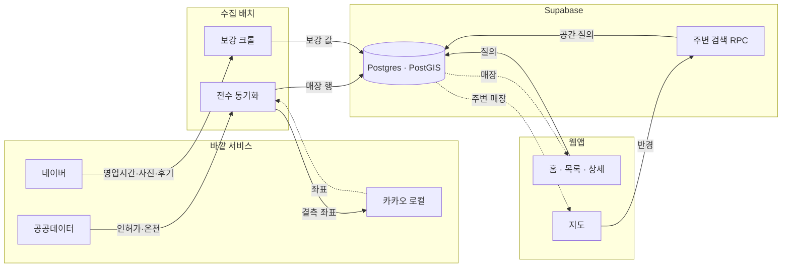

## 화면

### 홈

**이미지** https://wzaqtubtqwpddouevwbk.supabase.co/storage/v1/object/public/project-media/saunau/demo-1.png
**설명** 주변, 테마, 종류별로 매장을 찾아 들어가는 화면입니다

### 지도

**이미지** https://wzaqtubtqwpddouevwbk.supabase.co/storage/v1/object/public/project-media/saunau/demo-2.png
**설명** 매장을 지역별 개수로 묶어 보여 주고 칩으로 종류를 거릅니다

### 매장 상세

**이미지** https://wzaqtubtqwpddouevwbk.supabase.co/storage/v1/object/public/project-media/saunau/demo-3.png
**설명** 영업시간, 요금표, 후기, 메모를 한 화면에서 봅니다

### 읽을거리

**이미지** https://wzaqtubtqwpddouevwbk.supabase.co/storage/v1/object/public/project-media/saunau/demo-4.png
**설명** 사우나 문화와 이용법을 다룬 글을 모아 둡니다

## 데이터와 API

### 목욕장업 인허가 (공공데이터)

**용도** 전국 목욕탕 목록의 바탕 데이터다. 영업 중인 곳만 걸러 담는다
**방식** REST · 전수 스캔
**갱신** 매일 자동
**링크** https://apis.data.go.kr/1741000/public_baths/info
**주의** 한 번에 100건씩만 받을 수 있어 전국을 다 받는 데 시간이 걸린다. 좌표가 비어 있는 곳이 1.3% 있다

### 온천표준데이터 (공공데이터)

**용도** 실제 온천으로 인증된 곳을 구분해 표시한다
**방식** REST · 전국 18곳
**갱신** 매일 자동
**링크** https://api.data.go.kr/openapi/tn_pubr_public_hot_spring_api

### 네이버 검색 API

**용도** 매장별 블로그 후기를 모으고 인허가 데이터에 없는 세신샵과 효소찜질을 찾는다
**방식** REST · 키워드 질의
**갱신** 수동 실행
**링크** https://openapi.naver.com/v1/search/blog.json
**주의** 무료 사용량은 하루 25,000콜이다. 후기처럼 보이는 업소 목록 사이트가 섞여 들어와 따로 걸러낸다

### 네이버 플레이스

**용도** 영업시간, 요금표, 업체가 올린 사진을 채운다
**방식** 비공식 · 페이지 수집
**갱신** 수동 실행
**아이콘** Naver
**링크** https://map.naver.com
**주의** 요청 간격이 조금만 짧아도 차단된다. 페이지 구조가 바뀌면 그 값을 비워 두고 나머지 수집은 계속한다

### 네이버 지도

**용도** 지도 화면의 바탕 지도로 쓴다. 마커, 후기, 사진은 우리 데이터로 그린다
**방식** 클라이언트 SDK
**아이콘** Naver
**링크** https://www.ncloud.com/product/applicationService/maps
**주의** 콘솔에 서비스 주소를 등록해야 키가 동작한다. 없으면 지도 대신 안내 문구가 뜬다

### Google Places API — 중단

**용도** 업체 사진이 없는 매장에 대신 보여 줄 이미지를 받았다. 지금은 새로 받지 않는다
**방식** REST · 중단
**아이콘** Google Maps
**링크** https://developers.google.com/maps/documentation/places/web-service
**주의** 무료 한도가 항목별 월 단위라 금방 넘고, 업주가 올린 사진인지 구분할 수 없어 중단했다. 이미 받은 1,700여 장만 남겨 뒀다

### Google Cloud Vision

**용도** 사용자가 올린 사진을 공개 전에 자동으로 거른다
**방식** REST · 업로드 때 한 번
**아이콘** Google Cloud
**링크** https://cloud.google.com/vision/docs/detecting-safe-search
**주의** 호출이 실패하면 통과시키지 않고 거부한다. 운영자가 상주하지 않는 서비스라 막는 쪽을 택했다

### 카카오 로컬

**용도** 좌표가 비어 있는 주소에 좌표를 채워 지도에 표시한다
**방식** REST · 결측 행에만
**아이콘** Kakao
**링크** https://dapi.kakao.com/v2/local/search/address.json
**주의** 키가 없으면 이 단계만 건너뛰고 나머지 수집은 계속한다

### Claude Code

**용도** 매장 소개문을 작성한다
**방식** 로컬에서 실행
**아이콘** Claude
**링크** https://docs.claude.com/en/docs/claude-code/overview
**주의** 영업시간, 가격 같은 사실 항목은 쓰지 못하게 막았다. 지어낸 값이 원본 데이터를 덮어쓰면 바로잡을 수 없다

## 인터뷰

**소개** 전국 목욕탕, 찜질방, 온천, 세신샵 6천여 곳을 지도와 목록으로 보여 주는 모바일 웹앱이에요. 위치를 켜면 주변 매장이 거리순으로 나오고, 칩 하나로 "24시 찜질방"이나 "세신샵"만 남길 수 있습니다

**문제** 동네 목욕탕은 후기가 아예 없고, 어쩌다 있어도 사우나실 온도나 냉탕, 세신 얘기는 없어요. 상호에 목욕탕이라는 낱말이 없어 지도 검색에 안 나오는 곳도 있습니다
**계기** 제 주변 목욕탕과 검색으로는 안 나오는 숨은 목욕탕을 후기까지 같이 보고 싶었어요. 그런 서비스가 한국에는 없더라고요
**사용자** 요즘 들어 젊은 2030 세대들도 사우나에 관심을 갖기 시작했더라고요. 인스타에 사우나 전문 채널도 팔로워가 많고, 젊은층을 겨냥한 사우나 관련 스타트업도 나오고 있고요.
**벤치마크** 일본의 사우나이키타이예요(https://sauna-ikitai.com/). 사우나를 온도와 시설 기준으로 정리해 두는 방식을 참고했어요

## 구상

- 위치 기반(지도)으로 나와 가까운 사우나를 찾는다
- 공공데이터로 전국 매장을 넣어 검색에 안 나오던 곳까지 보여 준다
- 사우나 온도(충분히 뜨거운가), 냉탕 온도(충분히 차가운가) 데이터 적재
- 사용자 후기가 없는 콜드 스타트 시점은 블로그들의 후기를 가져와서 보완한다

## 유저 플로우

### 홈을 연다

카테고리 카드와 테마 큐레이션을 보여 줘요. 찾는 게 분명하면 보지 않고 바로 넘어갑니다.

**갈라짐** 위치로 찾는다 → 지도 / 조건으로 찾는다 → 목록·필터 / 이름을 안다 → 검색

### 조건으로 좁힌다

지도에서는 상단 칩으로 목욕탕, 찜질방, 온천, 세신샵, 효소를 켜고, 화면을 옮기면 "이 지역 다시 검색"이 떠요. 목록에서는 필터 시트로 온도 범위와 24시 여부까지 고를 수 있습니다.

### 매장 상세를 본다

온도, 영업시간, 요금표, 사진, 후기, 위치를 한 화면에서 봐요. 여기서 갈지 말지 정합니다.

**갈라짐** 가볼 만하다 → 찜 / 정보가 부족하다 → 블로그 후기 원문으로 나감

### 다녀와서 남긴다

찜한 곳은 찜 탭에 모이고, 다녀온 곳은 마이의 기록 탭에 메모로 남아요. 로그인해 두면 기기를 바꿔도 그대로 볼 수 있습니다.

## 구조

### 전수 동기화

목욕장업 인허가와 온천 데이터를 전부 받아 영업 상태로 거르고, 상호와 업태, 주소에서 유형을 추론합니다. 좌표가 빠진 행만 카카오 로컬로 채워요. 초기 적재 스크립트와 Cron이 같은 러너를 씁니다.

### 보강 크롤

영업시간, 요금표, 편의시설, 업체 사진, 블로그 후기, 세신샵, 효소찜질을 따로 수집합니다. 앱이 실행될 때는 돌지 않아요. 전부 수동으로 실행하고 결과만 DB에 남깁니다.

### Postgres · PostGIS

매장, 온천, 후기, 사진, 찜, 메모를 한 DB에 둡니다. 에디터가 손으로 채운 컬럼은 동기화 매핑에 없어서 upsert가 덮어쓰지 않아요.

### 주변 검색 RPC

"여기서 가까운 순" 계산을 DB 안에서 처리합니다. 지도 화면을 옮길 때마다 이 RPC를 다시 호출하고, 앱은 좌표와 반경만 넘겨요.

### 홈 · 목록 · 상세

같은 데이터를 세 가지 방식으로 보여 줍니다. 홈은 큐레이션, 목록은 정렬과 필터, 상세는 한 매장의 전체 정보예요. ISR로 미리 렌더링해 둡니다.

### 지도

셸을 먼저 그리고 데이터와 네이버 지도 SDK를 병렬로 받아요. 마커, 후기, 사진은 우리 데이터로 그립니다.

## 개발 과정

### 1. 전국 데이터부터 넣어야 했어요

처음에는 좋은 곳 몇백 곳만 골라 담을 생각이었어요. 그런데 지도 서비스에서 "내 주변"을 눌렀을 때 아무것도 안 나오면 앱을 쓸 수가 없어요. 그래서 커버리지부터 챙겼습니다.

검색 결과를 수집하는 방식은 처음부터 고려하지 않았어요. 그렇게 하면 "목욕탕"으로 검색해서 나오는 곳만 모이는데, 저는 그 검색에 안 나오는 곳을 찾고 싶었거든요. 호텔 지하나 리조트 안에 있는 사우나는 상호에 목욕탕이라는 낱말이 없어요. 인허가 데이터에는 그런 곳까지 다 있습니다. 그래서 공공데이터포털의 목욕장업 인허가를 전부 받았어요. 영업 상태로 거르고, 상호와 업태 문자열에서 찜질방, 온천, 24시를 추론해 플래그로 저장했습니다. 좌표가 아예 없는 행이 1.3% 있어서 그 행만 카카오 로컬로 주소를 좌표로 바꿨고요. 주변 검색은 애플리케이션에서 계산하지 않고 PostGIS RPC 하나로 처리했어요.

동기화를 붙이다가 문제가 하나 생겼습니다. 폐업으로 바뀐 행을 지우면 거기 연결된 찜과 기록이 같이 지워져요. 그래서 행을 삭제하지 않고 상태만 바꾸게 했고, 에디터가 손으로 채운 컬럼은 upsert 매핑에서 빼서 동기화가 덮어쓰지 못하게 했습니다.

**붙인 것** 공공데이터포털, 카카오 로컬, Supabase, PostGIS, Vercel

### 2. 후기가 0건인 채로 열 수는 없었어요

6천 곳을 넣고 나니 더 큰 문제가 보였어요. 후기가 하나도 없었습니다. 리뷰 작성 기능을 만들어도 첫날 사용자는 빈 화면을 보게 되고, 목욕탕은 방문을 증명하기 어려워 사람이 모여도 리뷰가 잘 안 쌓이는 업종이에요. 그래서 우리 서비스에 리뷰가 쌓이기를 기다리지 않기로 했습니다.

사람들은 목욕탕에 다녀온 이야기를 블로그에 써요. "사우나실 90도 넘어요" 같은 문장으로 온도도 적어 두고요. 그래서 블로그 후기를 가져오기로 했습니다. 네이버 검색 Open API에 매장 상호를 넣어 검색하고 관련 글만 추렸어요. 본문은 복제하면 안 돼서 제목, 발췌, 원문 링크, 작성일만 저장하고, 내용은 원문 링크로 나가서 보게 했습니다. 이렇게 블로그 글로 콜드스타트를 넘겼어요.

영업시간과 요금표는 검색 API로 얻을 수 없어서 네이버 플레이스 SSR 페이지를 파싱했어요. 처음에 정규식으로 수집했더니 favicon만 나왔고, `__APOLLO_STATE__` 를 JSON으로 파싱한 뒤에야 값이 제대로 나왔습니다. 영업시간 처리는 한참 고쳤어요. 처음에는 얻은 값을 다 넣었는데, 목욕탕 업종은 네이버에도 값이 없는 경우가 흔해서 일부만 넣으면 오히려 틀린 정보가 됩니다. 그래서 전체 스케줄이 확인될 때만 채우게 바꿨어요. 요금표는 후기 텍스트에서 숫자를 뽑는 파생 스크립트를 따로 뒀습니다.

**붙인 것** 네이버 검색 Open API, 네이버 플레이스

### 3. 사진 출처를 두 번 바꿨어요

네이버 업체제공 사진을 받으려다 캡차에 막혀서 수집할 수 없다고 판단하고 Google Places API로 바꿨어요. 결제까지 연결했습니다.

그런데 구글에서는 사진을 누가 올렸는지 구분할 수 없었어요. `authorAttributions` 에 올린 계정의 표시 이름만 있고 업주인지 손님인지는 나오지 않습니다. 같은 이름의 카페 사진이 목욕탕 상세 화면에 나오기 시작했어요. 두 달쯤 뒤에 네이버를 다시 확인해 보니 캡차가 걸리는 곳은 특정 경로였고, 영업시간을 받으려고 이미 매번 가져오던 페이지 안에 사진 원본 URL이 그대로 있었습니다. `mediaSource` 로 업체제공, 방문자, 블로그연동이 구분돼서 업체제공만 고를 수도 있었어요. 방문자 사진은 저작자가 개인이라 쓰지 않았습니다.

출처를 네이버로 바꾸면서 원칙을 하나 세웠어요. **어떤 경로로 받았든 이미지는 전부 우리 Storage에 다시 올려 거기서만 제공합니다.** `remotePatterns` 에 제3자 호스트를 등록하지 않아서 외부 이미지를 직접 불러올 수 없어요. 출처와 원본 URL은 서버 전용이라 클라이언트로 보내지 않고요. 구글 수집 스크립트는 진입점에 가드를 넣어 실행되지 않게 막았습니다. 이미 받은 1,700여 장은 네이버 업체 사진이 없는 매장에 대신 보여 주고, 소스 우선순위에서 네이버가 항상 먼저 오게 했어요. 런타임에는 구글을 호출하지 않습니다.

**붙인 것** Google Places API, Supabase Storage

### 4. 안 하기로 했던 두 가지를 만들고, 하기로 했던 하나를 뺐어요

기획할 때 로그인은 만들지 않기로 했어요. 기기 식별로 충분하다고 봤거든요. 찜과 메모를 로컬 스토리지에 저장했는데, 써 보니 폰에서 찜한 곳이 노트북에서 안 보였어요. 기기를 바꾸면 그냥 사라졌고요. 목욕탕은 "다음에 가 봐야지" 하고 담아 두는 서비스라 이건 큰 문제였습니다. 그래서 Supabase Auth로 계정을 붙이고 찜과 메모를 DB로 옮겼어요. 옮긴 뒤에도 고칠 곳이 남았는데, 비로그인 상태에서 하트를 눌러도 아무 일도 일어나지 않는 점이 가장 나빴습니다. 그래서 로그인 시트를 띄워 로그인을 유도하고, 찜 페이지와 기록 탭에는 비로그인 전용 화면을 따로 만들었어요. 낙관적 업데이트를 쓰고 있어서 쓰기가 실패하면 상태를 되돌리는 처리도 양쪽에 넣었습니다.

사진 업로드도 처음에는 뺐어요. 모더레이션 부담 때문이었는데, 크롤로 모은 사진이 매장당 몇 장 안 되는 곳이 꽤 많았습니다. 그래서 사진만 열기로 했어요. 혼자 운영하는 서비스라 사람이 검수할 수 없어서 전 과정을 자동으로 만들었습니다. 순서는 인증, 킬스위치, 레이트리밋(1인 1일 10장), 타입과 크기 검증, sharp로 EXIF 회전 반영과 리사이즈 후 WebP 재인코딩, Vision SafeSearch 모더레이션, 게시입니다. insert가 실패하면 이미 올라간 Storage 객체를 롤백해요. **모더레이션은 키가 없거나 호출이 실패하면 통과시키지 않고 거부합니다(페일 클로즈드).** 아무도 지켜보지 않는 서비스라 검증되지 않은 이미지가 공개되는 쪽을 막았어요. 그래도 문제가 생기면 재배포 없이 사진과 후기 노출을 한 번에 끌 수 있게 런타임 킬스위치를 뒀고, 관리자용 사진 관리와 신고 처리 화면도 붙였습니다.

"다녀옴" 3초 체크인은 반대로 접었어요. 원래 핵심 기능이었습니다. 객관식으로 가볍게 남기면 그 답이 쌓여 온도나 혼잡도 같은 값이 갱신되게 할 생각이었어요. 그런데 로그인을 붙이고 나니 로컬 방문 기록이 계정 동기화와 겹쳤고, 무엇보다 아무도 안 누를 버튼을 상세 화면의 가장 좋은 위치에 두고 있었어요. 그래서 버튼을 없애고 그 위치에 계정 기반 메모를 넣었습니다.

**붙인 것** Supabase Auth, sharp, Google Cloud Vision

### 5. 다 만들고 나니 느렸어요

기능이 늘수록 화면 전환이 느려졌어요. 특히 지도에서 "내 주변"을 누르면 위치, 데이터, 지도 SDK를 순서대로 받느라 몇 초씩 흰 화면이 나왔습니다.

그래서 홈, 지도, 읽을거리를 ISR로 미리 렌더링하고, 지도는 셸을 먼저 그린 뒤 캐시된 좌표로 바로 이동하면서 데이터와 SDK를 병렬로 받게 바꿨어요. 목록에는 windowing을 넣었고, 스켈레톤은 실제 레이아웃과 같은 모양으로 다시 만들었습니다. 모양이 다르면 로딩이 끝나는 순간 화면이 튀어서 더 느리게 느껴지거든요.

쓸 때 거슬리는 부분을 고치는 작업은 생각보다 오래 걸렸어요. 바텀시트 그랩의 터치 영역이 좁아 잘 안 잡히는 문제, 매장을 고르면 좌측 패널에 가려지는 위치로 지도 중심이 옮겨지는 문제, 스플래시가 끝나기도 전에 위치 권한 팝업이 뜨는 문제가 있었습니다.

### 6. 아이콘을 직접 그리기 시작했어요

범용 라인 아이콘을 쓰니 목욕탕과 찜질방이 구분되지 않았어요. 둘 다 물방울이나 건물 모양이 됐습니다. 이 서비스는 용어 자체가 콘텐츠라 아이콘으로 구분이 안 되면 곤란했어요.

그래서 반복해서 나오는 용어마다 전용 플랫 SVG를 그려 한 폴더에 모았습니다. 대형 씬과 16~20px 칩을 한 쌍으로 만들어서, 같은 용어는 홈에서든 지도에서든 같은 그림으로 보여요. 팔레트는 CSS 토큰 한 곳에서만 고칩니다. 칩은 여러 색을 써서 `currentColor` 틴트가 적용되지 않아요. 그래서 활성과 비활성 어느 쪽에서도 또렷하게 보이도록 둥근 토큰 배경 위에 올리는 규칙을 따로 뒀습니다.

로고도 만들었어요. 좌상단만 각진 판 모양 마크를 만들어 앱 아이콘, 파비콘, OG, 헤더를 전부 교체했습니다. OG 이미지는 satori가 SVG 그라디언트를 처리하지 못해서 div 두 장을 쌓아 같은 그림을 다시 그렸어요. 마크 색을 바꾸면 두 곳을 같이 고쳐야 하는 부채가 남아 있습니다.

### 7. 화면보다 데이터를 고치는 시간이 길어졌어요

어느 시점부터는 새 기능보다 값이 맞는지 확인하는 일이 대부분이었어요. 헬스장과 복지관 부속 목욕시설 189곳이 일반 목욕탕처럼 나오고, 전남·광주 행정통합으로 같은 매장이 두 번 들어오고, 네이버 매칭이 같은 건물의 다른 업소를 잡는 문제가 있었습니다.

헬스장 문제는 기획과 정면으로 충돌했어요. 숨은 목욕탕까지 다 보여 주려고 인허가 전체를 넣었는데, 거기에는 헬스장 샤워실과 복지관 부속 목욕시설도 들어 있었거든요. 목욕하러 갈 곳을 찾는 사람에게 "◯◯휘트니스사우나"가 섞여 나오면 목록 전체를 믿지 못하게 됩니다. 그래서 지우지 않고 `venue_type='community'` 로 분류해 기본 발견 대상에서만 뺐어요. 숨은 곳을 찾아 준다는 원칙은 호텔과 리조트 부속 시설에 적용하고, 목욕이 목적이 아닌 시설은 뺐습니다. 호텔 부속은 반대 문제가 있었어요. "호텔·리조트·콘도" 같은 일반어로만 분류했더니 상호에 그 낱말을 쓰지 않는 곳이 전부 일반 목욕탕으로 들어갔습니다. 도미인 서울 강남, 노보텔앰배서더강남, 소노캄 각 지점 같은 곳이에요. 그래서 브랜드명을 규칙에 넣되 일반 목욕탕 상호와 겹치는 낱말은 뺐습니다. "파라다이스목욕탕"이나 "리베라목욕탕"이 호텔로 분류되면 안 돼서요. "하얏트"는 단독으로 쓰지 않고 그랜드, 파크, 리젠시가 앞에 붙은 형태만 넣었고, "라한"은 도로명 "청라한내로"에 걸려서 뺐어요.

칩의 분류 기준이 좁다는 것도 이때 드러났습니다. 상단 칩이 목욕탕, 찜질방, 24시, 숙박이었는데, 사람들이 실제로 나누는 기준과 맞지 않았어요. "세신만 하는 1인샵"과 "효소찜질"은 완전히 다른 경험인데 둘 다 목욕탕에 섞여 있었습니다. 그런데 이런 곳은 목욕장업 인허가에 거의 없었어요. 세신샵은 업종이 다르고 효소찜질은 데이터에 아예 없습니다. 그래서 네이버 검색으로 따로 수집하는 경로를 만들었고, 세신샵은 별도 카테고리로 만들어 일반 목욕탕 필터에서 빠지게 했어요. 새 카테고리마다 전용 칩 일러스트도 그렸습니다. 세신샵은 하늘색 세신 침대에 초록 때수건, 효소는 모래언덕에 파묻힌 사람이에요.

검증 스크립트도 이때 늘렸어요. Storage와 DB 정합성 감사, 고아 객체 정리, 중복 매장 병합, 업소 목록 사이트 후기 제외 같은 것들입니다. 판단이 애매한 행은 지우지 않고 `needs_review` 로 적재만 한 뒤 노출에서 뺐어요. 매장 소개문은 Claude Code CLI를 헤드리스로 실행해 생성합니다. API 키가 아니라 로그인된 플랜으로 돌아가고, 결과에 코드펜스가 섞여 나와서 JSON을 방어적으로 추출하게 했어요. 아직 모든 매장에 적용하지는 못했습니다.

**붙인 것** Claude Code CLI

## 시행착오

### 구글 청구서 2만원은 호출 수가 아니라 필드 하나 때문이었어요

**증상** Google Places를 1,424회 호출했는데 약 2만원이 청구됐어요. Text Search 무료 한도가 월 5,000회라 한참 남았다고 알고 있었습니다.

**시도** 호출 수를 잘못 셌다고 보고 실행 로그를 다시 확인했는데 횟수는 맞았어요. SKU별 사용량을 열어 보니 요청이 Text Search Pro가 아니라 Enterprise 등급으로 집계돼 있었고, Enterprise 무료분은 1,000회였습니다.

**결론** 필드마스크에 포함된 필드 중 가장 높은 등급이 요청 전체의 요금 등급을 정해요. 매칭 근거로 쓰려고 넣어 둔 `places.websiteUri` 하나가 Enterprise 필드였고, 그래서 1,424회 중 424회가 유료 구간으로 넘어갔습니다. 이 필드를 마스크에서 빼서 Pro로 되돌리고, 배치 상한은 `--maxsearch` 와 `--maxphoto` 로 둘 다 걸게 했어요. 사진만 제한하고 검색을 제한하지 않으면 검색에서 한도를 넘기 때문입니다. 이후 구글 사진 경로를 중단하면서 스크립트 진입점에 가드를 넣어 실수로도 실행되지 않게 했어요.

### Storage 1.2GB, 무료 한도를 넘긴 원인은 사진 수가 아니었어요

**증상** Supabase Storage가 1,197MB로 무료 1GB를 넘겼어요. 사진을 너무 많이 수집했다고 판단했습니다.

**시도** 오래된 사진을 지우는 정리 스크립트부터 생각했어요. 그 전에 실측해 보니 블로그 후기 썸네일 10,305개가 버킷의 93%를 차지하고 있었습니다. 장수는 문제가 아니었어요.

**결론** 썸네일은 화면에 64px로만 표시되는데 갤러리와 같은 720px 규격으로 저장되고 있었어요. 용도별 규격(gallery 720px, thumb 160px)을 도입하니 장당 108KB가 4KB가 됐습니다. 고아 객체 3,362개까지 삭제하자 112.7MB로 줄었어요. 같은 작업에서 썸네일 Storage 키를 배열 인덱스에서 글 URL 해시로 바꿨습니다. 전에는 재크롤로 글 순서가 바뀌면 같은 경로에 다른 글의 이미지를 덮어썼어요.

### 썸네일 없는 후기 218건을 백필했더니 10건 중 1건만 성공했어요

**증상** 블로그 후기 중 218건에 썸네일이 없었어요. og:image를 다시 수집하면 해결된다고 봤습니다.

**시도** 백필 스크립트를 돌렸더니 10건 중 1건만 성공했어요. 크롤러가 og 태그를 잘못 파싱한다고 의심해 파서를 확인했지만 정상이었습니다.

**결론** 이 글들은 후기가 아니었어요. 7,164건을 실측하니 정상 블로그는 og:image 보유율이 92~100%인데 특정 세 도메인만 0%였습니다. 업소 정보를 나열하는 목록 사이트였고, 상호와 지역이 정확히 일치해 관련성 필터를 그대로 통과하고 있었어요. 필터가 글의 종류를 보지 않았습니다. 도메인 차단을 관련성 판정보다 앞에 두고 기존 110건을 숨겼어요. 제외한 뒤 백필 성공률이 10건 중 10건이 되면서 이 판단이 맞다고 확인했습니다.

### 좌표와 상호가 맞아도 다른 업소여서 요금표에 아메리카노가 들어왔어요

**증상** 강남 목욕장 "나인"의 요금표에 아메리카노가 들어 있었어요. 같은 이름의 카페 정보가 통째로 들어와 있었습니다.

**시도** 처음에는 구글 Places 사진 문제로 보고 사진 출처를 네이버 업체제공 사진으로 바꿨어요. 네이버는 mediaSource로 업체제공을 구분해 주기 때문입니다. 사진은 정리됐지만 요금표와 영업시간은 계속 틀렸어요.

**결론** 업종 검증이 사진 수집 단계에만 있었어요. 매칭 단계는 좌표와 상호만 봐서 같은 건물의 다른 업소를 걸러 내지 못했습니다. placeId가 저장된 채로 남아 파생 데이터도 계속 그 업소에서 수집됐고요. 업종 검증을 별도 모듈로 빼서 매칭 직후에 실행하고, 일치하지 않으면 placeId를 저장하지 않게 했어요. 잘못 매칭된 8곳의 파생 데이터는 정리했습니다. 검색 결과 1위를 그대로 믿지 않고 도로명과 건물번호로 후보를 거른 뒤 상호가 가장 가까운 곳을 고르는 규칙도 같이 넣었어요. 매칭 실패가 늘어나는 것은 정상으로 봤습니다. 틀린 사진보다 사진이 없는 편이 낫다고 판단했어요.

### 매장 사진이 캡차로 막혔는데, 두 달 뒤 다시 보니 경로가 틀렸어요

**증상** 네이버 업체제공 사진을 받으려는데 캡차가 떴어요. 수집할 수 없다고 결론 내리고 구글 Places 사진을 썼습니다.

**시도** 두 달 뒤에 다시 확인했어요. 캡차가 걸리는 곳은 `/photo` 페이지와 graphql XHR 경로였습니다. 영업시간을 받으려고 이미 매번 가져오던 `/home` SSR은 캡차 없이 열렸고, 그 안에 사진 원본 URL이 그대로 있었어요. 처음 조사에서 원시 HTML을 정규식으로 수집해 favicon만 나온 것도 오판의 한 원인이었습니다.

**결론** `__APOLLO_STATE__` 를 JSON으로 파싱해 업체제공 사진만 골라 받았어요. 네이버 썸네일이 1,485장에서 1,843장으로 늘었고, 구글 사진 1,954행을 지워 Storage 94.6MB를 확보했습니다. 남은 차단은 코드가 아니라 요청 속도 문제여서, 요청 간격에 ±40% 지터와 백오프를 넣어 차단 0회로 수집을 끝냈어요.

### 재시도 배치 회수율이 급락했지만 대상이 바닥난 게 아니었어요

**증상** 매칭 실패분 재시도 배치가 1회차에는 200곳 중 20곳을 회수했는데 2회차에는 2곳으로 떨어졌어요. 회수할 곳이 남지 않았다고 판단했습니다.

**시도** 실제로 회수된 2곳을 확인해 보니 1회차 이후 새로 들어온 20곳 중 2곳이었어요. 회수율은 그대로였습니다. 나머지 180곳은 방금 실패한 매장을 다시 조회한 낭비였어요.

**결론** 재시도 대상 조건(동기화 시각 있음 + placeId 없음)에 실패한 행이 그대로 남는데, open_date 순으로 정렬하고 있어서 매번 같은 상위 N곳을 뽑았어요. 세 경로 모두 동기화 시각을 갱신하므로, 가장 오래전에 시도한 순으로 정렬하면 새 컬럼 없이 대상 전체를 한 바퀴 돕니다. 수정 후 드라이런에서 15곳 중 2곳(13%)을 회수해 1회차 수준으로 돌아왔어요.

### 위치 동의 없이 지도를 열면 시골 매장 한 곳만 나왔고, 겹친 문제가 넷이었어요

**증상** 위치 권한을 주지 않고 지도를 열면 마커 하나뿐인 시골 지도가 떴어요. 좌표가 없으면 목록의 첫 매장에 줌 13으로 맞추는 코드였습니다.

**시도** 전국이 보이도록 fitBounds로 바꿨어요. 줌 9 미만에서는 시·도 집계 버블이 뜨는데, 그때부터 안 보이던 문제가 한꺼번에 나왔습니다. 버블 클릭이 전혀 안 됐고, 서울과 경기 버블이 서로 가렸고, 버블을 눌러 들어가면 결과가 바텀시트 뒤로 숨었어요.

**결론** anchor(0,0)에 CSS translate(-50%,-50%)를 겹쳐 쓰는 바람에 네이버가 인식하는 마커 박스와 그림이 어긋나 클릭이 안 됐어요. 0×0 래퍼로 감싸 클릭 영역을 그림과 맞췄습니다. 버블끼리 가리는 문제는 매장 수에 따라 zIndex를 줬어요. 경기도 버블이 서울과 완전히 겹친 이유는 소속 매장의 평균 좌표를 썼기 때문이라, 시·도 중심을 도청 소재지 좌표로 고정했습니다. fitBounds는 바텀시트와 좌측 패널을 뺀 보이는 영역을 기준으로 합니다.

### 온도를 남녀로 나눈 탓에 콜드스타트를 넘지 못했어요

**증상** 어느 매장에서도 온도가 표시되지 않았어요. 표시 임계치는 제보 2건인데 그 기준을 넘는 매장이 없었습니다.

**시도** 임계치를 낮출까 생각했어요. 데이터를 보니 남탕과 여탕으로 값이 갈리는 매장이 하나도 없었고, 성별 온도 제보도 0건이었습니다.

**결론** 성별로 나누면 필요한 제보가 두 배(2건 × 성별 × 지표)가 돼요. 아무도 쓰지 않는 구분 때문에 기준만 두 배로 높아져 있었습니다. 표시와 수집을 모두 하나로 합치고, 값이 없을 때 90°/20°를 하드코딩해 보여 주던 것도 없앴어요. 추정치가 실측처럼 보이는 문제가 있었습니다. gender 컬럼은 nullable로 DB에 남겨 되돌릴 수 있게 했어요.

## 남은 것

- 온도 제보가 0건이에요. 제보 동선을 다시 설계하지 않으면 표시 임계치를 넘지 못합니다.
- 매장 소개문 자동 생성은 일부 매장에만 적용돼 있어요.
- 보강 크롤은 전부 수동 실행이에요. 자동화하려면 크롤이 차단을 지금보다 더 잘 견뎌야 합니다.
- 요금표 정확도가 출처에 따라 달라요. 후기 텍스트에서 뽑은 값은 오래된 경우가 있습니다.
- 사진 모더레이션은 업로드할 때 1회만 해요. 사후 신고 처리는 관리자가 직접 합니다.
